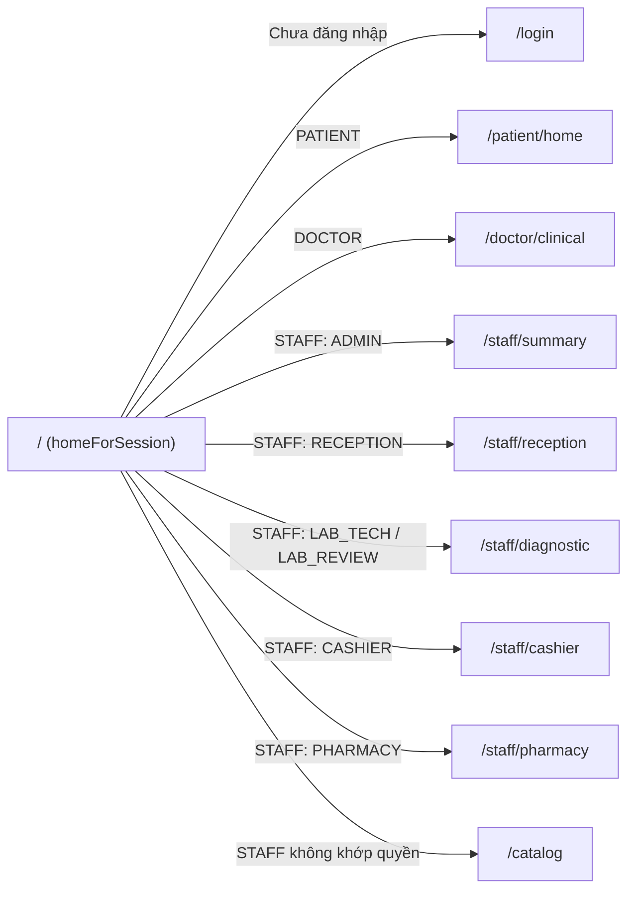

# Phân công công việc Web Frontend theo Router (HQH Care)

> **Phạm vi:** `apps/web` (React 19, TypeScript, Vite, `react-router-dom` v7)  
> **Thành viên:** **Quân**, **Huy**, **Hưng**  
> **Nguồn đối chiếu:** `apps/web/src/app/App.tsx`, `apps/web/src/app/runtime.ts`, `docs/PHAN_CONG_FRONTEND_WEB_3_THANH_VIEN.md`, Figma Web UI (`HQH_Care`).

---

## 1. Kiến trúc Router & Quy tắc làm việc chung

### Công cụ và cách tổ chức hiện tại
- **Thư viện định tuyến:** `react-router-dom` (`^7.0.0`), dùng `BrowserRouter`, `<Routes>`, `<Route>`, `<Outlet />`, `Navigate`, `NavLink`, `useParams`, `useNavigate`.
- **Nested Routes (Định tuyến lồng nhau):**
  - Nhóm **Auth công khai** (`/login`, `/register`, `/register/verify`, `/forgot-password`, `/forgot-password/reset`) nằm **ngoài** `AppLayout` (không có Sidebar/Header).
  - Nhóm **Nghiệp vụ** nằm **bên trong** `<Route element={<AppLayout session={session} />}>`, giữ nguyên Sidebar + Header và chỉ đổi phần nội dung tại `<Outlet />`.
- **Route Guards & Điều hướng mặc định (`homeForSession`):** kiểm tra `session` (`actorType` và `capabilities`) từ `src/app/runtime.ts`.

### Kiến trúc thư mục `src/app/router/` (khi tách khỏi `App.tsx`)
```text
apps/web/src/app/router/
├── job_devide.md   # File phân công này
├── paths.ts        # (Dự kiến) Hằng số URL dùng chung cho toàn app
├── guards.tsx      # (Dự kiến) RequireAuth, RequireActor, RequireCapability
└── index.tsx       # (Dự kiến) Định nghĩa & ghép toàn bộ <Routes>
```

### Quy tắc tránh merge conflict
- **Không code UI màn hình trong `src/app/router/`**. Thư mục này chỉ giữ cấu hình đường dẫn, guard phân quyền và tài liệu điều phối.
- **Vùng tự do sửa của từng người:**
  - **Quân:** `src/features/patient/`, `src/features/appointment/`, `src/features/pharmacy/` và test liên quan.
  - **Huy:** `src/features/catalog/`, `src/features/clinical/`, `src/features/diagnostic/` và test liên quan.
  - **Hưng:** `src/features/identity/`, `src/features/billing/`, `src/features/notification/` và test liên quan.
- **File dùng chung không tự ý sửa đè (cần thống nhất hoặc tạo PR nhỏ riêng):** `src/app/App.tsx`, `src/app/router/*`, `src/app/runtime.ts`, `src/app/app.css`, `src/shared/ui/*`.

---

## 2. Sơ đồ điều hướng mặc định theo Vai trò (`homeForSession`)



---

## 3. Bảng phân công Route chi tiết cho 3 thành viên

### 3.1. Quân — Shell, Bệnh nhân, Đặt lịch, Tiếp nhận, Nhà thuốc & Tổng quan
**Thư mục phụ trách:** `src/features/patient/`, `src/features/appointment/`, `src/features/pharmacy/`, shell `src/app/App.tsx`, `src/shared/ui/`.

| URL Route | Quyền / Guard | Component & Đường dẫn file | Nhóm Figma | Trạng thái hiện tại |
| --- | --- | --- | --- | --- |
| `/patient/home` | `PATIENT` (hoặc guest xem khung) | `PatientHome` (`src/features/patient/pages/PatientHome.tsx`) | Trang chủ bệnh nhân (gồm 768/360) | Đã có route & page, rà UI/responsive |
| `/patient/profiles` | `PATIENT` | `ProfileList` (`src/features/patient/pages/ProfileList.tsx`) | 02 · Hồ sơ của tôi | Đã có route & page |
| `/patient/profiles/new` | `PATIENT` | `ProfileForm` (`src/features/patient/pages/ProfileForm.tsx`) | 02 · Hồ sơ của tôi | Đã có route & page |
| `/patient/profiles/:patientId` | `PATIENT` | `ProfileDetail` (`src/features/patient/pages/ProfileDetail.tsx`) | 02 · Hồ sơ của tôi | Đã có route & page |
| `/patient/profiles/:patientId/edit` | `PATIENT` | `ProfileForm` (`src/features/patient/pages/ProfileForm.tsx`) | 02 · Hồ sơ của tôi | Đã có route & page |
| `/patient/appointments/new` | `PATIENT` | `AvailableSlots` (`src/features/appointment/pages/AvailableSlots.tsx`) | 03 · Đặt lịch khám | Đã có route & page |
| `/patient/appointments` | `PATIENT` | `MyAppointments` (`src/features/appointment/pages/MyAppointments.tsx`) | 05 · Lịch khám của tôi | Đã có route & page, cần ghép 05.01–05.08 |
| `/patient/appointments/:appointmentId` | `PATIENT` | `AppointmentDetail` (`src/features/appointment/pages/AppointmentDetail.tsx`) | 05 · Chi tiết lịch khám | Đã có route & page |
| `/patient/appointments/:appointmentId/reschedule` | `PATIENT` | `AppointmentDetail mode="reschedule"` | 05 · Đổi lịch | Đã có route & page |
| `/patient/appointments/:appointmentId/cancel` | `PATIENT` | `AppointmentDetail mode="cancel"` | 05.02 · Xác nhận hủy | Đã có route & page |
| `/patient/medications` | `PATIENT` | `PatientMedicationStatus` (`src/features/pharmacy/pages/PatientMedicationStatus.tsx`) | Đơn thuốc bệnh nhân | Đã có route & page |
| `/staff/reception` | `STAFF` + `RECEPTION` | `ReceptionQueue` (`src/features/appointment/pages/ReceptionQueue.tsx`) | 08 · Tiếp nhận bệnh nhân | Đã có route & guard |
| `/staff/schedules` | `STAFF` + `ADMIN` | `ScheduleAdmin` (`src/features/appointment/pages/ScheduleAdmin.tsx`) | Quản trị ca khám | Đã có route, cần siết guard `ADMIN` |
| `/staff/summary` | `STAFF` + `ADMIN` | `AdminSummary` (`src/features/appointment/pages/AdminSummary.tsx`) | 12 · Tổng quan bệnh viện | Đã có route, cần siết guard `ADMIN` |
| `/staff/pharmacy` | `STAFF` + `PHARMACY` | `PrescriptionQueue` (`src/features/pharmacy/pages/PrescriptionQueue.tsx`) | 11 · Cấp phát thuốc | Đã có route & guard `PharmacyAccess` |
| `/staff/pharmacy/stock` | `STAFF` + `PHARMACY` | `StockPage` (`src/features/pharmacy/pages/StockPage.tsx`) | 11 · Tồn kho dược | Đã có route & guard |
| `/staff/pharmacy/stock/adjust` | `STAFF` + `PHARMACY` | `StockPage adjust` (`src/features/pharmacy/pages/StockPage.tsx`) | 11 · Điều chỉnh tồn | Đã có route & guard |
| `/staff/pharmacy/prescriptions` | `STAFF` + `PHARMACY` | `PrescriptionQueue` (`src/features/pharmacy/pages/PrescriptionQueue.tsx`) | 11 · Hàng chờ toa | Đã có route & guard |
| `/staff/pharmacy/prescriptions/:prescriptionId` | `STAFF` + `PHARMACY` | `PrescriptionDetail` (`src/features/pharmacy/pages/PrescriptionDetail.tsx`) | 11 · Chi tiết cấp phát | **Lưu ý:** `App.tsx` đang render `PrescriptionQueue`, cần kiểm tra nối `PharmacyDetailRoute` |

---

### 3.2. Huy — Danh mục, Bác sĩ (Khám / Chỉ định / Kê đơn) & Xét nghiệm
**Thư mục phụ trách:** `src/features/catalog/`, `src/features/clinical/`, `src/features/diagnostic/`.

| URL Route | Quyền / Guard | Component & Đường dẫn file | Nhóm Figma | Trạng thái hiện tại |
| --- | --- | --- | --- | --- |
| `/catalog` | Public / đã đăng nhập (sửa giá theo quyền) | `CatalogPage` (`src/features/catalog/CatalogPage.tsx`) | Danh mục khoa/bác sĩ/dịch vụ & giá | Đã có route & page |
| `/doctor/clinical` | `DOCTOR` | `ClinicalRoute` (`src/features/clinical/ClinicalRoute.tsx`) | 06 · Bàn khám bác sĩ (06.01–06.04) | Đã có route & page, cần bổ sung guard `DOCTOR` rõ ràng |
| `/doctor/treatment` | `DOCTOR` | `ClinicalRoute view="treatment"` (`src/features/clinical/ClinicalRoute.tsx`) | 07 · Chỉ định & kê đơn thuốc (07.01–07.09) | Đã có route & page |
| `/staff/diagnostic` | `STAFF` + `LAB_TECH` / `LAB_REVIEW` | `DiagnosticFeature` (`src/features/diagnostic/DiagnosticFeature.tsx`) | 10 · Không gian xét nghiệm (10.01–10.07) | Đã có route & page, rà chặn tự duyệt |
| `/patient/lab-results` | `PATIENT` | `PatientRecordsRoute kind="results"` (`src/features/clinical/PatientRecordsRoute.tsx`) | 05.06 · Kết quả xét nghiệm đã công bố | Đã có route & guard `PATIENT` |
| `/patient/medical-records` | `PATIENT` | `PatientRecordsRoute kind="records"` (`src/features/clinical/PatientRecordsRoute.tsx`) | 05.07 · Bệnh án & toa đã ký | Đã có route & guard `PATIENT` |

---

### 3.3. Hưng — Tài khoản, Phiên đăng nhập, Xác nhận & Thanh toán, Thu ngân & Thông báo
**Thư mục phụ trách:** `src/features/identity/`, `src/features/billing/`, `src/features/notification/`, `src/app/runtime.ts`.

| URL Route | Quyền / Guard | Component & Đường dẫn file | Nhóm Figma | Trạng thái hiện tại |
| --- | --- | --- | --- | --- |
| `/login` | Public (ngoài `AppLayout`) | `LoginPage` (`src/features/identity/LoginPage.tsx`) | 01 · Đăng nhập (gồm 01.12, 01.13) | Đã có route & page |
| `/register` | Public (ngoài `AppLayout`) | `RegisterPage` (`src/features/identity/RegisterPage.tsx`) | 01.01–01.02 · Đăng ký tài khoản | Đã có route & page |
| `/register/verify` | Public (ngoài `AppLayout`) | `VerifyOtpPage` (`src/features/identity/VerifyOtpPage.tsx`) | 01.03–01.06 · Xác thực OTP | Đã có route & page |
| `/forgot-password` | Public (ngoài `AppLayout`) | `ForgotPasswordPage` (`src/features/identity/ForgotPasswordPage.tsx`) | 01.07–01.08 · Quên mật khẩu | Đã có route & page |
| `/forgot-password/reset` | Public (ngoài `AppLayout`) | `ResetPasswordPage` (`src/features/identity/ResetPasswordPage.tsx`) | 01.09–01.11 · Đặt lại mật khẩu | Đã có route & page |
| `/patient/appointments/review` | `PATIENT` | `BookingReview` (`src/features/appointment/pages/BookingReview.tsx` + `billingApi`) | 04 · Xác nhận & thanh toán (04.01–04.09) | Đã có route, đang nối `billingApi` (phối hợp với Quân) |
| `/patient/billing` *(đề xuất bổ sung)* | `PATIENT` | `PatientBillingPage` (`src/features/billing/pages/PatientBillingPage.tsx`) | Viện phí, biên nhận & hoàn tiền bệnh nhân | **Chưa có route & page** — cần bổ sung |
| `/staff/cashier` | `STAFF` + `CASHIER` | `CashierQueueRoute` → chuyển sang `src/features/billing/pages/CashierPage.tsx` | 09 · Thu ngân & viện phí (09.01–09.11) | **Đang là placeholder** trong `App.tsx`, chưa nối `billingApi` |
| `/notifications` *(đề xuất bổ sung)* | Đã đăng nhập | `NotificationPage` (`src/features/notification/pages/NotificationPage.tsx`) | Thông báo *(đang chờ thiết kế Figma)* | **Chưa có route & page** — nút chuông trên Header chưa điều hướng |

---

## 4. Các điểm nối giữa 3 thành viên (Cross-feature Contracts)

| Luồng liên thành viên | Người chủ trì | Người phối hợp | Dữ liệu / Hợp đồng cần giữ ổn định |
| --- | --- | --- | --- |
| Đặt lịch (`03`) → Xác nhận & thanh toán (`04`) | Quân (`/patient/appointments/new`) | Hưng (`/patient/appointments/review`), Huy (Catalog) | `patientId`, `doctorId`, `serviceId`, `holdId`, `holdExpiresAt`, giá snapshot, trạng thái `PENDING`/`CONFIRMED` |
| Hủy lịch (`05`) ↔ Hoàn tiền (`09`) | Quân (`AppointmentDetail`) | Hưng (`Billing`) | Lý do hủy, `cancellationId`, `refundStatus` (`REQUESTED`, `COMPLETED`, `FAILED`) và thao tác thử lại |
| Tiếp nhận (`08`) → Bàn khám (`06`) | Quân (`ReceptionQueue`) | Huy (`ClinicalRoute`) | `ticketId`, version, `visitType` (`FIRST`/`RETURN`), mở lại đúng lượt khám cũ |
| Chỉ định (`07`) → Thu phí (`09`) → Xét nghiệm (`10`) | Huy (`Clinical`, `Diagnostic`) | Hưng (`Billing`) | `orderId`, `chargeId`, điều kiện đã thu tiền trước khi lấy mẫu |
| Toa đã ký (`07`) → Nhà thuốc (`11`) | Huy (`TreatmentPanel`) | Quân (`Pharmacy`), Hưng (`Billing`) | Toa `FINAL`, giữ đủ toa 15 phút, bằng chứng đã thu tiền để cấp phát 1 lần |
| Nội dung bệnh nhân (`05.06–05.07`) | Quân (`MyAppointments`) | Huy (`PatientRecordsRoute`, `PublishedLabResults`) | Component hiển thị kết quả LAB đã công bố và toa đã ký theo đúng `patientId` |
| Shell, Sidebar & Phiên đăng nhập | Quân (`App.tsx`) | Hưng (`runtime.ts`), Huy (tích hợp feature) | `WebSession` (`userId`, `actorType`, `capabilities`, `lease`), xử lý 401/403, reset state khi đổi tài khoản |

---

## 5. Thứ tự triển khai đề xuất (4 đợt)

1. **Đợt 1 — Chốt nền tảng:**
   - **Quân:** Chốt shell, sidebar, router và shared UI.
   - **Huy:** Chốt đầu vào props cho `Clinical`, `Diagnostic` và dữ liệu `Catalog`.
   - **Hưng:** Chốt `runtime.ts` (session, Bearer, refresh, lease) và hoàn thiện nhóm `01` Auth.
2. **Đợt 2 — Luồng khám đầu vào:**
   - **Quân:** Trang chủ bệnh nhân, `02`, `03`, `05`, `08`.
   - **Huy:** `06`, `07` và dữ liệu kết quả/toa cho bệnh nhân.
   - **Hưng:** `04` (Xác nhận & thanh toán) và thu phí khám trong `09`.
3. **Đợt 3 — Luồng cận lâm sàng, dược & hoàn tiền:**
   - **Quân:** `11` (Cấp phát thuốc), ghép `05.06–05.07` và `12` (Tổng quan).
   - **Huy:** `10` (Xét nghiệm), điều kiện ký/duyệt và chặn tự duyệt.
   - **Hưng:** Hoàn thiện `09` (biên nhận, hoàn tiền, trạng thái bất đồng bộ `202`/`IN_DOUBT`), `/patient/billing` và `/notifications`.
4. **Đợt 4 — Rà lỗi & nghiệm thu:**
   - Kiểm tra responsive (360/768), quyền truy cập 401/403, hết phiên, retry/idempotency và đối chiếu đủ 12 nhóm frame Figma.

---

## 6. Hướng dẫn chạy & Checklist trước khi tạo PR

### Chạy local & kiểm tra (từ thư mục `apps/web`)
```powershell
cd .\apps\web
npm run dev         # Chạy dev server (proxy mặc định cổng 8080; đổi sang 18080 nếu dùng stack test)
npm run typecheck   # Kiểm tra TypeScript (bắt buộc 0 lỗi)
npm test            # Chạy Vitest unit/component tests
npm run build       # Kiểm tra production build
```

> Nếu cần dựng stack backend test riêng: chạy `python tools/be/start_test_stack.py` từ thư mục gốc repo (Gateway ở cổng `18080`, email giả lập).

### Checklist trước khi mở PR
- [ ] Chỉ sửa trong thư mục `src/features/<của-mình>/` và test tương ứng (không sửa đè file dùng chung ngoài phạm vi).
- [ ] Màn hình có đủ trạng thái: đang tải (`loading`), rỗng (`empty`), lỗi (`error`), không đủ quyền (`403`) và thao tác thử lại.
- [ ] Không hardcode token, mật khẩu, OTP hoặc giả lập `authorizationLease`.
- [ ] Đã chạy xanh `npm run typecheck`, `npm test`, `npm run build` và ghi rõ kết quả trong mô tả PR.
