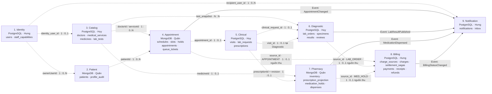

THIẾT KẾ CƠ SỞ DỮ LIỆU & SƠ ĐỒ ERD CHI TIẾT — HỆ THỐNG HQH Care (v5.0)

**Phiên bản:** 5.0 (Đồng bộ BRD, SRS, UC, OpenAPI 86 & AsyncAPI 18 Events / 5 Commands ngày 17/10/2026. Bản tích hợp bổ sung QueueTicketChanged và VisitDoctorGrantChanged)

**Mô hình phân công (3–3–3):**

**Hưng (Django · PostgreSQL):** Identity (identity\_db), Billing (billing\_db), Notification (notification\_db)

**Quân (Node.js/TS · MongoDB):** Patient (patient\_db), Appointment (appointment\_db), Pharmacy (pharmacy\_db)

**Huy (Go · PostgreSQL):** Catalog (catalog\_db), Clinical (clinical\_db), Diagnostic (diagnostic\_db)

# PHẦN 0: TỔNG QUAN KIẾN TRÚC DỮ LIỆU & LIÊN KẾT LOGIC XUYÊN SERVICE (LREF)

## 0.1. Nguyên tắc thiết kế cốt lõi

**Database-per-Service:** 6 database logic PostgreSQL và 3 database logic MongoDB (trên 1 Mongo Replica Set và 1 PostgreSQL instance phục vụ demo). Mỗi service dùng credential riêng và **chỉ có quyền ghi vào DB của mình**.

**Không FK / Không JOIN xuyên Service:** Mọi tham chiếu sang thực thể của service khác đều là **LREF (Logical Reference)** lưu dưới dạng UUID opaque. Việc kiểm tra quyền hoặc đồng bộ dữ liệu đọc được thực hiện qua **Local Projections** cập nhật từ 20 Integration Events và 5 Commands trên RabbitMQ.

**Quy ước sơ đồ:** Mỗi sơ đồ ở Phần 1 mô tả dữ liệu của một service. Sơ đồ PostgreSQL thể hiện khóa ngoại nội bộ. Sơ đồ MongoDB thể hiện các collection, khóa và tham chiếu logic. Mục 0.3 mô tả các tham chiếu logic xuyên service (LREF). Từ điển dữ liệu ghi các bảng kỹ thuật và ràng buộc có điều kiện.

**Phạm vi thiết kế:** Sơ đồ ERD và từ điển dữ liệu mô tả thiết kế đích. Trong từ điển PostgreSQL, dấu `?` chỉ cột nullable. Danh sách giá trị trong ngoặc mô tả miền nghiệp vụ của cột, ví dụ `text (enum)` là cột `text` có tập giá trị nghiệp vụ. Phần 3 tập hợp các khóa ứng viên và phụ thuộc hàm để chuẩn bị đánh giá 3NF.

**Định dạng chuẩn:** Khóa chính id kiểu uuid; thời gian lưu theo UTC (ngày nghiệp vụ tính theo Asia/Ho\_Chi\_Minh); tiền tệ kiểu số nguyên bigint / int64 (VND); kiểm soát đồng thời bằng version (Optimistic Concurrency) và SELECT FOR UPDATE / Mongo Transaction cho các thao tác giữ chỗ, trừ tồn, thu/hoàn tiền.

## 0.2. Sơ đồ Liên kết Logic xuyên Service (Cross-Service LREF & Event/Command Topology)


Hình trên là bản tổng quan để chèn vào báo cáo. Mã Mermaid bên dưới thể hiện các LREF trong bảng 0.3 và một số luồng thông báo tiêu biểu. Copy nội dung trong khối vào **draw.io → Arrange → Insert → Mermaid**. Mũi tên nét đứt đi từ service sở hữu dữ liệu đến service lưu tham chiếu; mũi tên liền chỉ chiều event qua RabbitMQ. Các đường Billing gắn `source_type` là LREF, không phải event.

Sơ đồ event chỉ minh họa các event đến Notification, không phải toàn bộ topology. Danh sách đầy đủ producer, consumer và command nằm trong [hợp đồng messages](../contracts/be-baseline-manifest.json). Các bội số bên dưới được giữ theo bảng 0.3; khóa duy nhất của Billing còn bao gồm `source_revision`.



## 0.3. Bảng tổng hợp Liên kết Logic xuyên Service (Cross-Service LREF)

| **Liên kết logic (Nguồn → Đích)** | **Bội số** | **Khóa tham chiếu & Ràng buộc đồng bộ** |
| --- | --- | --- |
| Identity.users → Patient.patients | 1 : 0..N | ownerUserId (LREF); Patient phát PatientAccessChanged, các consumer giữ patient\_access\_projection. |
| Identity.users → Catalog.doctors | 1 : 0..1 | identity\_user\_id (UQ LREF); quyền/scope vẫn thuộc Identity. |
| Catalog.doctors / medical\_services → Appointment.schedules | 1 : 0..N | doctorId / serviceId (LREF); giữ snapshot trường cần hiển thị. |
| Catalog.medicines → Pharmacy.inventory | 1 : 0..1 | medicineId (UQ LREF); tồn kho thực tế chỉ lưu ở Pharmacy. |
| Catalog.lab\_tests → Diagnostic.lab\_orders | N : N | Qua test\_snapshot giữ mã, đơn vị và khoảng tham chiếu tại thời điểm chỉ định. Giá được ghi trong price\_snapshot. |
| Patient.patients → Appointment.appointments | 1 : 0..N | patientId (LREF). |
| Appointment.appointments → Clinical.visits | 1 : 0..1 | appointment\_id (UQ LREF); lượt khám RETURN tiếp tục dùng cùng visitId. |
| Clinical.lab\_requests → Diagnostic.lab\_orders | 1 : 0..1 | clinical\_request\_id (UQ LREF); khi đang PENDING sẽ chặn ký kết luận Visit. |
| Clinical.visits → Diagnostic.diagnostic\_visit\_subjects | 1 : 0..1 | visit\_id (LREF). Một lượt khám ánh xạ đến một bệnh nhân. Nhiều order có thể tham chiếu cùng ánh xạ. |
| Clinical.prescriptions → Pharmacy.prescription\_projection | 1 : 0..1 | UQ(prescriptionId, revision) cho mỗi bản FINAL. |
| Appointment / Diagnostic / Pharmacy → Billing.charge\_sources | 1 : 0..1 | Bộ (source\_type, source\_id) định danh nguồn. Nguồn có thể có nhiều charge, tối đa một charge cho mỗi source\_revision. |
| Identity.users → Notification.notifications | 1 : 0..N | recipient\_user\_id (LREF); tuyệt đối không dùng patientId làm userId. |

# PHẦN 1: CHI TIẾT ERD & TỪ ĐIỂN DỮ LIỆU CỦA 9 MICROSERVICES

## 1. Identity Service (identity\_db — PostgreSQL · Owner: Hưng · Django)

**Trách nhiệm:** Quản lý tài khoản (PATIENT, DOCTOR, STAFF), xác minh tài khoản và đặt lại mật khẩu bằng OTP 6 số gửi qua email, quản lý phiên đăng nhập (sessions), phân quyền nhân viên theo capability/scope (staff\_capabilities), cấp authorization lease ngắn hạn (tối đa 30s) và ghi nhật ký bảo mật (audit\_events).

### Sơ đồ ERD — Identity Service

```dbml
Project identity_db {
  database_type: 'PostgreSQL'
}

Table users {
  id uuid [pk]
  phone text [not null, unique]
  email varchar(255) [null]
  password_hash text [not null]
  actor_type text [not null]
  status text [not null]
  phone_verified_at timestamptz [null]
  version int [not null]
  token_version int [not null]
  access_version int [not null]

  checks {
    `actor_type IN ('PATIENT', 'DOCTOR', 'STAFF')`
  }
}

Table otp_requests {
  id uuid [pk]
  user_id uuid [null, ref: > users.id]
  phone text [not null]
  email varchar(255) [null]
  purpose text [not null]
  code_hash text [not null]
  expires_at timestamptz [not null]
  used_at timestamptz [null]
  attempts int [not null]

  indexes {
    (phone, purpose, expires_at)
  }
}

Table sessions {
  id uuid [pk]
  user_id uuid [not null, ref: > users.id]
  refresh_hash text [not null, unique]
  expires_at timestamptz [not null]
  revoked_at timestamptz [null]
  device_id text [null]

  indexes {
    (user_id, expires_at)
  }
}

Table staff_capabilities {
  id uuid [pk]
  user_id uuid [not null, ref: > users.id]
  capability text [not null]
  scope_key text [not null]
  enabled boolean [not null]
  assigned_by uuid [null, ref: > users.id]
  assigned_at timestamptz [not null]

  indexes {
    (user_id, capability, scope_key) [unique]
  }
}

Table audit_events {
  id uuid [pk]
  actor_user_id uuid [null]
  action text [not null]
  target_id uuid [null]
  before_after jsonb [null]
  correlation_id uuid [not null]
  at timestamptz [not null]

  indexes {
    (actor_user_id, at)
  }
}
```

### Từ điển dữ liệu — Identity Service

| **Bảng (Table)** | **Thuộc tính & Kiểu dữ liệu** | **Khóa, Chỉ mục & Quy tắc bất biến (Invariants)** |
| --- | --- | --- |
| users | id: uuid PK; phone: text UQ; email: varchar(255)?; password\_hash: text; actor\_type: text; status: text; phone\_verified\_at: timestamptz?; version: int; token\_version: int; access\_version: int | UQ(phone); CHECK actor\_type IN ('PATIENT','DOCTOR','STAFF'); chỉ tài khoản ACTIVE mới được tạo phiên. API đăng ký yêu cầu email hợp lệ để nhận OTP. DB cho phép email NULL và không đặt UNIQUE cho email. Identity ghi phone\_verified\_at khi xác minh OTP đăng ký qua email. |
| otp\_requests | id: uuid PK; user\_id: uuid FK?; phone: text; email: varchar(255)?; purpose: text; code\_hash: text; expires\_at: timestamptz; used\_at: timestamptz?; attempts: int; created\_at: timestamptz; is\_resend: boolean | FK user\_id -> users.id (khi có); INDEX(phone, purpose, expires\_at); INDEX(phone, purpose, created\_at). Giới hạn thử ≤ 5 lần trong transaction, cooldown gửi 60 giây và tối đa 3 lần gửi lại trong cửa sổ 1 giờ theo phone/purpose. Lần gửi đầu của REGISTER/RESET đặt is_resend=false; đường resend và gửi lại qua đăng ký/quên mật khẩu đặt true. Migration 0009 tính bảo thủ các dòng lịch sử là resend để không bỏ qua hạn mức ngay khi nâng cấp; đây là metadata kiểm soát quota, không bổ sung lịch sử gửi email đã xác minh. Dọn dữ liệu không được xóa bản ghi cần tính quota trong giờ gần nhất. Email là địa chỉ đích; mã tra theo phone/purpose. |
| sessions | id: uuid PK; user\_id: uuid FK; refresh\_hash: text UQ; expires\_at: timestamptz; revoked\_at: timestamptz?; device\_id: text? | FK user\_id -> users.id; UQ(refresh\_hash); INDEX(user\_id, expires\_at). Đổi/reset mật khẩu thu hồi toàn bộ phiên cũ. |
| staff\_capabilities | id: uuid PK; user\_id: uuid FK; capability: text; scope\_key: text; enabled: boolean; assigned\_by: uuid FK?; assigned\_at: timestamptz | FK user\_id, assigned\_by -> users.id; UQ(user\_id, capability, scope\_key); quyền ADMIN chỉ cấp cho tài khoản quản trị chỉ định. |
| audit\_events | id: uuid PK; actor\_user\_id: uuid?; action: text; target\_id: uuid? LREF; before\_after: jsonb?; correlation\_id: uuid; at: timestamptz | INDEX(actor\_user\_id, at); bảng bất biến (append-only), tuyệt đối không ghi mã OTP hoặc password hash vào log/audit. |
| **Bảng kỹ thuật** | outbox, inbox, idempotency\_records, retry\_jobs, dead\_letters | Phát sự kiện IdentityAccessChanged qua outbox trong cùng SQL transaction khi thay đổi quyền/trạng thái. |

## 2. Patient Service (patient\_db — MongoDB · Owner: Quân · Node.js/TS)

**Trách nhiệm:** Quản lý hồ sơ hành chính của bệnh nhân (bản thân SELF hoặc người thân OTHER), kiểm soát quyền sở hữu hồ sơ (ownerUserId) và lưu vết chỉnh sửa (profile\_audit).

### Sơ đồ ERD — Patient Service

```dbml
Project patient_db {
}

Table patients {
  id uuid [pk]
  ownerUserId uuid [not null]
  relation string [not null]
  fullName string [not null]
  birthDate date [not null]
  sex string [null]
  bhytSelfDeclared string [null]
  version int [not null]
  contactPhone string [null]
  address string [null]
  createdAt date [not null]
  updatedAt date [not null]
  active bool [not null]
  policyVersion int [not null]

  indexes {
    ownerUserId
  }
}

Table profile_audit {
  id uuid [pk]
  patientId uuid [not null, ref: > patients.id]
  actorUserId uuid [not null]
  action string [not null]
  changedFields string[] [not null]
  at date [not null]

  indexes {
    (patientId, at)
  }
}
```

### Từ điển dữ liệu — Patient Service

| **Collection** | **Thuộc tính & Kiểu dữ liệu** | **Khóa, Chỉ mục & Quy tắc bất biến (Invariants)** |
| --- | --- | --- |
| patients | id: uuid PK; ownerUserId: uuid LREF; relation: enum (SELF|OTHER); fullName: string; birthDate: date; sex: enum?; bhytSelfDeclared: string?; version: int; contactPhone: string?; address: string?; createdAt: UTC; updatedAt: UTC; active: bool; policyVersion: int | INDEX(ownerUserId); cấm tạo hồ sơ vô chủ. Tại quầy lễ tân đối chiếu user\_access\_projection hoặc account proof ký từ Identity (không gọi chuỗi HTTP Patient -> Identity). |
| profile\_audit | id: uuid PK; patientId: uuid ref; actorUserId: uuid LREF; action: string; changedFields: string[]; at: UTC | INDEX(patientId, at); chỉ ghi tên trường thay đổi, không lưu dữ liệu nhạy cảm nguyên bản. |
| **Collection kỹ thuật** | user\_access\_projection, outbox, inbox, idempotency\_records, retry\_jobs, dead\_letters | Phát PatientAccessChanged(patientId, ownerUserId, active, policyVersion) qua outbox để 5 services nghiệp vụ cập nhật projection quyền. |

## 3. Catalog Service (catalog\_db — PostgreSQL · Owner: Huy · Go)

**Trách nhiệm:** Quản lý danh mục dùng chung (khoa, hồ sơ nghề nghiệp bác sĩ, dịch vụ khám, thuốc, xét nghiệm) và bảng giá có hiệu lực theo thời gian (price\_versions).

### Sơ đồ ERD — Catalog Service

```dbml
Project catalog_db {
  database_type: 'PostgreSQL'
}

Table departments {
  id uuid [pk]
  code text [not null, unique]
  name text [not null]
  status text [not null]
}

Table doctors {
  id uuid [pk]
  identity_user_id uuid [not null, unique]
  department_id uuid [not null, ref: > departments.id]
  display_name text [not null]
  status text [not null]
}

Table medical_services {
  id uuid [pk]
  department_id uuid [not null, ref: > departments.id]
  code text [not null, unique]
  name text [not null]
  status text [not null]
}

Table medicines {
  id uuid [pk]
  code text [not null, unique]
  name text [not null]
  unit text [not null]
  strength text [null]
  form text [null]
  status text [not null]
}

Table lab_tests {
  id uuid [pk]
  code text [not null, unique]
  name text [not null]
  specimen_type text [not null]
  unit text [null]
  reference_range text [null]
  revision int [not null]
  status text [not null]
}

Table price_versions {
  id uuid [pk]
  item_type text [not null]
  item_id uuid [not null]
  revision int [not null]
  amount_vnd bigint [not null]
  effective_from timestamptz [not null]
  effective_to timestamptz [null]
  created_by uuid [not null]

  indexes {
    (item_type, item_id, revision) [unique]
    (item_type, item_id, effective_from) [unique]
  }

  checks {
    `amount_vnd >= 0`
    `effective_to IS NULL OR effective_to > effective_from`
  }
}
```

### Từ điển dữ liệu — Catalog Service

| **Bảng (Table)** | **Thuộc tính & Kiểu dữ liệu** | **Khóa, Chỉ mục & Quy tắc bất biến (Invariants)** |
| --- | --- | --- |
| departments | id: uuid PK; code: text UQ; name: text; status: text | UQ(code). |
| doctors | id: uuid PK; identity\_user\_id: uuid LREF UQ; department\_id: uuid FK; display\_name: text; status: text | FK department\_id -> departments.id; UQ(identity\_user\_id). Quyền đăng nhập/scope thuộc Identity. |
| medical\_services | id: uuid PK; department\_id: uuid FK; code: text UQ; name: text; status: text | FK department\_id -> departments.id; UQ(code). Giá lưu tại price\_versions. |
| medicines | id: uuid PK; code: text UQ; name: text; unit: text; strength: text?; form: text?; status: text | UQ(code). Chỉ chứa định nghĩa danh mục; tồn kho thực tế thuộc Pharmacy. |
| lab\_tests | id: uuid PK; code: text UQ; name: text; specimen\_type: text; unit: text?; reference\_range: text?; revision: int; status: text | UQ(code). Khi chỉ định LAB, snapshot mã, đơn vị và khoảng tham chiếu vào order. |
| price\_versions | id: uuid PK; item\_type: text (EXAM\|LAB\|MEDICINE); item\_id: uuid; revision: int; amount\_vnd: bigint; effective\_from: timestamptz; effective\_to: timestamptz?; created\_by: uuid LREF | UQ(item\_type, item\_id, revision); UQ(item\_type, item\_id, effective\_from); CHECK amount\_vnd >= 0. Khoảng hiệu lực dùng [effective\_from, effective\_to), ngày kết thúc phải lớn hơn ngày bắt đầu khi có giá trị. Ràng buộc loại trừ chặn hai khoảng giá chồng nhau cho cùng mặt hàng. |
| **Bảng kỹ thuật** | outbox, inbox, user_access_projection, idempotency_records, catalog_stream, doctor_mapping_audit, schema_migrations | CatalogChanged giữ UPSERT/TOMBSTONE/CHECKPOINT và streamSequence. Lỗi được handoff qua outbox tới RabbitMQ DLQ; không còn catalog_quarantine sau migration 000005. Redis TTL khoảng 60s ±10%, cắt trước mốc giá đổi. |

## 4. Appointment Service (appointment\_db — MongoDB · Owner: Quân · Node.js/TS)

**Trách nhiệm:** Quản lý lịch làm việc (schedules), chia khung giờ (slots), giữ chỗ nguyên tử 10 phút (holds), chống trùng giờ cùng hồ sơ (patient\_time\_locks), lịch hẹn (appointments) và hàng chờ vé khám (queue\_tickets).

### Sơ đồ ERD — Appointment Service

```dbml
Project appointment_db {
}

Table schedules {
  id uuid [pk]
  doctorId uuid [not null]
  serviceId uuid [not null]
  room string [not null]
  startAt date [not null]
  endAt date [not null]
  capacityPerSlot int [not null]
  status string [not null]
  version int [not null]
  slotMinutes int [not null]

  indexes {
    (doctorId, startAt)
  }
}

Table slots {
  id uuid [pk]
  scheduleId uuid [not null, ref: > schedules.id]
  startAt date [not null]
  endAt date [not null]
  capacity int [not null]
  heldCount int [not null]
  confirmedCount int [not null]
  version int [not null]

  indexes {
    (scheduleId, startAt) [unique]
  }
}

Table holds {
  id uuid [pk]
  slotId uuid [not null, ref: > slots.id]
  patientId uuid [not null]
  status string [not null]
  expiresAt date [not null]
  principalId string [not null]
  idempotencyKey string [not null]
  createdAt date [not null]
  priceSnapshot object [not null]
  consumedAt date [null]

  indexes {
    (principalId, idempotencyKey) [unique]
  }
}

Table appointments {
  id uuid [pk]
  holdId uuid [not null, unique, ref: - holds.id]
  patientId uuid [not null]
  slotId uuid [not null, ref: > slots.id]
  serviceId uuid [not null]
  doctorId uuid [not null]
  priceSnapshotVnd int64 [not null]
  state string [not null]
  version int [not null]
  slotHistory object[] [not null]
  chargeId uuid [null]
  expiresAt date [not null]
  priceVersion uuid [not null]
  settlementId uuid [null]
  settlementState string [not null]
  settlementVersion int [not null]
}

Table queue_tickets {
  id uuid [pk]
  appointmentId uuid [not null, ref: > appointments.id]
  ticketType string [not null]
  visitId uuid [null]
  returnRound int [not null]
  state string [not null]
  calledAt date [null]
  claimId uuid [null]
  claimedBy uuid [null]
  noShowReason string [null]
  version int [not null]

  indexes {
    (appointmentId, ticketType, returnRound) [unique]
  }
}

Table patient_time_locks {
  patientId uuid [pk]
  intervals object[] [not null]
  version int [not null]
}
```

### Từ điển dữ liệu — Appointment Service

| **Collection** | **Thuộc tính & Kiểu dữ liệu** | **Khóa, Chỉ mục & Quy tắc bất biến (Invariants)** |
| --- | --- | --- |
| schedules | id: uuid PK; doctorId: uuid LREF; serviceId: uuid LREF; room: string; startAt: UTC; endAt: UTC; capacityPerSlot: int; status: enum; version: int; slotMinutes: int | INDEX(doctorId, startAt) chặn trùng ca bác sĩ; kiểm tra overlap (room, startAt); cấm giảm capacityPerSlot xuống dưới held + confirmed. slotMinutes được lưu từ AP-005/AP-006 để tái tạo slots nhất quán. |
| slots | id: uuid PK; scheduleId: uuid ref; startAt: UTC; endAt: UTC; capacity: int; heldCount: int; confirmedCount: int; version: int | UQ(scheduleId, startAt); bất biến heldCount + confirmedCount <= capacity. |
| holds | id: uuid PK; slotId: uuid ref; patientId: uuid LREF; status: enum (HELD|CONSUMED|RELEASED|EXPIRED); expiresAt: UTC; principalId: string; idempotencyKey: string; createdAt: UTC; priceSnapshot: object; consumedAt: UTC? | UQ(principalId, idempotencyKey); giữ chỗ 10 phút trong Mongo transaction; job trả chỗ khi hết hạn (Redis không phải nguồn giữ chỗ). |
| appointments | id: uuid PK; holdId: uuid ref UQ; patientId: uuid LREF; slotId: uuid ref; serviceId: uuid LREF; doctorId: uuid LREF; priceSnapshotVnd: int64; state: enum; version: int; slotHistory: object[]; chargeId: uuid LREF?; expiresAt: UTC; priceVersion: uuid LREF; settlementId: uuid?; settlementState: enum; settlementVersion: int | UQ(holdId). Đổi lịch giữ slot mới trước rồi mới nhả slot cũ trong cùng transaction. Chỉ chuyển CONFIRMED khi nhận ChargePaid/SettlementDecision đúng fence. |
| queue\_tickets | id: uuid PK; appointmentId: uuid ref; ticketType: FIRST|RETURN; visitId: uuid LREF?; returnRound: int; state: WAITING|CALLED|CLAIMED|NO\_SHOW|DONE; calledAt: UTC?; claimId: uuid?; claimedBy: uuid LREF?; noShowReason: string?; version: int | UQ(appointmentId, ticketType, returnRound); sparse UQ(claimId). FIRST có returnRound=0, RETURN có returnRound=1. Vắng mặt RETURN không đổi appointment thành NO\_SHOW. |
| patient\_time\_locks | patientId: uuid PK LREF; intervals: [{holdId, appointmentId?, startAt, endAt, state}]; version: int | 1 document / patient; cập nhật trong cùng Mongo transaction với slots khi giữ/đổi/nhả để chặn 1 hồ sơ đặt 2 lịch trùng khoảng [startAt, endAt). |
| **Collection kỹ thuật** | settlement\_decisions, command\_results, catalog\_projection, patient\_access\_projection, user\_access\_projection, projection\_checkpoints, outbox, inbox, idempotency\_records, retry\_jobs, dead\_letters | Nhận command ClaimQueueTicket (trả QueueTicketClaimed) và ReserveSettlement (khóa lịch SETTLEMENT\_LOCKED, tăng fence, trả SettlementReserved). |

## 5. Clinical Service (clinical\_db — PostgreSQL · Owner: Huy · Go)

**Trách nhiệm:** Quản lý lượt khám (visits), ghi chú khám bệnh nháp/ký cuối (visit\_notes), danh sách yêu cầu chỉ định xét nghiệm (lab\_requests) và kê toa thuốc (prescriptions, prescription\_items).

### Sơ đồ ERD — Clinical Service

```dbml
Project clinical_db {
  database_type: 'PostgreSQL'
}

Table visits {
  id uuid [pk]
  appointment_id uuid [not null, unique]
  doctor_user_id uuid [not null]
  state text [not null]
  version int [not null]
  started_at timestamptz [not null]
  signed_at timestamptz [null]
  patient_id uuid [not null]
  department_id uuid [not null]
  return_round int [not null]
  claim_id uuid [not null, unique]
}

Table visit_notes {
  id uuid [pk]
  visit_id uuid [not null, ref: > visits.id]
  revision int [not null]
  symptoms text [not null]
  findings text [not null]
  assessment text [not null]
  diagnosis text [not null]
  author_user_id uuid [not null]
  saved_at timestamptz [not null]

  indexes {
    (visit_id, revision) [unique]
  }
}

Table prescriptions {
  id uuid [pk]
  visit_id uuid [not null, ref: > visits.id]
  revision int [not null]
  state text [not null]
  version int [not null]
  finalized_at timestamptz [null]
  finalized_by uuid [null]

  indexes {
    (visit_id, revision) [unique]
  }
}

Table prescription_items {
  id uuid [pk]
  prescription_id uuid [not null, ref: > prescriptions.id]
  medicine_id uuid [not null]
  medicine_code_snapshot text [not null]
  name_snapshot text [not null]
  dose_text text [not null]
  quantity int [not null]
  instruction text [not null]

  indexes {
    (prescription_id, medicine_code_snapshot) [unique]
  }

  checks {
    `quantity > 0`
  }
}

Table lab_requests {
  id uuid [pk]
  visit_id uuid [not null, ref: > visits.id]
  request_hash text [not null]
  state text [not null]
  order_id uuid [null]
  test_snapshot jsonb [not null]
  version int [not null]
  created_at timestamptz [not null]

  indexes {
    (visit_id, request_hash) [unique]
  }
}
```

### Từ điển dữ liệu — Clinical Service

**Quy tắc dòng thuốc:** Bộ kiểm tra của Clinical từ chối `MedicineCode` trùng trong một toa. Thiết kế đích áp dụng quy tắc theo mã đã chụp trên dòng thuốc. Tên thuốc được lưu cùng nội dung tại thời điểm lập toa. [Bộ kiểm tra toa](../services/clinical/internal/domain/treatment.go)

| **Bảng (Table)** | **Thuộc tính & Kiểu dữ liệu** | **Khóa, Chỉ mục & Quy tắc bất biến (Invariants)** |
| --- | --- | --- |
| visits | id: uuid PK; appointment\_id: uuid LREF UQ; doctor\_user\_id: uuid LREF; state: text (enum); version: int; started\_at: timestamptz; signed\_at: timestamptz?; patient\_id: uuid LREF; department\_id: uuid LREF; return\_round: int; claim\_id: uuid LREF UQ | UQ(claim\_id); UQ(appointment\_id) — mỗi lịch hẹn có tối đa 1 visit duy nhất; lượt quay lại RETURN sau xét nghiệm tiếp tục dùng cùng visit.id và không thu phí khám mới. |
| visit\_notes | id: uuid PK; visit\_id: uuid FK; revision: int; symptoms: text; findings: text; assessment: text; diagnosis: text; author\_user\_id: uuid LREF; saved\_at: timestamptz | FK visit\_id -> visits.id; UQ(visit\_id, revision). Bản nháp không hiển thị cho bệnh nhân. |
| prescriptions | id: uuid PK; visit\_id: uuid FK; revision: int; state: text (DRAFT\|FINAL\|DELETED); version: int; finalized\_at: timestamptz?; finalized\_by: uuid LREF? | FK visit\_id -> visits.id; UQ(visit\_id, revision). Chỉ được ký FINAL sau khi visit đã SIGNED; tối đa 1 bản FINAL hiệu lực và bất biến sau khi ký. |
| prescription\_items | id: uuid PK; prescription\_id: uuid FK; medicine\_id: uuid LREF; medicine\_code\_snapshot: text; name\_snapshot: text; dose\_text: text; quantity: int; instruction: text | FK prescription\_id -> prescriptions.id; UQ(prescription\_id, medicine\_code\_snapshot); CHECK quantity > 0. Toa FINAL bắt buộc có ít nhất 1 dòng thuốc. |
| lab\_requests | id: uuid PK; visit\_id: uuid FK; request\_hash: text; state: text (PENDING\|CREATED\|FAILED); order\_id: uuid LREF?; test\_snapshot: jsonb; version: int; created\_at: timestamptz | FK visit\_id -> visits.id; UQ(visit\_id, request\_hash). Ghi PENDING + outbox CreateLabOrder trong cùng transaction khóa visit. Còn PENDING hoặc order chưa PUBLISHED/CANCELLED thì **cấm ký Visit**. Trạng thái FAILED trong DB ánh xạ thành REJECTED trên LabOrderResolved và CL-003; timeout vẫn PENDING, không coi là FAILED. |
| **Bảng kỹ thuật** | start_requests, ticket_projection, lab_terminal_projection, catalog_entity_projection, catalog_stream_state, visit_doctor_grants, visit_grant_stream, patient_access_projection, user_access_projection, outbox, inbox, idempotency_records, schema_migrations | Tên vật lý của LAB status và Catalog projection lần lượt là lab_terminal_projection và catalog_entity_projection. Quyền lượt khám và checkpoint có nguồn riêng. Retry/DLQ được handoff qua outbox tới RabbitMQ; inbox giữ retry_token và delivery_attempt, không còn retry_jobs/dead_letters sau migration 000008. |

## 6. Diagnostic Service (diagnostic\_db — PostgreSQL · Owner: Huy · Go)

**Trách nhiệm:** Quản lý vòng đời xét nghiệm (LAB) từ lúc nhận command tạo order (lab\_orders), lấy mẫu/từ chối/lấy lại mẫu (specimens), nhập kết quả nháp (results, result\_items) đến bước duyệt công bố bởi người thứ hai (reviews).

### Sơ đồ ERD — Diagnostic Service

```dbml
Project diagnostic_db {
  database_type: 'PostgreSQL'
}

Table diagnostic_visit_subjects {
  visit_id uuid [pk]
  patient_id uuid [not null]
}

Table lab_orders {
  id uuid [pk]
  visit_id uuid [not null, ref: > diagnostic_visit_subjects.visit_id]
  state text [not null]
  charge_id uuid [null]
  created_at timestamptz [not null]
  version int [not null]
  clinical_request_id uuid [not null, unique]
  test_snapshot jsonb [not null]
  price_snapshot jsonb [not null]
  settlement_id uuid [null]
  settlement_state text [not null]
  settlement_version int [not null]
}

Table specimens {
  id uuid [pk]
  order_id uuid [not null, ref: > lab_orders.id]
  sequence int [not null]
  state text [not null]
  barcode text [not null, unique]
  collected_at timestamptz [not null]
  collected_by uuid [not null]
  reject_reason text [null]
  version int [not null]

  indexes {
    (order_id, sequence) [unique]
  }
}

Table results {
  id uuid [pk]
  order_id uuid [not null, ref: > lab_orders.id]
  specimen_id uuid [not null, ref: > specimens.id]
  revision int [not null]
  state text [not null]
  entered_by uuid [not null]
  submitted_at timestamptz [null]
  published_at timestamptz [null]
  version int [not null]

  indexes {
    (order_id, revision) [unique]
  }
}

Table result_contributors {
  result_id uuid [not null, ref: > results.id]
  contributor_user_id uuid [not null]

  indexes {
    (result_id, contributor_user_id) [pk]
  }
}

Table result_items {
  id uuid [pk]
  result_id uuid [not null, ref: > results.id]
  test_code text [not null]
  value_text text [not null]
  flag text [null]

  indexes {
    (result_id, test_code) [unique]
  }
}

Table reviews {
  id uuid [pk]
  result_id uuid [not null, ref: > results.id]
  reviewer_user_id uuid [not null]
  decision text [not null]
  reason text [null]
  reviewed_at timestamptz [not null]
}
```

### Từ điển dữ liệu — Diagnostic Service

**Dữ liệu chụp:** Mã, tên, đơn vị và khoảng tham chiếu của xét nghiệm được giữ trong `test_snapshot`. Danh sách mã và thông tin diễn giải cho dòng kết quả được đọc từ snapshot. Mỗi mã xuất hiện tối đa một lần trong snapshot của order. Bệnh nhân của lượt khám được lưu cục bộ trong `diagnostic_visit_subjects` và dùng qua `visit_id`. `price_snapshot` lưu giá tại thời điểm phát sinh. [Cấu trúc snapshot Diagnostic](../services/diagnostic/internal/domain/diagnostic.go)

| **Bảng (Table)** | **Thuộc tính & Kiểu dữ liệu** | **Khóa, Chỉ mục & Quy tắc bất biến (Invariants)** |
| --- | --- | --- |
| diagnostic\_visit\_subjects | visit\_id: uuid PK LREF; patient\_id: uuid LREF | Mỗi lượt khám gắn với một hồ sơ bệnh nhân. Giữ ánh xạ cục bộ khi nhận chỉ định từ Clinical. |
| lab\_orders | id: uuid PK; visit\_id: uuid FK; state: text (enum); charge\_id: uuid LREF?; created\_at: timestamptz; version: int; clinical\_request\_id: uuid LREF UQ; test\_snapshot: jsonb; price\_snapshot: jsonb; settlement\_id: uuid?; settlement\_state: text (enum); settlement\_version: int | FK visit\_id -> diagnostic\_visit\_subjects.visit\_id; UQ(clinical\_request\_id). Chỉ tạo từ command CreateLabOrder của Clinical; ghi order + RequestCharge + LabOrderResolved trong cùng transaction với inbox. Chỉ được hủy trước khi có bất kỳ specimen nào. |
| specimens | id: uuid PK; order\_id: uuid FK; sequence: int; state: text (COLLECTED\|REJECTED); barcode: text UQ; collected\_at: timestamptz; collected\_by: uuid LREF; reject\_reason: text?; version: int | FK order\_id -> lab\_orders.id; UQ(order\_id, sequence); UQ(barcode). Chỉ lấy mẫu khi order đã PAID (xác minh qua settlement\_decisions cục bộ). Mẫu lỗi REJECTED được lấy lại (recollect) tăng sequence trong cùng order, không thu phí lần 2. |
| results | id: uuid PK; order\_id: uuid FK; specimen\_id: uuid FK; revision: int; state: text (DRAFT\|REVIEW\|REWORK\|PUBLISHED); entered\_by: uuid LREF; submitted\_at: timestamptz?; published\_at: timestamptz?; version: int | FK order\_id -> lab\_orders.id; FK specimen\_id -> specimens.id (phải cùng order\_id); UQ(order\_id, revision). Bản PUBLISHED là bất biến. |
| result\_contributors | result\_id: uuid FK; contributor\_user\_id: uuid LREF | PK(result\_id, contributor\_user\_id). Ghi nhận mỗi người đóng góp một lần cho từng kết quả. |
| result\_items | id: uuid PK; result\_id: uuid FK; test\_code: text; value\_text: text; flag: text? | FK result\_id -> results.id; UQ(result\_id, test\_code). Đơn vị và khoảng tham chiếu lấy từ snapshot bất biến của order. Mã xét nghiệm phải thuộc snapshot đó. |
| reviews | id: uuid PK; result\_id: uuid FK; reviewer\_user\_id: uuid LREF; decision: text (enum); reason: text?; reviewed\_at: timestamptz | FK result\_id -> results.id. **Quy tắc 2 người bắt buộc:** reviewer\_user\_id không được nằm trong result\_contributors của cùng kết quả (HTTP 403 FORBIDDEN theo hợp đồng Diagnostic hiện tại). |
| **Bảng kỹ thuật** | objects, outbox, inbox, idempotency_records, schema_migrations | objects phân loại projection quyền/danh mục, settlement và command/audit theo kind/key. Business results lưu relational; replay chỉ lưu trong idempotency_records. Retry/DLQ qua outbox và RabbitMQ; bỏ retry_jobs/dead_letters/specimen_barcodes sau migration 000004. |

## 7. Pharmacy Service (pharmacy\_db — MongoDB · Owner: Quân · Node.js/TS)

**Trách nhiệm:** Quản lý tồn kho thực tế (inventory), phiếu nhập kho bổ sung (stock\_receipts), nhận bản chiếu toa thuốc cuối (prescription\_projection), giữ toàn bộ toa 15 phút (medication\_holds) và cấp phát thuốc một lần (dispenses).

### Sơ đồ ERD — Pharmacy Service

```dbml
Project pharmacy_db {
}

Table inventory {
  id uuid [pk]
  medicineId uuid [not null, unique]
  onHand int [not null]
  reserved int [not null]
  version int [not null]
  updatedAt date [not null]
}

Table stock_receipts {
  id uuid [pk]
  receiptKey string [not null, unique]
  actorUserId uuid [not null]
  items object[] [not null]
  receivedAt date [not null]
}

Table prescription_projection {
  id uuid [pk]
  prescriptionId uuid [not null]
  revision int [not null]
  visitId uuid [not null]
  linesSnapshot object[] [not null]
  sourceEventId uuid [not null]
  patientId uuid [not null]

  indexes {
    (prescriptionId, revision) [unique]
  }
}

Table medication_holds {
  id uuid [pk]
  prescriptionId uuid [not null]
  revision int [not null]
  attemptNo int [not null]
  status string [not null]
  itemsSnapshot object[] [not null]
  expiresAt date [not null]
  chargeId uuid [null]
  version int [not null]
  attemptHistory object[] [not null]
  patientId uuid [not null]
  settlementId uuid [null]
  settlementState string [not null]
  settlementVersion int [not null]

  indexes {
    (prescriptionId, revision) [unique]
  }
}

Table dispenses {
  id uuid [pk]
  holdId uuid [not null, unique, ref: - medication_holds.id]
  prescriptionId uuid [not null]
  revision int [not null]
  actorUserId uuid [not null]
  itemsSnapshot object[] [not null]
  dispensedAt date [not null]
  attemptNo int [not null]

  indexes {
    (prescriptionId, revision) [unique]
  }
}

Ref: prescription_projection.(prescriptionId, revision) - medication_holds.(prescriptionId, revision)
```

### Từ điển dữ liệu — Pharmacy Service

| **Collection** | **Thuộc tính & Kiểu dữ liệu** | **Khóa, Chỉ mục & Quy tắc bất biến (Invariants)** |
| --- | --- | --- |
| inventory | id: uuid PK; medicineId: uuid LREF UQ; onHand: int; reserved: int; version: int; updatedAt: UTC | UQ(medicineId); bất biến 0 <= reserved <= onHand. Mọi thao tác giữ/nhả/phát toàn toa phải chạy trong Mongo transaction. |
| stock\_receipts | id: uuid PK; receiptKey: string UQ; actorUserId: uuid LREF; items: [{medicineId, quantity, batchRef}]; receivedAt: UTC | UQ(receiptKey); quantity > 0; ghi receipt và tăng onHand trong cùng transaction. PH-002 nhận một medicineId/quantity/batchRef và lưu thành một phần tử items[]; receiptKey chống nhập lặp. |
| prescription\_projection | id: uuid PK; prescriptionId: uuid LREF; revision: int; visitId: uuid LREF; linesSnapshot: object[]; sourceEventId: uuid; patientId: uuid LREF | UQ(prescriptionId, revision) nhận từ sự kiện PrescriptionFinalized. Nhà thuốc không bao giờ cấp phát từ toa DRAFT. patientId lấy từ PrescriptionFinalized để PH-004 kiểm quyền PATIENT owner với patient\_access\_projection. |
| medication\_holds | id: uuid PK; prescriptionId: uuid LREF; revision: int; attemptNo: int; status: enum (HELD|SETTLEMENT\_LOCKED|COMMITTED|RELEASED|EXPIRED); itemsSnapshot: object[]; expiresAt: UTC; chargeId: uuid LREF?; version: int; attemptHistory: object[]; patientId: uuid LREF; settlementId: uuid?; settlementState: enum; settlementVersion: int | UQ(prescriptionId, revision). Giữ đủ toàn toa (thiếu 1 dòng thì không giữ dòng nào). Khi giữ lại sau khi nhả/hết hạn sẽ tăng attemptNo (tương ứng sourceRevision bên Billing). Khi đang SETTLEMENT\_LOCKED tuyệt đối không tự nhả tồn do timeout. |
| dispenses | id: uuid PK; holdId: uuid ref UQ; prescriptionId: uuid LREF; revision: int; actorUserId: uuid LREF; itemsSnapshot: object[]; dispensedAt: UTC; attemptNo: int | UQ(holdId); UQ(prescriptionId, revision). Cùng transaction giảm onHand, giảm reserved, ghi dispenses và phát MedicationDispensed. |
| stock\_audit | id: uuid; medicineId: uuid LREF; kind: string (RECEIPT\|DISPENSE); quantity: int; receiptId: uuid ref?; holdId: uuid ref?; attemptNo: int?; actorUserId: uuid LREF; at: UTC | Khóa duy nhất id; INDEX(medicineId, at DESC). RECEIPT ghi quantity > 0 và receiptId tham chiếu stock_receipts.id; DISPENSE ghi quantity < 0, holdId tham chiếu medication_holds.id và attemptNo của lần giữ. Ghi audit cùng Mongo transaction với thay đổi tồn và chứng từ tương ứng; tham chiếu nội bộ Mongo không phải SQL FK. |
| **Collection kỹ thuật** | settlement\_decisions, command\_results, catalog\_projection, patient\_access\_projection, user\_access\_projection, projection\_checkpoints, outbox, inbox, idempotency\_records, retry\_jobs, dead\_letters | Kiểm tra bằng chứng thanh toán từ settlement\_decisions cục bộ đúng fence và attemptNo trước khi chuyển COMMITTED và phát thuốc. |

### Ánh xạ trạng thái cấp thuốc giữa ERD và SRS

Theo PR #53 tại commit `c041c568cf922cf2d62f616f6360773cfb525426`, `medication_holds.status` tiếp tục lưu `COMMITTED` sau khi cấp thuốc. Trạng thái nghiệp vụ `DISPENSED` trong máy trạng thái SRS được xác định từ bản ghi `dispenses` liên kết với hold và cùng toa/revision; thời điểm cấp lấy từ `dispenses.dispensedAt`. API chi tiết trả `DISPENSED` khi có chứng từ này. Chỉ có hold `COMMITTED` chưa đủ kết luận thuốc đã được cấp. Cách ánh xạ này không bổ sung giá trị `DISPENSED` vào enum lưu trữ của thiết kế đích.

Trước khi cấp, kiểm tra chưa có dispense cho cùng toa/revision. Việc giảm `onHand`, giảm `reserved`, ghi `dispenses`, ghi `stock_audit` và outbox `MedicationDispensed` phải cùng transaction. Khóa duy nhất của `dispenses` và idempotency bảo vệ thao tác retry; không dùng riêng giá trị `COMMITTED` để cho phép cấp lại.

Code lịch sử có thể lưu trực tiếp `DISPENSED` trong hold. Khi triển khai hoặc import seed phải đối chiếu phiên bản code/validator và chứng từ cấp thuốc; không tự chuyển trạng thái lịch sử hay tạo chứng từ chỉ để khớp sơ đồ. Mapping chi tiết: [mapping-erd-quan.md](ban-giao-hqh-care/mapping-erd-quan.md). Mô tả này là quy tắc của bản tích hợp nêu trên, không xác nhận mọi DB đã migrate hoặc bộ seed đã đạt kiểm tra.

## 8. Billing Service (billing\_db — PostgreSQL · Owner: Hưng · Django)

**Trách nhiệm:** Quản lý khoản phải thu (charges), điều phối Saga thanh toán và đối soát fence (settlement\_sagas), ghi nhận giao dịch thanh toán (payments), phát hành biên nhận bất biến (receipts) và xử lý hoàn tiền có căn cứ (refunds).

### Sơ đồ ERD — Billing Service

```dbml
Project billing_db {
  database_type: 'PostgreSQL'
}

Table charge_sources {
  source_type text [not null]
  source_id uuid [not null]
  patient_id uuid [not null]

  indexes {
    (source_type, source_id) [pk]
  }
}

Table charges {
  id uuid [pk]
  source_type text [not null]
  source_id uuid [not null]
  source_revision int [not null]
  amount_vnd bigint [not null]
  state text [not null]
  price_snapshot jsonb [not null]
  version int [not null]
  snapshot_hash text [not null]
  settlement_saga_id uuid [null, ref: > settlement_sagas.id]

  indexes {
    (source_type, source_id, source_revision) [unique]
  }

  checks {
    `amount_vnd >= 0`
  }
}

Ref: charges.(source_type, source_id) > charge_sources.(source_type, source_id)

Table settlement_sagas {
  id uuid [pk]
  charge_id uuid [not null, ref: > charges.id]
  state text [not null]
  fence int [null]
  decision_version int [not null]
  deadline_at timestamptz [not null]
  version int [not null]
}

Table payments {
  id uuid [pk]
  charge_id uuid [not null, ref: > charges.id]
  saga_id uuid [not null, unique, ref: - settlement_sagas.id]
  transaction_id text [not null, unique]
  state text [not null]
  method text [not null]
  attempted_at timestamptz [not null]
  paid_at timestamptz [null]
  idempotency_key text [not null]
  fence int [not null]
}

Table receipts {
  id uuid [pk]
  payment_id uuid [not null, unique, ref: - payments.id]
  charge_id uuid [not null, unique, ref: - charges.id]
  receipt_no text [not null, unique]
  amount_vnd bigint [not null]
  issued_at timestamptz [not null]
}

Table refunds {
  id uuid [pk]
  charge_id uuid [not null, ref: > charges.id]
  cancellation_id uuid [not null]
  reason_code text [not null]
  amount_vnd bigint [not null]
  state text [not null]
  attempts jsonb [not null]
  version int [not null]
  updated_at timestamptz [not null]

  indexes {
    (charge_id, cancellation_id, reason_code) [unique]
  }
}
```

### Từ điển dữ liệu — Billing Service

**Định danh nguồn:** Bộ `(source_type, source_id, source_revision)` được lưu tại `charges` và bất biến sau khi tạo khoản thu. Mọi saga của cùng khoản thu dùng bộ nguồn đó qua `charge_id`. Khi lập thông điệp settlement, Billing đọc bộ nguồn từ khoản thu. Trường `settlementId` của thông điệp lấy từ ID của saga. Khoản thu tham chiếu saga hiện tại qua `settlement_saga_id` để đọc trạng thái, còn payment tham chiếu saga của lần thử qua `saga_id`. Bệnh nhân của nguồn được lưu một lần tại `charge_sources` và dùng chung cho mọi revision.

**Dữ liệu chụp:** `charges.price_snapshot` giữ giá tại thời điểm phát sinh. Billing lưu số tiền đã được xác lập và hash do service sở hữu nguồn gửi. Diagnostic tính hash từ các dòng cùng số tiền, còn Pharmacy tính từ các dòng thuốc. Saga đọc hash qua khoản thu. Luồng cấp biên nhận ghi số tiền khi thanh toán thành công. [Cấp biên nhận](../services/billing/app/application/settlement_service.py) · [SRS](HQH_Care_SRS_9_Service_v5_20261017.md)

**Số tiền khoản thu:** `charges.amount_vnd` cố định sau khi tạo khoản thu. Mỗi lần thử thanh toán lấy số tiền và phiên bản nguồn từ khoản thu qua `charge_id`.

| **Bảng (Table)** | **Thuộc tính & Kiểu dữ liệu** | **Khóa, Chỉ mục & Quy tắc bất biến (Invariants)** |
| --- | --- | --- |
| charge\_sources | source\_type: text; source\_id: uuid LREF; patient\_id: uuid LREF | PK(source\_type, source\_id). Một nguồn thu gắn với một bệnh nhân xuyên suốt các revision. |
| charges | id: uuid PK; source\_type: text FK; source\_id: uuid FK; source\_revision: int; amount\_vnd: bigint; state: text (OPEN\|PAID\|VOID); price\_snapshot: jsonb; version: int; snapshot\_hash: text; settlement\_saga\_id: uuid FK? | FK(source\_type, source\_id) -> charge\_sources. Saga hiện tại phải thuộc khoản thu này. Trạng thái settlement lấy từ saga hiện tại, hoặc NONE khi chưa có saga. UQ(source\_type, source\_id, source\_revision); CHECK amount\_vnd >= 0. Tạo duy nhất qua handler RequestCharge và trả ChargePrepared. Không tự sửa giá lịch sử khi Catalog đổi giá. |
| settlement\_sagas | id: uuid PK; charge\_id: uuid FK; state: text (REQUESTED\|RESERVED\|IN\_DOUBT\|SUCCEEDED\|FAILED); fence: int?; decision\_version: int; deadline\_at: timestamptz; version: int | FK charge\_id trỏ đến charges.id. Partial UQ(charge\_id) giới hạn mỗi charge có tối đa một saga đang hoạt động. Quá 60s chưa có phản hồi thì chuyển IN\_DOUBT (không tự động chuyển FAILED chỉ vì timeout). |
| payments | id: uuid PK; charge\_id: uuid FK; saga\_id: uuid FK UQ; transaction\_id: text UQ; state: text (PENDING\|SUCCEEDED\|FAILED); method: text; attempted\_at: timestamptz; paid\_at: timestamptz?; idempotency\_key: text; fence: int | FK charge\_id -> charges.id; FK saga\_id -> settlement\_sagas.id; charge\_id phải trùng khoản thu của saga; UQ(saga\_id); UQ(transaction\_id); Partial UQ(charge\_id) WHERE state = 'SUCCEEDED'. Số tiền và phiên bản nguồn lấy từ charges. Chỉ chuyển SUCCEEDED sau khi nhận SettlementReserved(ACCEPTED) kèm fence hợp lệ. |
| receipts | id: uuid PK; payment\_id: uuid FK UQ; charge\_id: uuid FK UQ; receipt\_no: text UQ; amount\_vnd: bigint; issued\_at: timestamptz | FK payment\_id -> payments.id; FK charge\_id -> charges.id. Khoản thu phải trùng với khoản thu của payment. Mỗi khoản thu có tối đa một payment SUCCEEDED và tối đa một biên nhận. Ghi biên nhận cùng SQL transaction với payment SUCCEEDED và outbox. Biên nhận bất biến sau khi cấp. |
| refunds | id: uuid PK; charge\_id: uuid FK; cancellation\_id: uuid LREF; reason\_code: text; amount\_vnd: bigint; state: text (REQUESTED\|SUCCEEDED\|FAILED); attempts: jsonb; version: int; updated\_at: timestamptz | FK charge\_id -> charges.id; UQ(charge\_id, cancellation\_id, reason\_code). Dùng SELECT FOR UPDATE trên charge khi thực thi hoàn để bảo đảm tổng tiền hoàn thành công ≤ số tiền đã thu. |
| **Bảng kỹ thuật** | cancellation_evidence (model CancellationEvidence), billing_audit_events, command\_results, catalog\_projection, patient\_access\_projection, user\_access\_projection, projection\_checkpoints, outbox, inbox, idempotency\_records, retry\_jobs, dead\_letters | Phát ReserveSettlement (command) và các events ChargePrepared, ChargePaid, BillingStatusChanged, SettlementDecision. Tên kỹ thuật logic được ánh xạ sang tên vật lý trong phần dưới. |

### Từ điển dữ liệu kỹ thuật — căn cứ hủy và audit Billing

Các bảng dưới hỗ trợ SRS FR-12, FR-23, FR-30 và yêu cầu ghi vết nghiệp vụ tại owner. Chúng được mô tả ngoài sơ đồ nghiệp vụ chính; không tạo FK hoặc JOIN sang DB Appointment, Diagnostic, Pharmacy hay Identity.

| **Thực thể / tên vật lý** | **Thuộc tính & Kiểu dữ liệu** | **Khóa, liên kết & quy tắc** |
| --- | --- | --- |
| cancellation_evidence / `app_cancellationevidence` | cancellation_id: uuid PK; source_type: varchar(50); source_id: uuid; source_revision: positive int; source_version: positive bigint; body_hash: varchar(64) | Model `CancellationEvidence` chưa đặt `Meta.db_table`, nên migration hiện có dùng tên mặc định Django `app_cancellationevidence`; `cancellation_evidence` là tên logic trong tài liệu. Bộ source_type/source_id/source_revision liên kết logic đến bộ nguồn của charges, có thể có evidence trước khi charge tồn tại nên không đặt FK bắt buộc đến charge. source_version là aggregateVersion của event owner, khác source_revision. Chỉ nhận event từ đúng owner; cùng cancellation_id nhưng khác nội dung phải bị từ chối. |
| cancellation_evidence.context — trường mở rộng | context: jsonb NOT NULL, mặc định `{}`; metadata gồm messageId, requestId, correlationId và reasonCode khi có | Giữ ngữ cảnh event owner để đối soát sau settlement; không sao chép bệnh án, secret hoặc token. Trường này đã được bổ sung trong model local khi cập nhật tài liệu nhưng cần migration trước khi dùng trên DB. Dữ liệu cũ có thể có context rỗng; không suy diễn người thực hiện hoặc lịch sử còn thiếu. |
| billing_audit_events | id: uuid PK; action: varchar(60); actor_user_id: uuid? LREF; target_id: uuid?; payload: jsonb; correlation_id: varchar(64); at: timestamptz | INDEX(action, at). target_id trỏ logic đến đối tượng Billing được mô tả bởi action/payload, không phải FK đa hình. Audit lưu thao tác, căn cứ hủy, khoản thu/hoàn và số tiền cần truy vết; actor có thể NULL cho xử lý tự động. Giữ audit nghiệp vụ cùng transaction với thay đổi tương ứng; không ghi OTP, token hoặc dữ liệu y tế nhạy cảm. |

### Bất biến hủy và hoàn tiền theo SRS

- FR-30 yêu cầu consumer xử lý AppointmentChanged(CANCELLED/EXPIRED/EXPIRED_LATE_PAID) và LabCancelled: khoản OPEN không còn settlement đang xử lý được vô hiệu; khoản đã thu có căn cứ hợp lệ được tạo refund REQUESTED, thu ngân thực hiện hoàn. Đây là yêu cầu đích, không phải xác nhận mọi nhánh code hiện tại đã triển khai.
- Bằng chứng hủy phải khớp nguồn và revision khoản thu. Đổi lịch cùng bác sĩ/giá, giữ charge cũ thì giữ revision khoản thu; version của appointment có thể tăng độc lập. LabCancelled cần revision đủ rõ để xử lý cả trường hợp event hủy đến trước RequestCharge; không suy đoán từ nhiều charge hoặc từ aggregateVersion.
- Khi settlement còn REQUESTED/RESERVED/IN_DOUBT, lưu evidence và đối soát kết quả trước khi void hoặc tạo hoàn. Timeout và UNKNOWN không chứng minh giao dịch đã thất bại. Việc tiếp nhận evidence, quyết định xử lý và outbox/inbox phải có ranh giới transaction rõ ràng.
- Khóa charge khi tạo/thực hiện hoàn. Tổng tiền đã hoàn thành công không vượt số đã thu; khi tạo yêu cầu phải tính cả khoản đã phân bổ cho REQUESTED và khoản FAILED còn được phép retry. Nếu giữ chính sách retry trên refund FAILED cũ thì phần tiền đó vẫn được giữ, không tạo yêu cầu khác chiếm cùng phần tiền.
- UQ(charge_id, cancellation_id, reason_code) là khóa hiện có, chưa tự bảo đảm chỉ một yêu cầu nghiệp vụ cho mỗi lần hủy khi reason_code thay đổi. Handler phải kiểm idempotency, số tiền và evidence; đổi lý do không được tạo hoàn trùng. Refund attempts lưu lịch sử thử; không xóa dấu vết lần thất bại để retry.

Đồng bộ chi tiết chính sách retry với SRS và API trước khi triển khai: SRS ghi request mới gắn nguồn cũ nhưng chưa quy định phải tạo refund row mới hay thêm attempt vào row cũ. Mô tả bất biến trên không thay đổi khóa của bảng refunds và không cho phép hoàn vượt số tiền đã thu.

## 9. Notification Service (notification\_db — PostgreSQL · Owner: Hưng · Django)

**Trách nhiệm:** Hộp thư thông báo trong ứng dụng cho cả 3 actor (PATIENT, DOCTOR, STAFF), tiêu thụ sự kiện một lần qua inbox và tuyệt đối không lưu trữ dữ liệu bệnh án nhạy cảm.

### Sơ đồ ERD — Notification Service

```dbml
Project notification_db {
  database_type: 'PostgreSQL'
}

Table notifications {
  id uuid [pk]
  recipient_user_id uuid [not null]
  event_id uuid [not null, unique, ref: - received_messages.message_id]
  kind text [not null]
  subject_ref text [not null]
  message_code text [not null]
  created_at timestamptz [not null]
  read_at timestamptz [null]

  indexes {
    (recipient_user_id, created_at [desc])
  }
}

Table received_messages {
  message_id uuid [pk]
  command_id uuid [null]
  payload_hash text [not null]
  source_aggregate_id uuid [not null]
  source_version int [not null]
}

Table inbox {
  message_id uuid [not null, ref: > received_messages.message_id]
  consumer_name text [not null]
  state text [not null]
  outcome_ref text [null]
  processed_at timestamptz [not null]

  indexes {
    (message_id, consumer_name) [unique]
  }
}
```

### Từ điển dữ liệu — Notification Service

| **Bảng (Table)** | **Thuộc tính & Kiểu dữ liệu** | **Khóa, Chỉ mục & Quy tắc bất biến (Invariants)** |
| --- | --- | --- |
| notifications | id: uuid PK; recipient\_user\_id: uuid LREF; event\_id: uuid FK UQ; kind: text; subject\_ref: text; message\_code: text; created\_at: timestamptz; read\_at: timestamptz? | UQ(event\_id); INDEX(recipient\_user\_id, created\_at DESC). Mỗi event gửi cho một người nhận và tạo tối đa một thông báo. Ghi metadata, inbox và thông báo trong cùng SQL transaction; chỉ lưu mã thông điệp (message\_code) và ID tham chiếu, không sao chép chẩn đoán, kết quả xét nghiệm hay tên thuốc. |
| received\_messages | message\_id: uuid PK; command\_id: uuid?; payload\_hash: text; source\_aggregate\_id: uuid; source\_version: int | Metadata và hash được lưu một lần cho mỗi message đã tiếp nhận. Từ chối message lặp ID có nội dung khác. |
| inbox | message\_id: uuid FK; consumer\_name: text; state: text (PROCESSED\|RETRY\_SCHEDULED); outcome\_ref: text?; processed\_at: timestamptz | UQ(message\_id, consumer\_name) chống xử lý lặp mọi bản tin từ AppointmentChanged, LabResultPublished, MedicationDispensed, BillingStatusChanged. |
| **Bảng kỹ thuật** | user\_access\_projection, idempotency\_records, retry\_jobs, dead\_letters | Không có bảng outbox nghiệp vụ vì Notification là consumer cuối. |

# PHẦN 2: TỔNG HỢP CÁC BẢNG KĨ THUẬT BẤT ĐỒNG BỘ (TECHNICAL TABLES & PROJECTIONS)

Để đảm bảo tính đúng đắn của kiến trúc hướng sự kiện (At-least-once delivery, Idempotent consumer, Transactional Outbox và Saga Fence), các bảng/collection kỹ thuật dưới đây được đặt trực tiếp trong DB của từng service sở hữu:

| **Thực thể kỹ thuật** | **Service sở hữu (Owner)** | **Khóa chính / Unique & Quy tắc vận hành cốt lõi** |
| --- | --- | --- |
| outbox | 8 Services (trừ Notification) | PK(message\_id). Ghi cùng local transaction với state nghiệp vụ. Publisher claim theo lease, dùng delivery\_mode=2, mandatory=true và publisher confirms; chỉ đánh dấu PUBLISHED khi được broker confirm và không bị return. Giữ tối thiểu ≥ 7 ngày trong demo. |
| inbox | Cả 9 Services | Chống trùng theo message và consumer. Huy dùng PK(message_id) trong từng DB service, các consumer khác theo schema owner. Ghi inbox + cập nhật state + ghi response/handoff outbox khi có trong cùng transaction trước khi gửi basic.ack. Chống lặp cho cả trường hợp redelivered=false (publisher phát lại). |
| command\_results | Billing, Diagnostic, Appointment, Pharmacy | PK(command\_id). Lưu kết quả xử lý của 5 commands (RequestCharge, CreateLabOrder, ClaimQueueTicket, ReserveSettlement, QuerySettlement). Nếu trùng key nhưng khác request\_hash → trả conflict; nếu trùng hoàn toàn → phát lại response cũ. |
| retry_jobs & dead_letters | Các service còn dùng scheduler DB; Huy đã có migration chuyển sang broker | Huy giữ tác vụ retry/DLQ qua outbox và RabbitMQ. Message retry durable chứa source/body/attempt/token/NotBefore; worker không ACK trước khi xử lý hoặc commit handoff. Các service khác giữ cơ chế đã được owner triển khai. |
| idempotency\_records | Cả 9 Services (HTTP Write) | UQ(principal\_id, route, key). Lưu request\_hash và response\_ref tối thiểu ≥ 24h cho mọi lệnh POST/PUT/PATCH/DELETE có Idempotency-Key. |
| settlement\_sagas & settlement\_decisions | Billing (sagas) & Appt/Diag/Pharm (decisions) | Bảo vệ giao dịch thu tiền hai pha qua RabbitMQ. Nếu SettlementDecision(FAILED) đến trước ReserveSettlement, owner ghi ngay **tombstone FAILED** vào settlement\_decisions để chặn lệnh reserve đến muộn khóa lại nguồn. Trạng thái UNKNOWN không bao giờ tự mở khóa SETTLEMENT\_LOCKED. |
| cancellation_evidence & billing_audit_events | Billing | Evidence giữ danh tính hủy và bộ nguồn/revision kể cả trước khi có charge; audit ghi vết nghiệp vụ tại Billing. Tên vật lý và trường mở rộng được mô tả ở mục 8. |
| stock_audit | Pharmacy | Khóa id; index medicineId/at; audit nhập và cấp thuốc cùng transaction thay đổi tồn và chứng từ. Chi tiết ở mục 7. |
| user\_access\_projection & patient\_access\_projection | Các Consumer Services | Đồng bộ từ IdentityAccessChanged và PatientAccessChanged. Kiểm tra quyền cục bộ kết hợp với Authorization Lease (hạn tối đa 30s) mà không cần gọi HTTP chéo về Identity hay Patient. |
| catalog\_projection & projection\_checkpoints | Appt, Clin, Diag, Pharm, Bill | UQ(entity\_type, entity\_id) và UQ(producer, stream\_id). Theo dõi CHECKPOINT mỗi 10s từ Catalog; nếu phát hiện gap hoặc checkpoint trễ quá 30s thì chặn tạo báo giá mới bằng mã lỗi 503 PRICE\_PROJECTION\_STALE. |

## Từ điển định danh và phiên bản settlement

Tên trong hợp đồng message dùng camelCase; PostgreSQL thường dùng snake_case. Bảng này mô tả ý nghĩa chung, không buộc mọi owner lưu trùng toàn bộ trường. Diagnostic có thể giữ metadata trong `objects` theo kind/key; Appointment/Pharmacy dùng collection `settlement_decisions`.

| **Trường / ánh xạ** | **Ý nghĩa và phạm vi bất biến** |
| --- | --- |
| sourceType/source_type, sourceId/source_id | Bộ định danh nguồn do Appointment, Diagnostic hoặc Pharmacy sở hữu; giá trị chuẩn APPOINTMENT/LAB_ORDER/MED_HOLD. UUID nguồn là LREF, không phải FK xuyên service. |
| sourceRevision/source_revision | Phiên bản nguồn tính phí, nằm trong unique key của charges. Không đồng nhất với version aggregate; Pharmacy ánh xạ attemptNo của lần giữ vào revision này. |
| settlementId / settlement_sagas.id | ID của một lần điều phối thu tiền. Billing lưu saga hiện tại qua charges.settlement_saga_id; quyết định của saga cũ không được ghi đè saga mới. |
| attemptVersion / settlement_sagas.version | Phiên bản lần thử reserve gửi cho owner, được kiểm cùng nguồn và số tiền. Không thay cho sourceRevision hoặc decisionVersion. |
| fence | Số dương do owner cấp khi chấp nhận khóa nguồn. Khi áp dụng quyết định hoặc bằng chứng PAID phải khớp settlementId, nguồn/revision và fence của lần khóa; counter không được lùi hoặc tái sử dụng để hợp thức hóa message cũ. |
| decisionVersion / settlement_sagas.decision_version | Thứ tự quyết định của một settlement, không phải version appointment/order/hold. Appointment có unique(settlementId, decisionVersion) trong settlement_decisions; các owner khác kiểm phiên bản theo schema riêng. Message lặp có nội dung khác phải bị từ chối. |
| settlementVersion, settlement_version | Phiên bản quyết định đã áp dụng tại owner theo settlement đang xét. Khi chuyển scope sang settlement mới phải khởi tạo theo quy tắc owner; không dùng quyết định cũ để mở khóa hoặc xác nhận nguồn mới. |
| amountHash / charges.snapshot_hash | Hash snapshot bất biến do owner cung cấp và Billing lưu để đối soát reserve. Billing không tự tính lại giá từ Catalog để thay snapshot lịch sử. |
| paidEvidence | Bằng chứng thanh toán cục bộ tại owner khi implementation có lưu, phải liên kết đúng charge/nguồn/revision/settlement/fence. Không tạo evidence giả khi import hoặc coi một cờ trạng thái đơn lẻ là bằng chứng đầy đủ. |

Các bổ sung từ điển không thay đổi khối DBML của 9 sơ đồ chính hay các quan hệ nghiệp vụ đang vẽ. ERD chính thể hiện cấu trúc nghiệp vụ; các bảng kỹ thuật, guard transaction và ánh xạ trạng thái nằm trong từ điển đi kèm. Khi cần sơ đồ vật lý đầy đủ để triển khai, phải bổ sung các bảng kỹ thuật vào một sơ đồ riêng và đối chiếu migration; không coi sơ đồ nghiệp vụ hiện tại là bản vẽ mọi bảng/cột của DB.

# PHẦN 3: KHÓA ỨNG VIÊN VÀ PHỤ THUỘC HÀM CỦA THIẾT KẾ ĐÍCH

Phạm vi gồm 32 bảng PostgreSQL trong thiết kế đích, kể cả `notification_db.inbox`. Bảng dưới mô tả thiết kế đích. Các collection MongoDB được đánh giá theo cách truy cập và tính nhất quán của document nhúng.

Mỗi khóa `K` trong bảng có phụ thuộc hàm `K → *`, nghĩa là khóa xác định các thuộc tính còn lại của hàng. Khóa ứng viên được xác định từ PK và UNIQUE vô điều kiện trên các cột bắt buộc của từng bảng. Index thường, UNIQUE trên cột nullable và UNIQUE có điều kiện không bảo đảm tính duy nhất và đầy đủ của khóa trên toàn bảng.

Để đạt 3NF, với mỗi FD không tầm thường `X → A`, `X` phải là siêu khóa hoặc `A` phải thuộc một khóa ứng viên. Kết quả đánh giá dựa trên các bất biến được ghi trong thiết kế đích. Snapshot, audit và lịch sử dạng JSON được xem là một giá trị khi chúng được lưu, đọc và đối soát như một đơn vị nghiệp vụ.

| Service | Bảng | Khóa ứng viên và FD `K → *` | Căn cứ đánh giá |
| --- | --- | --- | --- |
| Identity | `users` | `id`, `phone` | Email nullable và không unique. |
| Identity | `otp_requests` | `id` | Index `(phone, purpose, expires_at)` là index tra cứu. Email là địa chỉ đích của lần gửi. |
| Identity | `sessions` | `id`, `refresh_hash` | Một user có thể có nhiều session. |
| Identity | `staff_capabilities` | `id`, `(user_id, capability, scope_key)` | Người cấp quyền có thể null sau khi tài khoản bị xóa. |
| Identity | `audit_events` | `id` | `before_after` là một nội dung audit theo sự kiện, được lưu và đọc cùng bản ghi. |
| Catalog | `departments` | `id`, `code` | Mã khoa duy nhất toàn bảng. |
| Catalog | `doctors` | `id`, `identity_user_id` | `department_id` là FK nội bộ. |
| Catalog | `medical_services` | `id`, `code` | Lịch sử giá nằm trong `price_versions`. |
| Catalog | `medicines` | `id`, `code` | Mã thuốc duy nhất toàn bảng. |
| Catalog | `lab_tests` | `id`, `code` | Catalog lưu định nghĩa hiện hành theo mã. Phiên bản đã sử dụng được giữ trong snapshot nghiệp vụ. |
| Catalog | `price_versions` | `id`, `(item_type, item_id, revision)`, `(item_type, item_id, effective_from)` | Mỗi revision và mỗi mốc bắt đầu xác định một giá của mặt hàng. Các khoảng cùng mặt hàng không chồng nhau. |
| Clinical | `visits` | `id`, `appointment_id`, `claim_id` | Mỗi lịch hẹn và mỗi lượt nhận khám xác định tối đa một visit. |
| Clinical | `visit_notes` | `id`, `(visit_id, revision)` | Revision phân biệt các bản ghi chú của cùng lượt khám. |
| Clinical | `prescriptions` | `id`, `(visit_id, revision)` | Thiết kế đích cấp revision duy nhất trong phạm vi visit, cho cả toa DRAFT, FINAL và DELETED. Quy tắc tối đa một toa FINAL áp dụng cho tập toa FINAL. |
| Clinical | `prescription_items` | `id`, `(prescription_id, medicine_code_snapshot)` | Mỗi toa lưu tối đa một dòng cho mỗi mã thuốc. Tên và mã đã chụp lưu theo thời điểm lập dòng. |
| Clinical | `lab_requests` | `id`, `(visit_id, request_hash)` | Hash của lệnh tạo chỉ định được lưu với yêu cầu. Khóa ghép theo visit và hash khớp ràng buộc trong migration. |
| Diagnostic | `diagnostic_visit_subjects` | `visit_id` | Lượt khám xác định hồ sơ bệnh nhân. Cả hai định danh là LREF. |
| Diagnostic | `lab_orders` | `id`, `clinical_request_id` | Mỗi khóa xác định snapshot xét nghiệm và snapshot giá của order. Mã xét nghiệm được suy ra từ snapshot. Bệnh nhân được đọc qua ánh xạ lượt khám. |
| Diagnostic | `specimens` | `id`, `barcode`, `(order_id, sequence)` | Mỗi `id` xác định một `order_id` theo cấu trúc mẫu trong ERD. |
| Diagnostic | `results` | `id`, `(order_id, revision)` | Bất biến cùng order cho FD `specimen_id → order_id`. FD này đáp ứng 3NF vì `order_id` thuộc khóa ứng viên `(order_id, revision)`. Thành viên đóng góp được lưu ở `result_contributors`. |
| Diagnostic | `result_contributors` | `(result_id, contributor_user_id)` | Khóa ghép ghi nhận một người đóng góp một lần cho cùng kết quả. |
| Diagnostic | `result_items` | `id`, `(result_id, test_code)` | Mã xét nghiệm phân biệt các dòng trong cùng kết quả. Đơn vị và khoảng tham chiếu thuộc snapshot của order. |
| Diagnostic | `reviews` | `id` | Mỗi hàng ghi nhận một quyết định duyệt. Sau yêu cầu làm lại, cùng người có thể duyệt lại nếu đủ điều kiện. |
| Billing | `charge_sources` | `(source_type, source_id)` | Nguồn thu xác định bệnh nhân qua mọi revision. ID nguồn và bệnh nhân là LREF xuyên service. |
| Billing | `charges` | `id`, `(source_type, source_id, source_revision)` | Mỗi khóa xác định số tiền được chấp nhận, snapshot giá và hash do nguồn cung cấp. Hợp đồng lưu hash như giá trị đối soát của nguồn và service nguồn có thể dùng đầu vào tính hash khác nhau. |
| Billing | `settlement_sagas` | `id` | ID xác định thông tin lần điều phối. Bộ nguồn và hash được đọc từ khoản thu qua `charge_id`. Unique theo charge giới hạn các saga đang hoạt động. |
| Billing | `payments` | `id`, `saga_id`, `transaction_id` | Mỗi khóa `→ *`. Thiết kế lưu phiên bản nguồn và số tiền tại `charges` để loại bỏ `charge_id → (source_revision, amount_vnd)` khỏi payment. Unique theo charge chỉ áp dụng với payment `SUCCEEDED`. |
| Billing | `receipts` | `id`, `payment_id`, `charge_id`, `receipt_no` | Mỗi khóa xác định chứng từ. `charge_id` là khóa vì mỗi khoản thu có tối đa một biên nhận. Số tiền tại thời điểm cấp được giữ cùng chứng từ. |
| Billing | `refunds` | `id`, `(charge_id, cancellation_id, reason_code)` | `attempts` được lưu như nội dung lịch sử của khoản hoàn. |
| Notification | `notifications` | `id`, `event_id` | Mỗi khóa xác định người nhận, nội dung và trạng thái đọc. Mỗi sự kiện thông báo có một người nhận. Metadata của sự kiện được đọc qua `event_id` từ `received_messages`. |
| Notification | `received_messages` | `message_id` | ID xác định hash và metadata của envelope đã được chấp nhận. |
| Notification | `inbox` | `(message_id, consumer_name)` | Khóa ghép xác định trạng thái xử lý của từng consumer. Hash và thông tin nguồn thuộc message trong `received_messages`. |

**Kết quả:** Thiết kế đích đáp ứng 3NF đối với các phụ thuộc hàm đã xác định trong phạm vi trên. Các phép tách giữ liên kết bằng khóa gốc: khoản thu giữ khóa nguồn và khóa saga, order giữ khóa lượt khám, người đóng góp giữ khóa kết quả, còn thông báo và inbox giữ khóa message. Sơ đồ và từ điển dữ liệu ghi nhận khóa và miền giá trị. Các bất biến nghiệp vụ như saga phải thuộc đúng khoản thu hoặc mã xét nghiệm phải nằm trong snapshot của order được kiểm tra trong giao dịch ghi tương ứng khi triển khai.

## Ghi chú triển khai Huy sau broker-delivery migration

Các bảng nghiệp vụ ở trên giữ nguyên trách nhiệm và khóa. Phần kỹ thuật ghi tên bảng vật lý hiện được code Huy dùng, không áp số bảng mẫu cho mọi service. Clinical cache lịch sử SIGNED/FINAL 15s; Diagnostic cache kết quả PUBLISHED 30s. Mọi cache hit vẫn đi qua quyền DB và lease; khóa cache chứa scope và fingerprint phiên bản. Redis không thay quyền, settlement hay checkpoint bền vững.

Migrate chạy trước readiness khi MIGRATE_ON_START=1. Worker RabbitMQ là tiến trình riêng. Phải dừng binary cũ trước upgrade; migration chuyển retry pending và lỗi cũ sang outbox rồi mới DROP bảng. Thông tin này mô tả phiên bản code/migration, không xác nhận môi trường online đã áp dụng.
