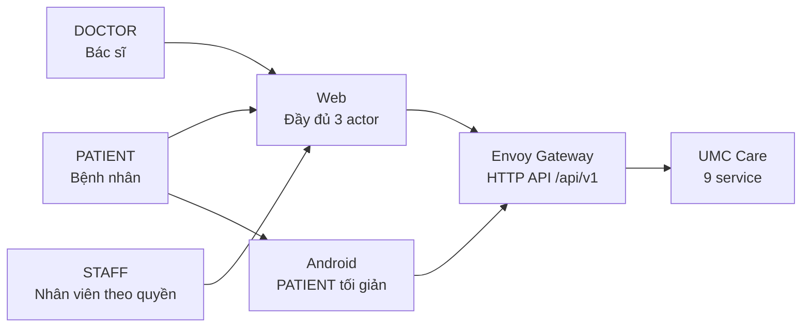
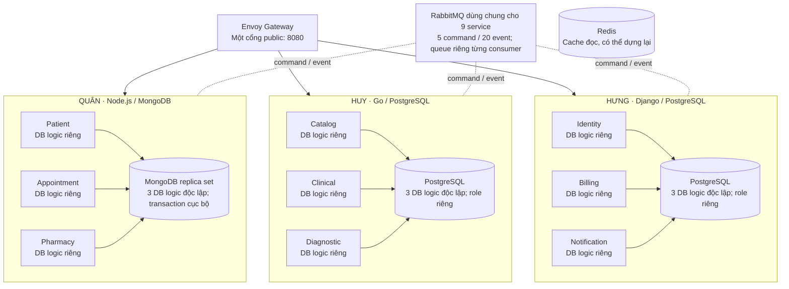
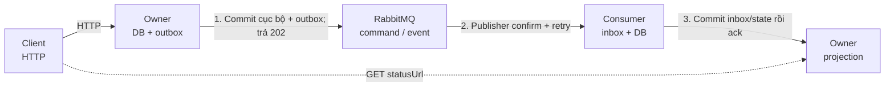

# UMC CARE

## KIẾN TRÚC TỔNG THỂ HỆ THỐNG

Bản thiết kế để triển khai và bảo vệ đồ án · 19/10/2026

Phạm vi toàn sản phẩm: web cho PATIENT / DOCTOR / STAFF; Android Kotlin cho PATIENT; Envoy Gateway; 9 service, 9 DB logic, RabbitMQ, Redis, Docker Compose, GitHub/CI, kiểm thử và demo. 86 HTTP operations theo API v5.2; thanh toán/hoàn tiền mô phỏng; dữ liệu bệnh nhân giả.

| **Thuộc tính**   | **Quyết định**                                                                                                       |
|------------------|----------------------------------------------------------------------------------------------------------------------|
| Baseline         | BRD, SRS, UC, ERD v5 (17/10/2026); API v5.2; tài liệu Saga 19/10; hai tài liệu kiến trúc người dùng cung cấp.        |
| Nhóm và hạn nộp  | Huy, Quân, Hưng; mỗi người khoảng 20–24 giờ/tuần; nộp 23/11/2026.                                                    |
| Tình trạng       | Tài liệu THIẾT KẾ. Chưa phải bằng chứng hệ thống đã code, chạy, đạt hiệu năng hoặc được giảng viên duyệt.            |
| Quy tắc thay đổi | Contract BRD/SRS/UC/ERD/API là chuẩn triển khai. Các mâu thuẫn nêu ở §14 phải đồng bộ trước khi khóa code liên quan. |

Phán quyết thiết kế: phù hợp hướng học phần và yêu cầu hai nền tảng do nhóm cung cấp; chưa thể khẳng định “đạt điểm tối đa” khi chưa có rubric riêng của giảng viên và kết quả chạy thật. Trọng tâm chấm dự kiến là ranh giới service, hợp đồng API, giao tiếp và xử lý lỗi, dữ liệu độc lập, demo end-to-end, báo cáo và bảo vệ.

# 1. Căn cứ học phần và tiêu chí kiểm chứng

Đề cương INT1448 “Phát triển phần mềm hướng dịch vụ” nêu CLO1 (hiểu phân tích/thiết kế SOAP, REST, Microservice), CLO2 (áp dụng phát triển cho bài toán cụ thể), CLO3 (trình bày kết quả); báo cáo cuối kỳ 40% và trình bày mã nguồn/demo, bảo vệ 30%. Slide có Gateway, IPC, Saga, DDD/CQRS, API composition/BFF/GraphQL và triển khai. Đây là các nội dung học, không có căn cứ để coi mọi công nghệ trong slide là bắt buộc cho cùng một đồ án.

| **Nguồn yêu cầu**                 | **Cách UMC Care thể hiện**                                                                                                  | **Minh chứng phải có**                                                                 |
|-----------------------------------|-----------------------------------------------------------------------------------------------------------------------------|----------------------------------------------------------------------------------------|
| CLO1 — phân tích/thiết kế         | BRD → SRS/UC → bounded context/ERD → OpenAPI/event contract; giải thích chọn REST/Microservice, so sánh SOAP ở phần bảo vệ. | Ma trận FR–UC–API–service; sơ đồ context/container/sequence; ADR.                      |
| CLO2 — phát triển                 | 9 service tách dữ liệu, web + Android; Gateway; message bus; Saga, outbox/inbox; Docker Compose.                            | Source, migration/index, Compose health, test contract/integration/E2E, bản demo chạy. |
| CLO3 — trình bày/bảo vệ           | Mỗi người giải thích 3 service mình sở hữu và ít nhất 1 luồng lỗi xuyên service.                                            | Kịch bản demo, log correlationId, dữ liệu seed/reset, kết quả test.                    |
| Yêu cầu đề tài do nhóm cung cấp   | Microservices và 2 nền tảng; web đủ 3 actor, Android bệnh nhân tối giản.                                                    | Đăng nhập đúng quyền; cùng dữ liệu/trạng thái trên web và Android.                     |
| Nội dung slide mang tính lựa chọn | Kubernetes, GraphQL, BFF, Kafka, Event Sourcing, gRPC/SOAP implementation.                                                  | Nêu lý do không chọn và phương án mở rộng; không thêm chỉ để có tên công nghệ.         |

# 2. Quyết định kiến trúc ở một trang

| **Mã** | **Quyết định**                                                                      | **Lý do**                                                                                                       |
|--------|-------------------------------------------------------------------------------------|-----------------------------------------------------------------------------------------------------------------|
| A-01   | Một Envoy Gateway, HTTP/REST /api/v1, không BFF.                                    | Một entry point; route và bảo mật tập trung; client ghép vài GET, projection ở owner cho truy vấn thường xuyên. |
| A-02   | 9 bounded context/service; 9 DB logic, không chia DB theo lập trình viên.           | Owner giữ bất biến và dữ liệu gốc; service không đọc/ghi DB khác.                                               |
| A-03   | RabbitMQ cho command/event nội bộ; không chuỗi HTTP liên service trong request gốc. | Tách lỗi và thời gian xử lý; 202 + statusUrl cho tác vụ pending.                                                |
| A-04   | Local transaction + outbox/inbox; at-least-once và idempotency.                     | Không có distributed transaction giữa Mongo/PostgreSQL/broker.                                                  |
| A-05   | Billing điều phối settlement saga; nguồn giữ khóa/fence và quyết định domain.       | Tiền và nguồn cùng có chứng cứ trạng thái; lỗi được bù/truy vấn.                                                |
| A-06   | Docker Compose; Redis cache có thể dựng lại; mô phỏng payment/refund.               | Phù hợp 3 người và thời hạn, vẫn thể hiện triển khai phân tán.                                                  |

# 3. Bối cảnh và thành phần triển khai

### Hình 1. Bối cảnh hệ thống UMC Care

Ba actor là nhóm người dùng; STAFF còn được giới hạn theo capability. Android chỉ có chức năng bệnh nhân. Web và Android dùng chung hợp đồng API; quyền truy cập do service sở hữu quyết định.

### Hình 2. Container và ranh giới sở hữu dữ liệu

Sơ đồ thể hiện phân công và ranh giới dữ liệu: mỗi service có DB logic riêng; các DB logic được triển khai trên một MongoDB replica set hoặc các PostgreSQL database. Mọi service dùng RabbitMQ. Redis chỉ là cache đọc có thể dựng lại. Không JOIN, không FK hoặc ghi DB xuyên service. Các mũi tên hạ tầng trong hình mang tính minh họa, không phải sơ đồ toàn bộ kết nối.

Container Compose tối thiểu: Envoy, web, 9 service (worker có thể chạy chung image nhưng process riêng), RabbitMQ, Redis, PostgreSQL với 6 DB/role logic, MongoDB replica set với 3 DB logic. Android là client ngoài Compose. Chỉ Envoy/web cần cổng host; các service và DB nằm trên mạng nội bộ. Health “ready” phải chờ DB/broker/migration thực sự dùng được; liveness không thay thế readiness.

## 3.1. Công nghệ cho toàn bộ sản phẩm

Bảng dưới là quyết định triển khai của nhóm, không phải tuyên bố rằng các framework đã tồn tại trong repo. Ưu tiên cùng một API contract, ít công cụ mới, chạy lại được trên máy ba thành viên.

| **Lớp**         | **Công nghệ / cấu trúc chọn**                                                                               | **Trách nhiệm và lý do**                                                                                                                                |
|-----------------|-------------------------------------------------------------------------------------------------------------|---------------------------------------------------------------------------------------------------------------------------------------------------------|
| Web             | React + TypeScript + Vite; React Router; CSS Modules và bộ UI chung; fetch wrapper + hook trạng thái async. | Một SPA responsive cho cả 3 actor. Feature folder theo domain giảm đụng file. React/Vite dễ dựng và đóng gói static; không tạo BFF riêng.               |
| Android         | Kotlin, Jetpack Compose, ViewModel, coroutines/StateFlow, Repository, HTTP client Retrofit/OkHttp.          | Một app PATIENT, cùng Gateway/API; UI state rõ Loading/Ready/Pending/Error, không sao chép business rule từ server. Không cần local DB y tế trong demo. |
| Backend Quân    | Node.js + TypeScript, Express, MongoDB driver, validation schema, worker AMQP.                              | Patient, Appointment, Pharmacy; transaction/index nằm ở Mongo replica set, không dựa Redis lock để giữ slot/thuốc.                                      |
| Backend Huy     | Go net/http, pgx, SQL migration, go test, worker AMQP.                                                      | Catalog, Clinical, Diagnostic; ít abstraction, SQL/constraint nhìn thấy được khi bảo vệ.                                                                |
| Backend Hưng    | Django + Django REST Framework, PostgreSQL migration, worker AMQP.                                          | Identity, Billing, Notification; Billing sở hữu settlement Saga và ledger trạng thái.                                                                   |
| Edge và message | Envoy; RabbitMQ durable queue/topic exchange; Redis cache chỉ đọc.                                          | Một public API entry point; async liên service; Redis mất không làm sai nguồn dữ liệu.                                                                  |
| Dữ liệu và demo | PostgreSQL 6 DB logic, Mongo replica set 3 DB logic, Docker Compose và bộ gửi OTP qua email của Identity. | Mỗi service có credential và database logic riêng. Billing mô phỏng thanh toán. Identity dùng SMTP để gửi OTP đến hộp thư kiểm thử hoặc lưu mã vào hộp thư dev khi chạy offline. |
| Contract và CI  | OpenAPI 3.1.1 cho HTTP; JSON Schema/version cho message; GitHub Actions kiểm build/test/contract.           | Workbook API là danh mục ID và hành vi; schema máy đọc là nguồn kiểm CI; không tự tạo endpoint ngoài baseline.                                          |

Không khóa phiên bản thư viện trong tài liệu kiến trúc: package/lockfile của từng app/service sẽ khóa phiên bản khi scaffold. Mọi nâng cấp sau đó qua PR và test. Không thêm Kubernetes, Kafka, GraphQL, BFF hoặc Event Sourcing để lấy điểm khi các luồng cốt lõi chưa chạy.

## 3.2. Kiến trúc web và ranh giới màn hình

Web là một ứng dụng React, không phải ba web riêng. Mỗi route/feature có đúng một owner; actor chỉ quyết định quyền thấy và thao tác. UI ẩn menu theo quyền để dễ dùng, còn service owner vẫn kiểm quyền thật. Route UI dưới đây là đề xuất bố trí màn hình, không thay method/path API v5.2.

| **Mã / owner** | **Route UI và màn hình**                                                              | **API và ranh giới**                                                                      |
|----------------|---------------------------------------------------------------------------------------|-------------------------------------------------------------------------------------------|
| W01 · Quân     | /; shell, menu PATIENT/DOCTOR/STAFF, layout responsive, trang điều hướng.             | IA-010 để đọc phiên; menu theo capability. Quân sở hữu route registry và shared UI.       |
| W02 · Hưng     | /auth/\*; đăng ký, OTP/đăng nhập, quên/reset/đổi mật khẩu, đăng xuất.                 | IA-001–010. Hưng sở hữu auth state và token/refresh adapter dùng chung.                   |
| W03 · Huy      | /catalog/\*; khoa, bác sĩ, dịch vụ, giá, xét nghiệm và thuốc tham khảo.               | CA-001–006. Không hiển thị tồn thuốc ở Catalog; tồn nằm Pharmacy.                         |
| W04 · Quân     | /patient/profiles/\*; danh sách, tạo, chi tiết, sửa hồ sơ và người thân.              | PT-001, PT-003–005. STAFF tra cứu hồ sơ ở route riêng /staff/patients/search dùng PT-002. |
| W05 · Quân     | /patient/appointments/new; tìm slot, giữ, tạo lịch.                                   | AP-004, AP-008–010; link sang màn phí W07. Lỗi hết slot/hold hết hạn do Quân xử lý.       |
| W06 · Quân     | /patient/appointments/\*; danh sách, chi tiết, đổi, hủy và trạng thái hoàn.           | AP-011–014. Chỉ dùng refundStatus projection đã được chốt; không client tự suy diễn.      |
| W07 · Hưng     | /patient/billing/\*; khoản phí, thanh toán mô phỏng, biên nhận, hoàn.                 | BI-002–004, BI-006–009. Payment view do Hưng sở hữu; Quân chỉ điều hướng tới đây.         |
| W08 · Huy      | /patient/records/\*; visit đã ký, kết quả PUBLISHED và toa FINAL.                     | CL-011, DI-013 cùng endpoint chi tiết được phép; không lộ draft/review nội bộ.            |
| W09 · Hưng     | /patient/notifications; hộp thư và đánh dấu đã đọc.                                   | NO-001–002; nội dung thông báo tối thiểu, không mang số liệu xét nghiệm.                  |
| W10 · Huy      | /doctor/worklist và /doctor/visits/\*; nhận lượt, nháp khám, chỉ định LAB, toa và ký. | CL-001–010; bác sĩ không sửa toa FINAL hoặc ký khi LAB chưa giải quyết.                   |
| W11 · Quân     | /staff/reception/\*; schedule, check-in, hàng chờ, gọi số/no-show, tra cứu.           | AP-005–006, AP-015–018, PT-002; capability RECEPTION.                                     |
| W12 · Huy      | /staff/lab/\*; order/mẫu/recollect, nhập, gửi duyệt, trả sửa, công bố.                | DI-002–012; LAB_TECH và LAB_REVIEW tách tác vụ; self-review bị chặn ở owner.              |
| W13 · Quân     | /staff/pharmacy/\*; tồn, phiếu nhập, hàng đợi toa, giữ/nhả/cấp.                       | PH-001–008; capability PHARMACY; không tạo charge từ UI bằng lối tắt.                     |
| W14 · Hưng     | /staff/cashier/\*; charge, thu quầy, refund/retry, receipt.                           | BI-002, BI-005–009, BI-013–014; capability CASHIER.                                       |
| W15 · Hưng     | /staff/admin/users/\* và /staff/admin/billing; cấp quyền/audit, báo cáo phí.          | IA-011–013, BI-010; ADMIN chỉ tài khoản chỉ định.                                         |
| W16 · Quân     | /staff/admin/appointments; báo cáo lịch.                                              | AP-019; tách khỏi W15 để không sửa cùng màn admin tổng hợp.                               |

Quy tắc không chồng việc: chủ màn sửa page, form, hook và test trong feature folder của mình. Màn đặt lịch chỉ liên kết tới Billing, không nhúng form thanh toán vào Appointment. Trang hồ sơ hành chính thuộc Quân; bệnh án/kết quả thuộc Huy. Trang admin báo cáo lịch và báo cáo phí là hai route riêng. Hưng không sửa trang Appointment khi nối Android; Quân không sửa màn Billing.

Tầng web: route → page/component → feature hook → shared API client → Envoy. shared/api xử lý Bearer token, refresh, correlationId và error envelope; feature hook xử lý query/poll statusUrl; component chỉ render. Ghi bất đồng bộ phải có Loading, PENDING, IN_DOUBT, Success, Error và nút refresh/retry an toàn. Responsive theo SRS ở 360/768/1440px, dùng bàn phím được, lỗi gắn đúng trường.

| **Thư mục web dùng chung**        | **Owner chỉnh chính**                                  | **Quy tắc để tránh conflict**                                                                                              |
|-----------------------------------|--------------------------------------------------------|----------------------------------------------------------------------------------------------------------------------------|
| apps/web/src/app                  | Quân                                                   | Shell, route registry, providers và menu. Mỗi feature export routes/menu của mình; Quân tích hợp file registry sau review. |
| apps/web/src/shared/ui            | Quân                                                   | Button, Modal, FormField, StatusBadge, ErrorPanel. Đổi giao diện chung cần Huy/Hưng review vì tác động toàn web.           |
| apps/web/src/shared/api           | Hưng                                                   | HTTP client, session/refresh, lỗi chuẩn, correlationId; không chứa business rule của từng domain.                          |
| apps/web/src/features/\<domain\>  | Owner domain                                           | Page, components, hooks, API mapping, tests, route export. Không import sâu từ feature của người khác.                     |
| contracts/http và generated types | Huy quản schema/CI; mỗi owner quản schema service mình | Client types sinh từ contract; không sửa generated code bằng tay. Thay contract liên service cần owner đôi bên review.     |

## 3.3. Kiến trúc Android Kotlin

Android là một app riêng trong apps/android, do Hưng code. Cấu trúc feature giống hành trình bệnh nhân nhưng không chia quyền màn bác sĩ/nhân viên. UI Compose quan sát StateFlow của ViewModel; ViewModel gọi Repository; Repository dùng HTTP client tới Envoy. Không cho composable gọi API trực tiếp. Access token giữ ngắn hạn; refresh token phải lưu bằng cơ chế dựa trên Android Keystore, xóa khi logout. Không cache lâu dài kết quả y tế nhạy cảm.

| **Cụm màn Android**     | **API dùng lại**                           | **Điều kiện nghiệm thu**                                                         |
|-------------------------|--------------------------------------------|----------------------------------------------------------------------------------|
| A01 Tài khoản           | IA-001–010                                 | Đăng ký/OTP/login, quên–đổi mật khẩu, refresh/logout; OTP sai/hết hạn hiện lỗi.  |
| A02 Hồ sơ               | PT-001, PT-003–005                         | Chọn/tạo/sửa hồ sơ bản thân/người thân; không xem hồ sơ người khác.              |
| A03 Tra cứu và đặt      | CA-001–003, AP-004, AP-008–012, BI-002–004 | Tìm bác sĩ/slot, hold, đặt, phí mô phỏng, trạng thái PENDING→CONFIRMED hoặc lỗi. |
| A04 Lịch, đổi/hủy, tiền | AP-011–014, BI-003, BI-006–009, NO-001–002 | Lịch của tôi, đổi/hủy, refund pending/failed và retry; thông báo.                |
| A05 Bản công bố         | CL-011, DI-013, BI-006                     | Chỉ hiện visit SIGNED, kết quả PUBLISHED, toa FINAL và biên nhận đúng hồ sơ.     |

Android emulator dùng URL Gateway cấu hình theo môi trường, không hard-code localhost của container; khi demo bằng điện thoại thật cần URL mạng nội bộ phù hợp và cấu hình HTTPS/cleartext đúng môi trường. Web và Android không tự sửa trạng thái tiền/lịch trên client; cả hai đọc trạng thái owner qua API.

## 3.4. Luồng xuyên tầng và API composition

| **Luồng UI**                        | **Đường đi và trạng thái**                                                                                                                                               | **Điểm giao việc**                                                                          |
|-------------------------------------|--------------------------------------------------------------------------------------------------------------------------------------------------------------------------|---------------------------------------------------------------------------------------------|
| Bệnh nhân đặt lịch trên web/Android | Client → Gateway → Appointment hold/create → local DB+outbox → RabbitMQ → Billing → ChargePaid/SettlementDecision → Appointment projection; client GET AP-011/statusUrl. | Quân sở hữu booking/status; Hưng charge/payment và Android; Huy catalog price version.      |
| Bác sĩ khám có LAB                  | Web Clinical → Clinical visit/CreateLabOrder → RabbitMQ → Diagnostic; LAB web nhập/review/publish → event → Clinical; bệnh nhân đọc bản công bố.                         | Huy sở hữu toàn UI/service Clinical–Diagnostic; Hưng Billing phí LAB; Quân queue.           |
| Toa và cấp thuốc                    | Doctor web FINAL → event → Pharmacy projection; Staff Pharmacy giữ toàn toa → Billing phí → settlement → dispense; bệnh nhân đọc receipt.                                | Huy toa; Quân kho/cấp; Hưng phí. Mỗi owner chỉ thay file trong feature/service của mình.    |
| Đọc nhiều nguồn                     | Client ghép vài GET độc lập; màn đọc thường xuyên dùng owner projection với asOf/version.                                                                                | Không JOIN DB, không BFF ở Gateway; tránh màn dashboard gọi chuỗi HTTP đồng bộ qua service. |

## 3.5. Cấu trúc repository dự kiến trên develop

Bản đồ dưới là THIẾT KẾ thư mục để bạn duyệt. Chưa tạo thư mục, commit hoặc push. Một service có mã nguồn, Dockerfile, migration/index, test và README riêng. Hai nhánh main/develop hiện có được giữ; không tạo nhánh dài hạn cho từng người.

| **Đường dẫn dự kiến**                                             | **Owner chính**                  | **Nội dung và quy tắc**                                                                                            |
|-------------------------------------------------------------------|----------------------------------|--------------------------------------------------------------------------------------------------------------------|
| services/patient, appointment, pharmacy                           | Quân                             | Mỗi service tự chứa api/application/domain/infrastructure/worker/tests; Dockerfile và schema Mongo của riêng mình. |
| services/catalog, clinical, diagnostic                            | Huy                              | Mỗi service Go tự chứa handler/usecase/domain/repository/worker/tests và SQL migration riêng.                      |
| services/identity, billing, notification                          | Hưng                             | Mỗi service Django có app/domain/worker/tests và PostgreSQL migration riêng.                                       |
| apps/web/src/features/patients, appointments, pharmacy            | Quân                             | Chỉ các màn và test thuộc domain Quân; không sửa feature của Huy/Hưng.                                             |
| apps/web/src/features/catalog, clinical, diagnostic               | Huy                              | Màn public catalog, doctor và LAB; chỉ export API/route cần tích hợp.                                              |
| apps/web/src/features/auth, billing, notifications, admin-billing | Hưng                             | Màn auth, cashier, patient billing, inbox, user admin; auth client chung theo bảng trên.                           |
| apps/web/src/app, shared/ui, shared/api                           | Quân / Hưng                      | Quân sở hữu app+shared/ui; Hưng sở hữu shared/api. Mọi sửa file chung cần review của owner chính.                  |
| apps/android                                                      | Hưng                             | Một module app Kotlin; core/network, core/session, core/ui và 5 feature bệnh nhân.                                 |
| contracts/http, contracts/messages                                | Huy điều phối; mỗi owner service | OpenAPI từng service và schema message theo producer; version và ví dụ payload có test contract.                   |
| infra/compose, rabbitmq, mongo                                    | Quân                             | Compose profiles dev/demo; replica set init, topology broker, volume/health.                                       |
| infra/envoy; infra/postgres                                       | Hưng / Huy                       | Hưng Envoy/JWT/route; Huy init 6 DB/role và migration conventions; Billing/Identity migration do Hưng.             |
| tests/e2e, tests/performance; .github/workflows                   | Huy điều phối                    | Kịch bản xuyên service, script đo NFR và CI. Owner service vẫn phải viết unit/integration test ở service mình.     |
| docs                                                              | Cả nhóm, Huy tổng hợp            | Giữ 5 hợp đồng gốc, kiến trúc, Saga, README/demo runbook; sửa hợp đồng có trace issue.                             |

## 3.6. Môi trường chạy, CI và quy trình Git

| **Môi trường** | **Thành phần và cách kiểm**                                                                                                                                                                                            |
|----------------|------------------------------------------------------------------------------------------------------------------------------------------------------------------------------------------------------------------------|
| local dev      | Vite web dev server, Android emulator, Envoy localhost:8080, 9 service, Postgres/Mongo/RabbitMQ/Redis trong Compose. Chỉ mở cổng cần thiết; cấu hình .env.example, không commit secret.                                |
| demo           | Build web static phục vụ trong container, Compose dựng hạ tầng, init/seed có thể chạy lại với 2 bệnh nhân và staff theo capability. Dùng email kiểm thử khi đăng ký và tài khoản có email khi demo quên mật khẩu. Mô phỏng thanh toán/hoàn tiền. Android APK trỏ đúng Gateway demo. |
| CI             | Trên thay đổi: lint/build/test từng runtime và web; Android assemble/test khi app đổi; OpenAPI/event schema validation; kiểm secret; E2E Compose ở mốc tích hợp. Fail thì không coi PR/commit là Done.                 |
| release        | main là bản được chốt, develop là bản tích hợp. Trước khi nhập main phải chạy seed→E2E→build APK→backup/restore thử. Chưa áp dụng GitHub branch protection/CI lên repo trong bước thiết kế này.                        |

Với demo gửi email, đặt `EMAIL_BACKEND=smtp` cho Identity và cấp `SMTP_USER`, `SMTP_PASSWORD`. Cấu hình `SMTP_HOST`, `SMTP_PORT` và `SMTP_FROM_EMAIL` theo máy chủ gửi. Nếu không đặt `EMAIL_BACKEND`, Identity dùng `dev_inbox` và lưu mã trong DB. Chỉ dùng chế độ này để kiểm thử offline. Giữ `ALLOW_DEV_OTP=false` ngoài môi trường phát triển cô lập.

Vì nhóm đang yêu cầu chỉ main/develop là hai nhánh tồn tại thường trực, đề xuất không giữ nhánh cá nhân lâu dài. Khi triển khai cần chốt một trong hai cơ chế: feature branch ngắn hạn rồi xóa ngay sau PR, hoặc cùng push develop theo phân vùng thư mục kèm review diff và pull/rebase trước push. Cơ chế thứ nhất dễ review/CI hơn nhưng tạo nhánh tạm; cơ chế thứ hai giữ đúng hai nhánh mọi lúc nhưng bảo vệ develop yếu hơn. Chưa đổi thiết lập GitHub khi chưa được duyệt.

# 4. Service, năng lực và người chịu trách nhiệm

| **Service / API** | **Owner / runtime / DB**    | **Sự thật gốc và ranh giới**                                         |
|-------------------|-----------------------------|----------------------------------------------------------------------|
| Identity · 14     | Hưng · Django · PostgreSQL  | Account, OTP, refresh, capability/lease; phát IdentityAccessChanged. |
| Patient · 5       | Quân · Node.js/TS · MongoDB | Hồ sơ hành chính, ownerUserId; phát PatientAccessChanged.            |
| Catalog · 6       | Huy · Go · PostgreSQL       | Khoa/bác sĩ/dịch vụ/thuốc, giá và version hiệu lực.                  |
| Appointment · 15  | Quân · Node.js/TS · MongoDB | Schedule/slot/hold/lịch/hàng chờ; giữ capacity và chống trùng giờ.   |
| Clinical · 11     | Huy · Go · PostgreSQL       | Visit, ghi khám, chỉ định LAB, toa FINAL, ký visit.                  |
| Diagnostic · 13   | Huy · Go · PostgreSQL       | LAB order, specimen, nhập/review/công bố kết quả.                    |
| Pharmacy · 8      | Quân · Node.js/TS · MongoDB | Tồn kho thực, giữ toàn toa, phát thuốc.                              |
| Billing · 12      | Hưng · Django · PostgreSQL  | Charge, settlement, payment/refund mô phỏng, receipt.                |
| Notification · 2  | Hưng · Django · PostgreSQL  | Inbox thông báo, trạng thái đọc/dedupe.                              |

Tổng 86 HTTP operations: 83 client/tác vụ và 3 recovery adapter nội bộ (IA-014, DI-001, BI-001) tắt theo profile chuẩn; health, metrics, background jobs, command/event không cộng vào số 86. 20 integration events và 5 commands là hợp đồng riêng; tên và payload chi tiết lấy từ workbook API.

# 5. Sở hữu dữ liệu và nhất quán

- ID giữa service là UUID dạng chuỗi; không foreign key/JOIN xuyên DB. Mỗi service chỉ tạo migration/index, đọc/ghi DB và bảng/collection do mình sở hữu; account DB/role riêng.

- MongoDB dùng một replica set để transaction cục bộ trong Appointment/Pharmacy/Patient; ba DB logic tách theo service. PostgreSQL có sáu DB logic, vai trò kết nối riêng. Chọn Mongo cho aggregate lịch/giữ chỗ/toa với cập nhật nguyên tử và cấu trúc document; chọn PostgreSQL cho identity/catalog/clinical/diagnostic/billing/notification có ràng buộc quan hệ, lịch sử và giao dịch rõ. Không tuyên bố một DB “tối ưu tuyệt đối”.

- Consumer lưu local reference và projection tối thiểu: sourceId, sourceVersion, effectiveAt, processedAt/checkpoint. Event cũ hơn không ghi đè mới hơn; projection có lệnh rebuild. Redis chỉ cache GET và hết hạn/invalidate; cache miss không làm sai nghiệp vụ.

- Giá khi đặt lịch/thu phí phải là snapshot gồm amountVnd, currency=VND, catalogVersion/effectiveAt. Nếu projection giá không đủ mới để xác nhận, trả trạng thái cần làm mới/chặn ghi thay vì thu nhầm giá.

| **Bất biến chủ sở hữu**                                                                           | **Bảo vệ bằng**                                                                        | **Kiểm thử quyết định**                                            |
|---------------------------------------------------------------------------------------------------|----------------------------------------------------------------------------------------|--------------------------------------------------------------------|
| Slot: heldCount + confirmedCount ≤ capacity; không hai lịch trùng giờ cho cùng patient.           | Appointment transaction + conditional update + unique patient_time_lock; hold 10 phút. | Hai request tranh slot cuối: đúng một thắng; retry không nhân đôi. |
| Đúng một charge cho source revision; một settlement đang xử lý mỗi charge.                        | Billing unique business key và settlement fence/attempt; ledger trạng thái.            | Hai callback PAID trùng chỉ có một kết quả.                        |
| LAB chỉ lấy mẫu sau bằng chứng thanh toán local; người nhập/sửa revision không duyệt revision đó. | Diagnostic state/version và author/reviewer constraint.                                | Draft không lộ; self-review bị 403/409.                            |
| Thuốc: 0 ≤ reserved ≤ onHand; giữ toàn bộ toa hoặc không giữ; một dispense/toa revision.          | Pharmacy transaction nhiều item, unique prescription revision; hold 15 phút.           | Thiếu 1 thuốc không giữ thuốc khác; replay không cấp trùng.        |
| Visit chưa giải quyết chỉ định LAB không thể ký.                                                  | Clinical state machine theo outcome LAB order.                                         | REJECTED/FAILED/resubmit có kết quả xác định.                      |

# 6. Giao tiếp HTTP, command/event và phục hồi

### Hình 3. Một yêu cầu liên service được xử lý như thế nào

1. Owner ghi trạng thái nghiệp vụ và outbox trong cùng giao dịch cục bộ, sau đó trả HTTP 202.
2. Publisher gửi message; chỉ đánh dấu đã gửi khi nhận publisher confirm hợp lệ. Có retry khi gửi lỗi.
3. Consumer ghi inbox và cập nhật DB/projection trong giao dịch cục bộ, sau đó mới ack message.

Client truy vấn `statusUrl` để theo dõi kết quả. Message gửi trùng được inbox và khóa nghiệp vụ dùng để chống xử lý lặp.

HTTP đồng bộ chỉ cho client → Gateway → đúng một owner; endpoint đọc owner hoặc local projection. Các service không gọi dây chuyền HTTP trong cùng request người dùng. Business operation bất đồng bộ dùng 202 với requestId, resourceId, state, statusUrl. Không coi 202 là nghiệp vụ đã thành công.

| **Loại thông điệp**    | **Danh mục chốt**                                                                                                                                                                                                                                                                                                                                    | **Quy tắc**                                                                                          |
|------------------------|------------------------------------------------------------------------------------------------------------------------------------------------------------------------------------------------------------------------------------------------------------------------------------------------------------------------------------------------------|------------------------------------------------------------------------------------------------------|
| Command (5)            | RequestCharge; CreateLabOrder; ClaimQueueTicket; ReserveSettlement; QuerySettlement.                                                                                                                                                                                                                                                                 | Yêu cầu đích làm hành động; có commandId, correlationId, causationId, aggregateId, revision/attempt. |
| Integration event (18) | ChargePaid; AppointmentChanged; LabCancelled; LabResultPublished; PrescriptionFinalized; MedicationDispensed; BillingStatusChanged; MedicationHoldChanged; VisitSigned; VisitReturnReady; CatalogChanged; PatientAccessChanged; IdentityAccessChanged; ChargePrepared; LabOrderResolved; QueueTicketClaimed; SettlementReserved; SettlementDecision. | Sự thật đã commit tại owner; consumer dùng để cập nhật local projection/workflow.                    |
| RabbitMQ topology      | Topic exchanges umc.events.{producer}.v1 / umc.commands.{producer}.v1; queues cmd.{target}.v1 / evt.{consumer}.v1.                                                                                                                                                                                                                                   | Mỗi consumer có queue của mình; một queue chung không tạo fanout cho nhiều service.                  |

Publisher lưu outbox cùng giao dịch domain; publish message persistent tới durable exchange/queue với mandatory flag và publisher confirm, chỉ đánh dấu “sent” khi được confirm và không bị returned. Consumer kiểm schema/producer, chèn inbox theo messageId và business key, cập nhật state/projection + outbox trong một giao dịch cục bộ, rồi mới ack. Broker redelivery là bình thường; idempotency phải bảo vệ cả tầng DB. Retry có backoff 5/15/60 giây cộng jitter, tối đa ba lần; lỗi vượt ngưỡng đưa DLQ/quarantine và có thao tác replay có kiểm soát. Không hot requeue.

Contract envelope tối thiểu: messageId, type, schemaVersion, producer, occurredAt UTC, correlationId, causationId, aggregateId, aggregateVersion, payload. Schema version mới không được thay nghĩa trường cũ; consumer bỏ qua event version đã xử lý, xử lý out-of-order theo aggregateVersion/checkpoint. Không phát thông tin nhạy cảm ngoài dữ liệu tối thiểu cần dùng.

# 7. Saga và lỗi xuyên service

Billing sở hữu settlement saga cho charge/paid/refund. Appointment giữ slot và patient lock; Diagnostic giữ LAB order; Pharmacy giữ stock; mỗi nguồn kiểm revision, attempt và fence khi nhận ReserveSettlement. Luồng chi tiết và ma trận compensation đã có trong tài liệu Saga; bản này khóa nguyên tắc kiến trúc và điểm cần chứng minh.

| **Luồng**                 | **Thành công**                                                                                                                                     | **Lỗi / compensation bắt buộc**                                                                                                                                                                      |
|---------------------------|----------------------------------------------------------------------------------------------------------------------------------------------------|------------------------------------------------------------------------------------------------------------------------------------------------------------------------------------------------------|
| Đặt lịch / đổi lịch / hủy | Giữ slot 10 phút → tạo PENDING_PAYMENT → RequestCharge → reserve settlement → ChargePaid → CONFIRMED. Đổi lịch giữ slot mới trước khi nhả lịch cũ. | Trước PAID: VOID charge/nhả hold. Sau PAID: tạo refund mô phỏng, không xóa appointment/receipt. Refund FAILED giữ REFUND_PENDING cho retry. Late PAID không được tự xác nhận nếu fence hết hiệu lực. |
| Khám có LAB               | Clinical tạo yêu cầu → Diagnostic order → charge LAB/PAID → specimen → draft → reviewer khác tác giả → PUBLISHED → Clinical tiếp tục ký.           | LAB bị hủy/lấy mẫu lỗi/rejected có trạng thái và lý do; không trả draft cho bệnh nhân. Order chưa được giải quyết chặn ký; không tự tạo charge thứ hai trên replay.                                  |
| Giữ/cấp thuốc             | Toa FINAL → Pharmacy reserve toàn toa 15 phút → Billing charge/PAID → Pharmacy commit/dispense.                                                    | Thiếu thuốc abort toàn toa; quá hạn trước settlement nhả giữ. Khi settlement IN_DOUBT vẫn giữ khóa, QuerySettlement thay vì tự hết hạn. Replay không phát thuốc hai lần.                             |
| Timeout không rõ kết quả  | Nguồn QuerySettlement mỗi 30 giây khi quá 60 giây chưa có quyết định; Billing trả SettlementDecision theo attempt.                                 | UNKNOWN giữ PENDING/IN_DOUBT và lock; tuyệt đối không suy diễn thất bại rồi nhả tài nguyên nếu có thể đã PAID.                                                                                       |

# 8. REST, Gateway và bảo mật

- Một Envoy Gateway công khai /api/v1; allowlist route/method, CORS origin, rate limit, request/correlation ID. Local demo qua localhost:8080; nếu mở ra mạng công khai thì TLS tại gateway.

- Access JWT 15 phút, refresh rotation; Envoy kiểm chữ ký, issuer, audience, exp bằng public key và chỉ lấy token từ Authorization header. Tắt nguồn query parameter access_token nếu filter mặc định hỗ trợ nó; không ghi token/OTP vào log.

- Gateway xóa header định danh do client tự gửi rồi gắn identity context đã xác minh. Service chỉ tin context từ đường nội bộ được bảo vệ và vẫn kiểm ownership, capability, status/version. STAFF là một actor với quyền tác vụ cụ thể; ADMIN chỉ cấp cho tài khoản chỉ định.

- Request ghi cần Idempotency-Key + request hash theo API contract; dùng 400 validation, 401 chưa xác thực, 403 không quyền, 404 không lộ tài nguyên, 409 conflict/version, 422 lỗi nghiệp vụ, 429 rate limit; response lỗi có code, message, correlationId. Xử lý chính xác theo workbook API, không tự đổi status/payload khi code.

- Dữ liệu bệnh nhân giả; log có cấu trúc và mask PII/y tế; không dùng tài khoản admin chung. Seed user, staff và capability tối thiểu cho demo.

Không dùng BFF trong baseline. Web ghép vài endpoint đọc ở client khi số nguồn ít; màn hình cần đọc thường xuyên hoặc chịu lỗi owner thì dùng projection thuộc service owner. Không thêm endpoint “gom mọi thứ” ở Gateway hay cho client trực tiếp truy vấn DB.

# 9. Hai nền tảng và hành trình dọc

| **Nền tảng**    | **Phạm vi UI và trạng thái**                                                                                                                                                                                                                                              |
|-----------------|---------------------------------------------------------------------------------------------------------------------------------------------------------------------------------------------------------------------------------------------------------------------------|
| Web PATIENT     | Đăng ký/OTP/quên/đổi mật khẩu; quản lý hồ sơ; xem catalog/bác sĩ; tìm–giữ–đặt/đổi/hủy lịch; thanh toán mô phỏng và trạng thái refund; kết quả đã PUBLISHED; toa FINAL, đơn thuốc/biên nhận, thông báo.                                                                    |
| Web DOCTOR      | Lịch/queue được phân công; mở visit; ghi khám; chỉ định LAB; xem kết quả PUBLISHED; kê toa; ký sau khi LAB đã giải quyết.                                                                                                                                                 |
| Web STAFF       | Một actor nhưng UI theo capability: RECEPTION (schedule/check-in/queue), LAB_TECH (mẫu/nhập), LAB_REVIEW (duyệt), PHARMACY (tồn/giữ/cấp), CASHIER (charge/refund), ADMIN (quyền/báo cáo). Một account có thể nhiều capability nhưng không tự duyệt kết quả LAB mình nhập. |
| Android PATIENT | Đăng nhập/refresh, chọn hồ sơ, xem catalog/slot, đặt–xem–đổi–hủy lịch và trạng thái thanh toán, xem kết quả công bố/toa/thông báo. Không làm vai trò bác sĩ/nhân viên.                                                                                                    |

Client dùng cùng API contract và hiển thị PENDING/IN_DOUBT thay vì giả lập thành công. Android không cần toàn bộ màn hình web, nhưng luồng đặt/đổi/hủy phải trọn vẹn. Các trường y tế chỉ hiện theo publish/final state và quyền hồ sơ.

# 10. Triển khai, quan sát và xử lý lỗi

| **Năng lực**          | **Thiết kế có thể làm trong 5 tuần**                                                                                                                                                                       |
|-----------------------|------------------------------------------------------------------------------------------------------------------------------------------------------------------------------------------------------------|
| Compose và cấu hình   | Một compose profile demo, .env.example không chứa bí mật, init DB/role/index, healthcheck, volume dữ liệu, seed/reset idempotent; không hard-code IP container.                                            |
| Log/trace             | JSON log có timestamp UTC, service, operation, correlationId, messageId, aggregateId (không PII); Gateway tạo/forward correlationId; có lệnh xem chuỗi request→message→state.                              |
| Metrics tối thiểu     | Số request theo status/latency, outbox backlog và age, DLQ count, consumer lag, settlement IN_DOUBT, projection checkpoint; log/test evidence đủ cho bảo vệ, không bắt buộc dựng full observability stack. |
| Timeout/restart       | Timeout cho mọi HTTP client và broker operation; readiness hạ tầng; replay outbox/inbox sau restart; pending giữ đúng bất biến.                                                                            |
| Migration và rollback | Mỗi service có migration/index version và seed riêng; API/event version v1 giữ tương thích khi cùng nhóm phát triển; rollback code không tự rollback dữ liệu đã thanh toán/công bố.                        |

# 11. Kiểm thử và bằng chứng để bảo vệ

BAC-01…12 trong BRD/SRS là mức nghiệm thu nghiệp vụ; SRS có thêm BAC-13…27 cho kiến trúc/phi chức năng. Nhóm phải xuất bảng trace FR/UC → API/event → test → kết quả. Không đánh dấu PASS nếu chưa có output chạy thật.

| **Lớp test**        | **Tình huống ưu tiên**                                                                                                                                                                                                  |
|---------------------|-------------------------------------------------------------------------------------------------------------------------------------------------------------------------------------------------------------------------|
| Unit / DB invariant | Slot cuối 2 request; patient time overlap; một hold/một appointment; stock multi-item rollback; một dispense/revision; self-review LAB; request trùng key/hash.                                                         |
| Contract            | OpenAPI 3.1.1 đối chiếu 86 operation; ví dụ 202/4xx; event schema và version; producer/consumer pact hoặc JSON Schema test; auth route/capability.                                                                      |
| Integration         | Outbox publisher confirm/return; consumer commit rồi ack; replay message; broker restart; projection rebuild; Billing–source fence/attempt; payment/refund FAILED→retry.                                                |
| E2E                 | Khám không LAB; khám có LAB (recollect và reviewer); đặt/đổi/hủy/hoàn; giữ/cấp thuốc khi thiếu hàng; web và Android cùng thấy trạng thái.                                                                               |
| NFR theo SRS        | Seed ≥100 appointments; 30 concurrent reads; p95 đọc \<2s, ghi thường \<3s; 100 event p95 outbox→projection \<5s; backlog sau restart \<60s; Redis cache hit ≥80% sau warmup 100 GET. Ghi máy, cách đo và kết quả thật. |

Bộ seed demo tối thiểu: 2 bệnh nhân, lễ tân, 2 bác sĩ, kỹ thuật viên và người duyệt độc lập, dược sĩ, thu ngân, admin; slot cuối, mẫu không đạt, thuốc thiếu, refund FAILED rồi retry. Video/ảnh chỉ là bằng chứng phụ; demo trên hệ thống chạy mới là chính.

# 12. Phân công và đường găng nhóm 3 người

| **Người** | **Sở hữu code / contract**                                                                        | **Trách nhiệm tích hợp và kiểm chứng**                                                                                               |
|-----------|---------------------------------------------------------------------------------------------------|--------------------------------------------------------------------------------------------------------------------------------------|
| Quân      | Patient + Appointment + Pharmacy; Node.js/TS + MongoDB; index/transaction/holds/projection.       | Chốt DB ownership, slot/stock concurrent tests, event consumer/outbox của 3 service; hỗ trợ API bệnh nhân cho Android.               |
| Huy       | Catalog + Clinical + Diagnostic; Go + PostgreSQL; catalog price, visit/LAB state/reviewer.        | Chốt UC/ERD→domain state, LabOrderResolved/LabResultPublished, contract tests và luồng có LAB; phụ trách hợp nhất tài liệu kỹ thuật. |
| Hưng      | Identity + Billing + Notification; Django + PostgreSQL; Envoy/JWT, Billing saga, receipts/refund. | Dựng Compose/RabbitMQ mẫu, auth/gateway, Android PATIENT chính; pairing với Quân/Huy cho settlement và E2E.                          |
| Cả nhóm   | Web chia theo domain màn hình, dùng một design/API client convention.                             | Mỗi PR có người khác review; daily tích hợp, không chờ xong 9 service rồi mới kết nối.                                               |

Tổng sức làm lý thuyết khoảng 300–360 giờ đến 23/11 (3 người × 20–24 giờ/tuần × ~5 tuần). Đây là phạm vi tham vọng: 9 service + 86 API + 2 client + messaging/Saga không có nhiều biên độ cho lỗi. Kiến trúc chỉ khả thi nếu tái sử dụng skeleton chung, chia việc theo đường dọc và khóa phạm vi; không thêm Kubernetes/BFF/GraphQL/Kafka/AI sản phẩm trước khi E2E cốt lõi chạy.

| **Mốc**     | **Đầu ra được kiểm tra**                                                                                                                            |
|-------------|-----------------------------------------------------------------------------------------------------------------------------------------------------|
| 19–25/10    | Chốt bốn contract gap §14; Compose skeleton, gateway, auth, shared HTTP/error/event conventions; mỗi người có một service boot/health/DB migration. |
| 26/10–01/11 | Luồng bệnh nhân → catalog → slot/hold → đặt lịch → charge/PAID, web patient; contract test booking/settlement.                                      |
| 02–08/11    | Check-in → queue → visit không LAB; sau đó LAB order/sample/review/publish; web doctor/staff.                                                       |
| 09–15/11    | Toa FINAL → stock/hold/dispense, đổi/hủy/hoàn, Android PATIENT; lỗi/replay/pending.                                                                 |
| 16–22/11    | Đóng 86 operation theo bảng trace, integration/E2E/NFR, seed/reset, fix lỗi, báo cáo, mỗi người tập bảo vệ service của mình.                        |
| 23/11       | Demo có thể tái chạy từ Compose và nộp gói tài liệu/source theo yêu cầu giảng viên.                                                                 |

# 13. ADR: công nghệ được chọn và không chọn

| **Quyết định**                   | **Lý do và điều kiện xét lại**                                                                                                                                          |
|----------------------------------|-------------------------------------------------------------------------------------------------------------------------------------------------------------------------|
| REST + RabbitMQ                  | REST cho client và resource; RabbitMQ cho nghiệp vụ xuyên service cần xử lý không đồng bộ. Chỉ cân nhắc gRPC nếu có vấn đề đo được về latency/contract nội bộ.          |
| MongoDB + PostgreSQL             | Chọn theo aggregate/invariant và kỹ năng nhóm; tách DB logic thay vì dựng 9 máy DB. Đổi storage chỉ sau benchmark hoặc bất biến không thể giữ.                          |
| Docker Compose, không Kubernetes | Compose đủ tái lập local demo và health/restart; Kubernetes là nội dung tốt để giải thích mở rộng khi cần scale/HA, nhưng tăng vận hành cho nhóm 3 người.               |
| Không BFF/GraphQL                | Một gateway và contract chung đủ cho 2 client; client composition nhẹ + owner projection giải quyết đọc. Xét BFF nếu số round-trip/độ khác biệt client đo được quá cao. |
| Không Event Sourcing/CQRS đầy đủ | Dùng projection/CQRS đọc cục bộ nơi cần; state hiện hành + audit/outbox đủ cho scope. Event Sourcing thêm migration/replay semantics ngoài sức nhóm.                    |
| Không Kafka hay payment thật     | 20 event/5 command và Compose phù hợp RabbitMQ; thanh toán giả để demo đúng Saga mà không vướng tích hợp ngân hàng và dữ liệu thật.                                     |

# 14. Các điểm phải sửa đồng bộ trước khi code phần liên quan

Đây là kết quả review chéo, không khẳng định các tài liệu nguồn hiện đã thống nhất. Nhóm phải sửa contract gốc và test cùng một phiên bản; không chỉ ghi quyết định trong tài liệu kiến trúc.

| **Vấn đề phát hiện**                                                                                   | **Quyết định đề xuất / nơi sửa**                                                                                                                                            |
|--------------------------------------------------------------------------------------------------------|-----------------------------------------------------------------------------------------------------------------------------------------------------------------------------|
| Tài liệu Full Project gợi ý BFF composition, còn Gateway final chốt không BFF.                         | Khóa quyết định không BFF. Sửa phần query composition ở Full Project/SRS nếu dùng làm baseline; web ghép GET ít nguồn, projection ở owner.                                  |
| ERD medication_holds.status thiếu DISPENSED trong khi SRS có.                                          | Thêm DISPENSED hoặc dùng terminal state khác nhất quán ở ERD, SRS, API PH-\*, migration và test; ưu tiên DISPENSED để trace cấp phát.                                       |
| AP-011/DI-012 refundStatus lấy từ đâu chưa rõ; BillingStatusChanged chỉ liệt kê Notification consumer. | BillingStatusChanged phải có consumer Appointment/Diagnostic khi hai API đọc trạng thái hoàn; projection gồm status/version/asOf. Đồng bộ event routing, response và tests. |
| BI-007 yêu cầu refund thiếu cancellationId dù ERD dedupe theo cancellationId.                          | Thêm cancellationId vào request/schema + unique business key hoặc đổi key nhất quán trên ERD/API/SRS; ưu tiên thêm cancellationId.                                          |
| Clinical LAB request REJECTED/FAILED chưa xác định ký visit/resubmit.                                  | Quy định FAILED/REJECTED là unresolved khi còn ý định LAB; cho resubmit idempotent có revision hoặc bác sĩ hủy chỉ định có lý do/audit rồi mới ký. Đồng bộ UC/SRS/API/ERD.  |
| Số lượng tài liệu và tên baseline có biến thể v5.                                                      | Giữ 5 tài liệu BRD/SRS/UC/ERD/API làm nguồn hợp đồng; tài liệu Saga/Gateway/Architecture là hướng dẫn triển khai. Tạo manifest version/checksum trước sprint tích hợp.      |

# 15. Kết luận review và tiêu chí “được bắt đầu code”

| **Mức**             | **Kết luận có căn cứ**                                                                                                                                                                                                                                     |
|---------------------|------------------------------------------------------------------------------------------------------------------------------------------------------------------------------------------------------------------------------------------------------------|
| Phù hợp với thầy    | Phù hợp các CLO và nhóm chủ đề microservice/REST/service contract/IPC/Saga/Gateway/deployment trong đề cương, cùng yêu cầu web + Android do nhóm xác nhận. Chưa thể bảo đảm điểm số hoặc “đủ mọi tiêu chí” nếu chưa có rubric/đề bài riêng của giảng viên. |
| Khả thi cho 3 người | Có thể triển khai nếu làm theo vertical slice và skeleton chung; rủi ro tiến độ cao. Không thêm công nghệ chỉ để lấy điểm cộng khi các luồng cốt lõi chưa chạy.                                                                                            |
| Đủ để code?         | Kiến trúc đã xác định boundaries, ownership, giao tiếp, security, deployment, NFR và test. Bốn contract gap nghiệp vụ và mâu thuẫn BFF ở §14 phải đóng trên baseline trước khi implement phần liên quan.                                                   |
| Điều kiện demo      | Compose lên từ máy sạch; seed/reset; hai hành trình có/không LAB; đổi/hủy/hoàn; thuốc thiếu; duplicate/restart; quyền actor; Android patient; test/log cho các lỗi quan trọng.                                                                             |

# 16. Tài liệu tham chiếu

- Nguồn trong nhóm: UMC_Care_BRD_9_Service_v5_20261017.docx; UMC_Care_SRS_9_Service_v5_20261017.docx; UMC_Care_UC_9_Service_v5_20261017.docx; UMC_Care_ERD_9_Service_v5_20261017.docx; UMC_Care_API_86_9_Service_v5_2.xlsx; UMC_Care_Saga_Compensation_9_Service_v5_20261019.docx.

- Nguồn người dùng gửi: UMC_Care_Full_Project.docx; gateway_REST_security_v5_final.docx. Quyết định web/Android ở §3.1–3.6 là thiết kế triển khai bổ sung; chưa sửa năm hợp đồng baseline.

- Slide/đề cương liên quan từ ZIP môn học: Đề cương INT1448, bài REST, microservices, communication/Saga, SOA/API Gateway. Đã dùng để đối chiếu tiêu chí, không coi mọi ví dụ công nghệ trong slide là bắt buộc.

- Nguồn kỹ thuật chính thức: React https://react.dev/learn/installation ; Vite https://vite.dev/guide/ ; Android https://developer.android.com/topic/architecture/recommendations ; OpenAPI 3.1.1 https://spec.openapis.org/oas/v3.1.1.html ; Envoy JWT filter https://www.envoyproxy.io/docs/envoy/latest/configuration/http/http_filters/jwt_authn_filter ; RabbitMQ acknowledgements/confirms https://www.rabbitmq.com/docs/confirms ; Docker Compose startup order https://docs.docker.com/compose/how-tos/startup-order/ .
