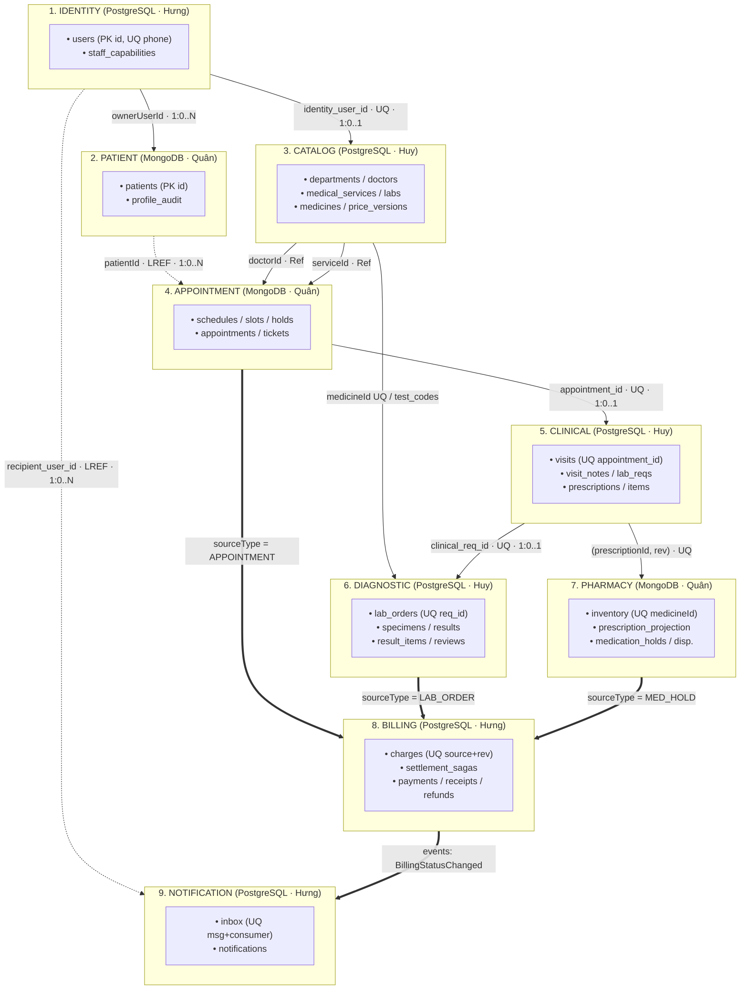
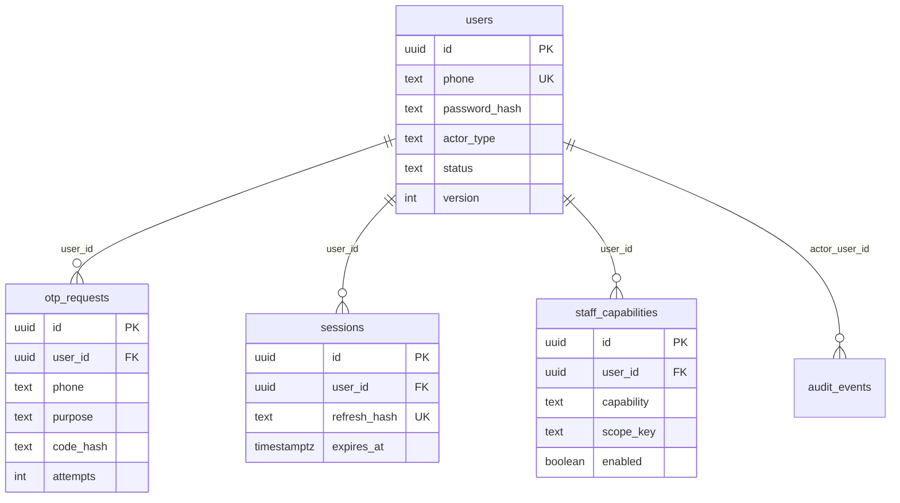
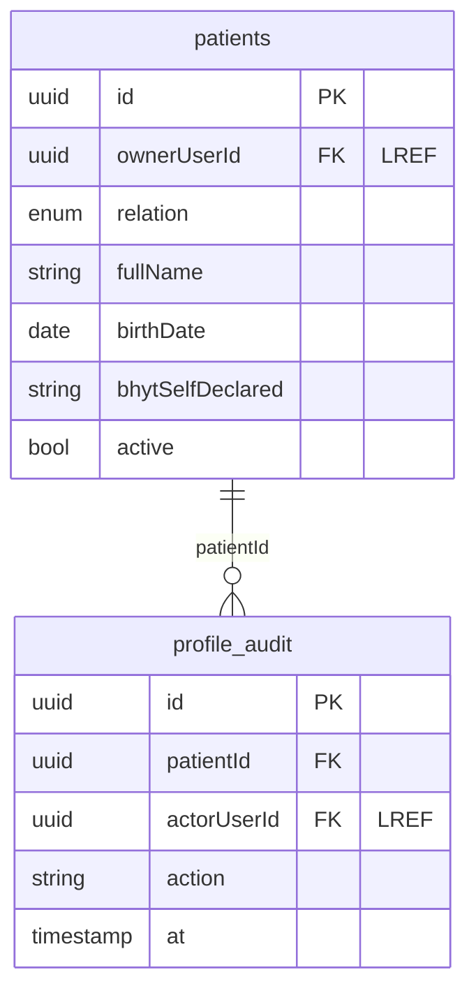
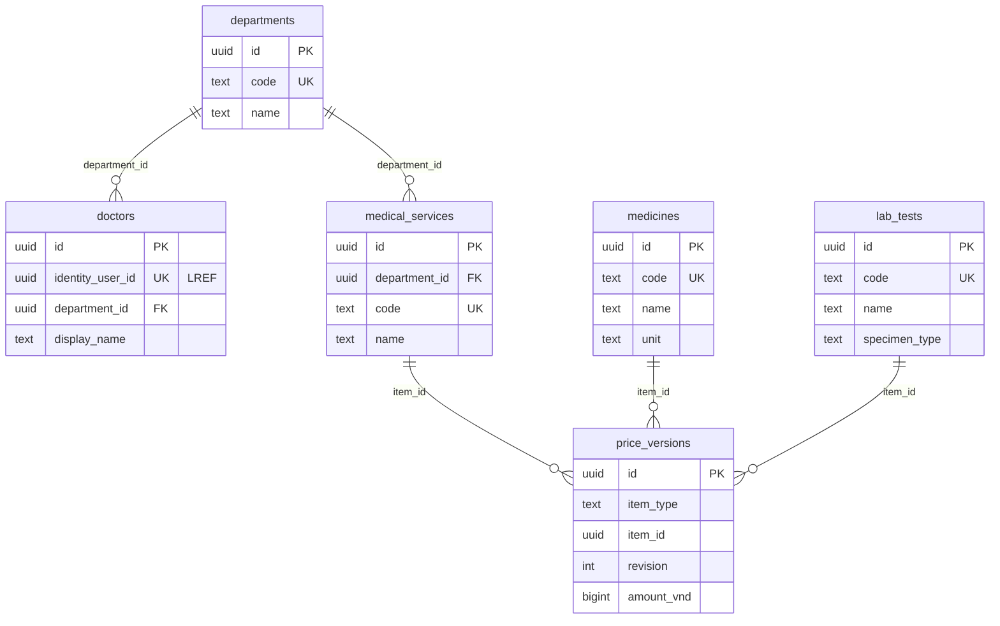
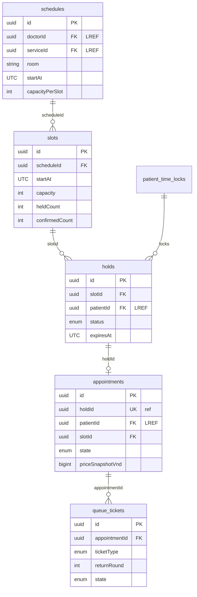
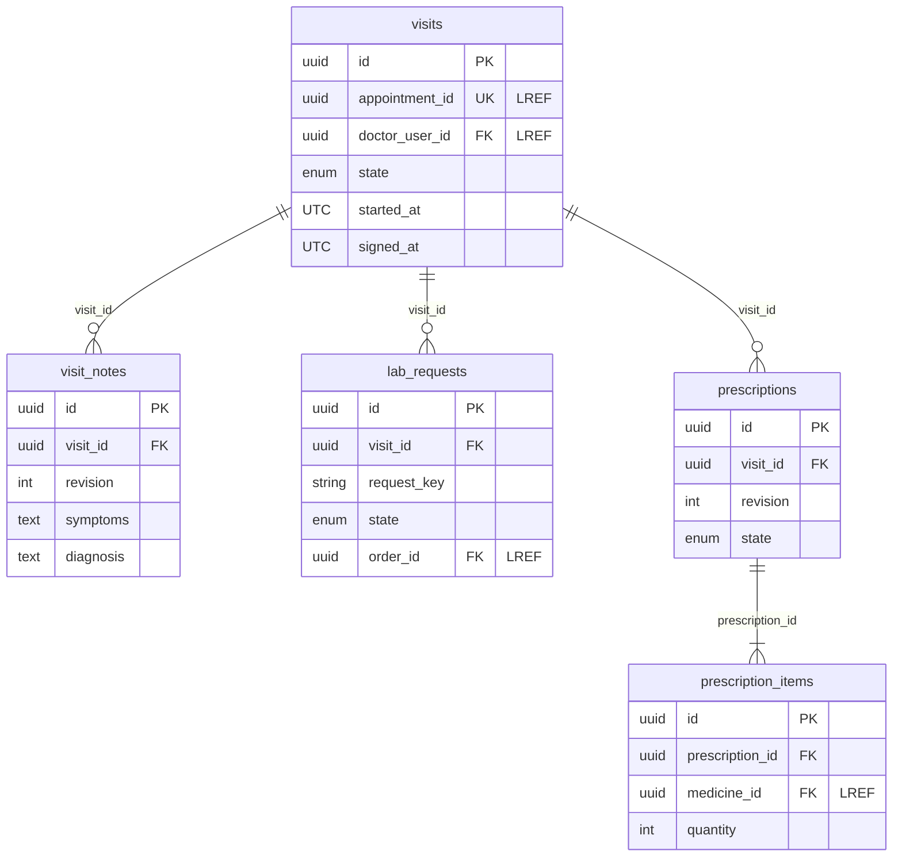
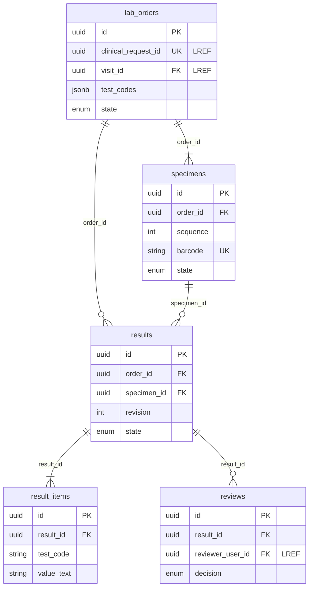
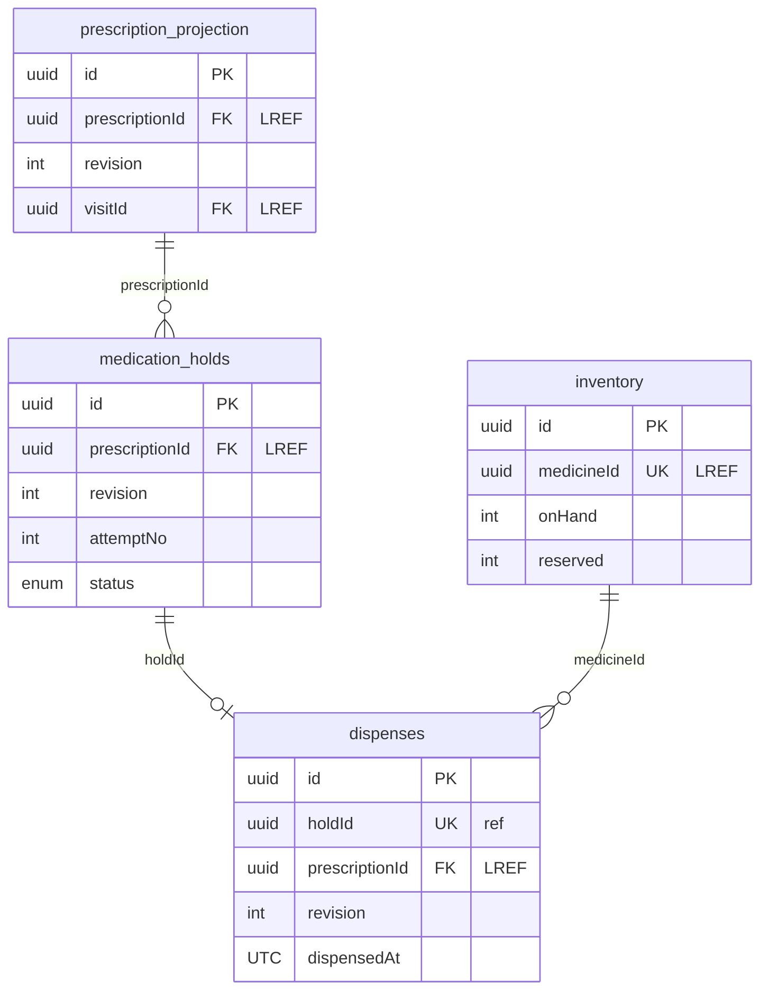
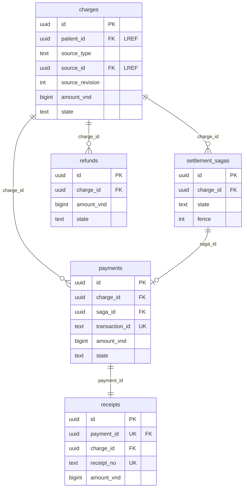
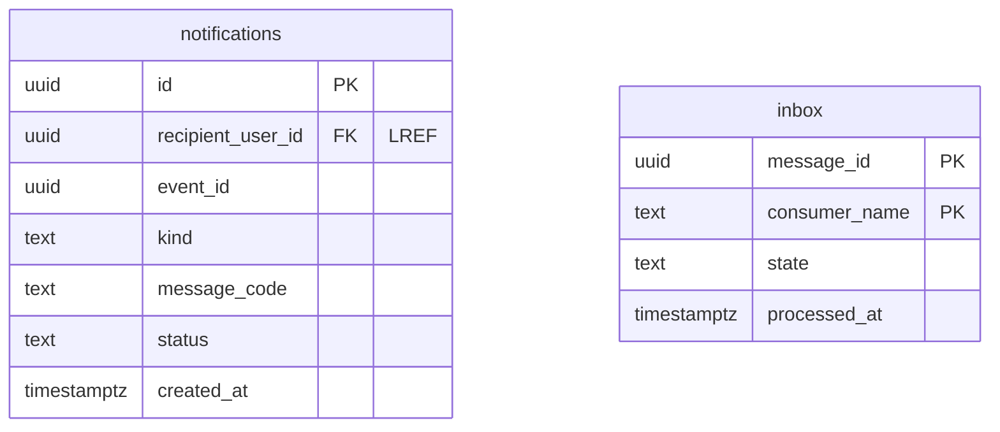

THIẾT KẾ CƠ SỞ DỮ LIỆU & SƠ ĐỒ ERD CHI TIẾT — HỆ THỐNG UMC CARE (v5.0)

**Phiên bản:** 5.0 (Đồng bộ BRD, SRS, UC, OpenAPI 86 & AsyncAPI 18 Events / 5 Commands ngày 17/10/2026)

**Mô hình phân công (3–3–3):**

**Hưng (Django · PostgreSQL):** Identity (identity\_db), Billing (billing\_db), Notification (notification\_db)

**Quân (Node.js/TS · MongoDB):** Patient (patient\_db), Appointment (appointment\_db), Pharmacy (pharmacy\_db)

**Huy (Go · PostgreSQL):** Catalog (catalog\_db), Clinical (clinical\_db), Diagnostic (diagnostic\_db)

# PHẦN 0: TỔNG QUAN KIẾN TRÚC DỮ LIỆU & LIÊN KẾT LOGIC XUYÊN SERVICE (LREF)

## 0.1. Nguyên tắc thiết kế cốt lõi

**Database-per-Service:** 6 database logic PostgreSQL và 3 database logic MongoDB (trên 1 Mongo Replica Set và 1 PostgreSQL instance phục vụ demo). Mỗi service dùng credential riêng và **chỉ có quyền ghi vào DB của mình**.

**Không FK / Không JOIN xuyên Service:** Mọi tham chiếu sang thực thể của service khác đều là **LREF (Logical Reference)** lưu dưới dạng UUID opaque. Việc kiểm tra quyền hoặc đồng bộ dữ liệu đọc được thực hiện qua **Local Projections** cập nhật từ 18 Integration Events và 5 Commands trên RabbitMQ.

**Định dạng chuẩn:** Khóa chính id kiểu uuid; thời gian lưu theo UTC (ngày nghiệp vụ tính theo Asia/Ho\_Chi\_Minh); tiền tệ kiểu số nguyên bigint / int64 (VND); kiểm soát đồng thời bằng version (Optimistic Concurrency) và SELECT FOR UPDATE / Mongo Transaction cho các thao tác giữ chỗ, trừ tồn, thu/hoàn tiền.

## 0.2. Sơ đồ Liên kết Logic xuyên Service (Cross-Service LREF & Event/Command Topology)

## 0.3. Bảng tổng hợp Liên kết Logic xuyên Service (Cross-Service LREF)

| **Liên kết logic (Nguồn → Đích)** | **Bội số** | **Khóa tham chiếu & Ràng buộc đồng bộ** |
| --- | --- | --- |
| Identity.users → Patient.patients | 1 : 0..N | ownerUserId (LREF); Patient phát PatientAccessChanged, các consumer giữ patient\_access\_projection. |
| Identity.users → Catalog.doctors | 1 : 0..1 | identity\_user\_id (UQ LREF); quyền/scope vẫn thuộc Identity. |
| Catalog.doctors / medical\_services → Appointment.schedules | 1 : 0..N | doctorId / serviceId (LREF); giữ snapshot trường cần hiển thị. |
| Catalog.medicines → Pharmacy.inventory | 1 : 0..1 | medicineId (UQ LREF); tồn kho thực tế chỉ lưu ở Pharmacy. |
| Catalog.lab\_tests → Diagnostic.lab\_orders | N : N | Qua test\_codes / test\_snapshot (lưu mã, đơn vị, khoảng tham chiếu, giá tại thời điểm chỉ định). |
| Patient.patients → Appointment.appointments | 1 : 0..N | patientId (LREF). |
| Appointment.appointments → Clinical.visits | 1 : 0..1 | appointment\_id (UQ LREF); lượt khám RETURN tiếp tục dùng cùng visitId. |
| Clinical.lab\_requests → Diagnostic.lab\_orders | 1 : 0..1 | clinical\_request\_id (UQ LREF); khi đang PENDING sẽ chặn ký kết luận Visit. |
| Clinical.visits → Diagnostic.lab\_orders | 1 : 0..N | visit\_id (LREF). |
| Clinical.prescriptions → Pharmacy.prescription\_projection | 1 : 0..1 | UQ(prescriptionId, revision) cho mỗi bản FINAL. |
| Appointment / Diagnostic / Pharmacy → Billing.charges | 1 : 0..1 | UQ(source\_type, source\_id, source\_revision); không tạo FK đa hình. |
| Identity.users → Notification.notifications | 1 : 0..N | recipient\_user\_id (LREF); tuyệt đối không dùng patientId làm userId. |

# PHẦN 1: CHI TIẾT ERD & TỪ ĐIỂN DỮ LIỆU CỦA 9 MICROSERVICES

## 1. Identity Service (identity\_db — PostgreSQL · Owner: Hưng · Django)

**Trách nhiệm:** Quản lý tài khoản (PATIENT, DOCTOR, STAFF), xác thực OTP 6 số, phiên đăng nhập (sessions), phân quyền nhân viên theo capability/scope (staff\_capabilities), cấp authorization lease ngắn hạn (tối đa 30s) và ghi nhật ký bảo mật (audit\_events).

### Sơ đồ ERD — Identity Service

### Từ điển dữ liệu — Identity Service

| **Bảng (Table)** | **Thuộc tính & Kiểu dữ liệu** | **Khóa, Chỉ mục & Quy tắc bất biến (Invariants)** |
| --- | --- | --- |
| users | id: uuid PK; phone: text UQ; password\_hash: text; actor\_type: text; status: text; phone\_verified\_at: timestamptz?; version: int; token\_version: int; access\_version: int | UQ(phone); CHECK actor\_type IN ('PATIENT','DOCTOR','STAFF'); chỉ tài khoản ACTIVE mới được tạo phiên. |
| otp\_requests | id: uuid PK; user\_id: uuid FK?; phone: text; purpose: text; code\_hash: text; expires\_at: timestamptz; used\_at: timestamptz?; attempts: int | FK user\_id -> users.id (khi có); INDEX(phone, purpose, expires\_at); giới hạn thử ≤ 5 lần trong transaction; job dọn dữ liệu quá hạn. |
| sessions | id: uuid PK; user\_id: uuid FK; refresh\_hash: text UQ; expires\_at: timestamptz; revoked\_at: timestamptz?; device\_id: text? | FK user\_id -> users.id; UQ(refresh\_hash); INDEX(user\_id, expires\_at). Đổi/reset mật khẩu thu hồi toàn bộ phiên cũ. |
| staff\_capabilities | id: uuid PK; user\_id: uuid FK; capability: text; scope\_key: text; enabled: boolean; assigned\_by: uuid FK; assigned\_at: timestamptz | FK user\_id, assigned\_by -> users.id; UQ(user\_id, capability, scope\_key); quyền ADMIN chỉ cấp cho tài khoản quản trị chỉ định. |
| audit\_events | id: uuid PK; actor\_user\_id: uuid FK?; action: text; target\_id: uuid? LREF; before\_after: jsonb?; correlation\_id: uuid; at: timestamptz | INDEX(actor\_user\_id, at); bảng bất biến (append-only), tuyệt đối không ghi mã OTP hoặc password hash vào log/audit. |
| **Bảng kỹ thuật** | outbox, inbox, idempotency\_records, retry\_jobs, dead\_letters | Phát sự kiện IdentityAccessChanged qua outbox trong cùng SQL transaction khi thay đổi quyền/trạng thái. |

## 2. Patient Service (patient\_db — MongoDB · Owner: Quân · Node.js/TS)

**Trách nhiệm:** Quản lý hồ sơ hành chính của bệnh nhân (bản thân SELF hoặc người thân OTHER), kiểm soát quyền sở hữu hồ sơ (ownerUserId) và lưu vết chỉnh sửa (profile\_audit).

### Sơ đồ ERD — Patient Service

### Từ điển dữ liệu — Patient Service

| **Collection** | **Thuộc tính & Kiểu dữ liệu** | **Khóa, Chỉ mục & Quy tắc bất biến (Invariants)** |
| --- | --- | --- |
| patients | id: uuid PK; ownerUserId: uuid LREF; relation: enum (SELF|OTHER); fullName: string; birthDate: date; sex: enum?; bhytSelfDeclared: string?; version: int; contactPhone: string?; address: string?; createdAt: UTC; updatedAt: UTC; active: bool; policyVersion: int | INDEX(ownerUserId); cấm tạo hồ sơ vô chủ. Tại quầy lễ tân đối chiếu user\_access\_projection hoặc account proof ký từ Identity (không gọi chuỗi HTTP Patient -> Identity). |
| profile\_audit | id: uuid PK; patientId: uuid ref; actorUserId: uuid LREF; action: string; changedFields: string[]; at: UTC | INDEX(patientId, at); chỉ ghi tên trường thay đổi, không lưu dữ liệu nhạy cảm nguyên bản. |
| **Collection kỹ thuật** | user\_access\_projection, outbox, inbox, idempotency\_records, retry\_jobs, dead\_letters | Phát PatientAccessChanged(patientId, ownerUserId, active, policyVersion) qua outbox để 5 services nghiệp vụ cập nhật projection quyền. |

## 3. Catalog Service (catalog\_db — PostgreSQL · Owner: Huy · Go)

**Trách nhiệm:** Quản lý danh mục dùng chung (khoa, hồ sơ nghề nghiệp bác sĩ, dịch vụ khám, thuốc, xét nghiệm) và bảng giá có hiệu lực theo thời gian (price\_versions).

### Sơ đồ ERD — Catalog Service

### Từ điển dữ liệu — Catalog Service

| **Bảng (Table)** | **Thuộc tính & Kiểu dữ liệu** | **Khóa, Chỉ mục & Quy tắc bất biến (Invariants)** |
| --- | --- | --- |
| departments | id: uuid PK; code: text UQ; name: text; status: text | UQ(code). |
| doctors | id: uuid PK; identity\_user\_id: uuid LREF UQ; department\_id: uuid FK; display\_name: text; status: text | FK department\_id -> departments.id; UQ(identity\_user\_id). Quyền đăng nhập/scope thuộc Identity. |
| medical\_services | id: uuid PK; department\_id: uuid FK; code: text UQ; name: text; status: text | FK department\_id -> departments.id; UQ(code). Giá lưu tại price\_versions. |
| medicines | id: uuid PK; code: text UQ; name: text; unit: text; strength: text?; form: text?; status: text | UQ(code). Chỉ chứa định nghĩa danh mục; tồn kho thực tế thuộc Pharmacy. |
| lab\_tests | id: uuid PK; code: text UQ; name: text; specimen\_type: text; unit: text?; reference\_range: text?; revision: int; status: text | UQ(code). Khi chỉ định LAB, snapshot mã, đơn vị và khoảng tham chiếu vào order. |
| price\_versions | id: uuid PK; item\_type: text (EXAM|LAB|MEDICINE); item\_id: uuid; revision: int; amount\_vnd: bigint; effective\_from: timestamptz; effective\_to: timestamptz?; created\_by: uuid LREF | UQ(item\_type, item\_id, revision); CHECK amount\_vnd >= 0; dùng khóa/advisory lock khi phát hành giá tương lai để chặn khoảng thời gian hiệu lực chồng lấn. |
| **Bảng kỹ thuật** | outbox, inbox, user\_access\_projection, idempotency\_records, retry\_jobs, dead\_letters | Phát CatalogChanged (UPSERT/TOMBSTONE và CHECKPOINT mỗi 10s kèm streamSequence). Cache Redis umc:catalog:v1:{generation}:{filterHash} TTL 60s. |

## 4. Appointment Service (appointment\_db — MongoDB · Owner: Quân · Node.js/TS)

**Trách nhiệm:** Quản lý lịch làm việc (schedules), chia khung giờ (slots), giữ chỗ nguyên tử 10 phút (holds), chống trùng giờ cùng hồ sơ (patient\_time\_locks), lịch hẹn (appointments) và hàng chờ vé khám (queue\_tickets).

### Sơ đồ ERD — Appointment Service

### Từ điển dữ liệu — Appointment Service

| **Collection** | **Thuộc tính & Kiểu dữ liệu** | **Khóa, Chỉ mục & Quy tắc bất biến (Invariants)** |
| --- | --- | --- |
| schedules | id: uuid PK; doctorId: uuid LREF; serviceId: uuid LREF; room: string; startAt: UTC; endAt: UTC; capacityPerSlot: int; status: enum; version: int; slotMinutes: int | INDEX(doctorId, startAt) chặn trùng ca bác sĩ; kiểm tra overlap (room, startAt); cấm giảm capacityPerSlot xuống dưới held + confirmed. slotMinutes được lưu từ AP-005/AP-006 để tái tạo slots nhất quán. |
| slots | id: uuid PK; scheduleId: uuid ref; startAt: UTC; endAt: UTC; capacity: int; heldCount: int; confirmedCount: int; version: int | UQ(scheduleId, startAt); bất biến heldCount + confirmedCount <= capacity. |
| holds | id: uuid PK; slotId: uuid ref; patientId: uuid LREF; status: enum (HELD|CONSUMED|RELEASED|EXPIRED); expiresAt: UTC; idempotencyKey: string; createdAt: UTC; priceSnapshot: object; consumedAt: UTC? | UQ(principalId, idempotencyKey); giữ chỗ 10 phút trong Mongo transaction; job trả chỗ khi hết hạn (Redis không phải nguồn giữ chỗ). |
| appointments | id: uuid PK; holdId: uuid ref UQ; patientId: uuid LREF; slotId: uuid ref; serviceId: uuid LREF; doctorId: uuid LREF; priceSnapshotVnd: int64; state: enum; version: int; slotHistory: object[]; chargeId: uuid LREF?; expiresAt: UTC; priceVersion: uuid LREF; settlementId: uuid?; settlementState: enum; settlementVersion: int | UQ(holdId). Đổi lịch giữ slot mới trước rồi mới nhả slot cũ trong cùng transaction. Chỉ chuyển CONFIRMED khi nhận ChargePaid/SettlementDecision đúng fence. |
| queue\_tickets | id: uuid PK; appointmentId: uuid ref; ticketType: FIRST|RETURN; visitId: uuid LREF?; returnRound: int; state: WAITING|CALLED|CLAIMED|NO\_SHOW|DONE; calledAt: UTC?; claimId: uuid?; claimedBy: uuid LREF?; noShowReason: string?; version: int | UQ(appointmentId, ticketType, returnRound); sparse UQ(claimId). FIRST có returnRound=0, RETURN có returnRound=1. Vắng mặt RETURN không đổi appointment thành NO\_SHOW. |
| patient\_time\_locks | patientId: uuid PK LREF; intervals: [{holdId, appointmentId?, startAt, endAt, state}]; version: int | 1 document / patient; cập nhật trong cùng Mongo transaction với slots khi giữ/đổi/nhả để chặn 1 hồ sơ đặt 2 lịch trùng khoảng [startAt, endAt). |
| **Collection kỹ thuật** | settlement\_decisions, command\_results, catalog\_projection, patient\_access\_projection, user\_access\_projection, projection\_checkpoints, outbox, inbox, idempotency\_records, retry\_jobs, dead\_letters | Nhận command ClaimQueueTicket (trả QueueTicketClaimed) và ReserveSettlement (khóa lịch SETTLEMENT\_LOCKED, tăng fence, trả SettlementReserved). |

## 5. Clinical Service (clinical\_db — PostgreSQL · Owner: Huy · Go)

**Trách nhiệm:** Quản lý lượt khám (visits), ghi chú khám bệnh nháp/ký cuối (visit\_notes), danh sách yêu cầu chỉ định xét nghiệm (lab\_requests) và kê toa thuốc (prescriptions, prescription\_items).

### Sơ đồ ERD — Clinical Service

### Từ điển dữ liệu — Clinical Service

| **Bảng (Table)** | **Thuộc tính & Kiểu dữ liệu** | **Khóa, Chỉ mục & Quy tắc bất biến (Invariants)** |
| --- | --- | --- |
| visits | id: uuid PK; appointment\_id: uuid LREF UQ; doctor\_user\_id: uuid LREF; state: enum; version: int; started\_at: UTC; signed\_at: UTC?; patient\_id: uuid LREF; department\_id: uuid LREF; return\_round: int; claim\_id: uuid LREF | UQ(appointment\_id) — mỗi lịch hẹn có tối đa 1 visit duy nhất; lượt quay lại RETURN sau xét nghiệm tiếp tục dùng cùng visit.id và không thu phí khám mới. |
| visit\_notes | id: uuid PK; visit\_id: uuid FK; revision: int; symptoms: text; findings: text; assessment: text; diagnosis: text; author\_user\_id: uuid LREF; saved\_at: UTC | FK visit\_id -> visits.id; UQ(visit\_id, revision). Bản nháp không hiển thị cho bệnh nhân. |
| prescriptions | id: uuid PK; visit\_id: uuid FK; revision: int; state: DRAFT|FINAL|DELETED; version: int; finalized\_at: UTC?; finalized\_by: uuid LREF? | FK visit\_id -> visits.id; UQ(visit\_id, revision). Chỉ được ký FINAL sau khi visit đã SIGNED; tối đa 1 bản FINAL hiệu lực và bất biến sau khi ký. |
| prescription\_items | id: uuid PK; prescription\_id: uuid FK; medicine\_id: uuid LREF; medicine\_code\_snapshot: string; name\_snapshot: string; dose\_text: string; quantity: int; instruction: text | FK prescription\_id -> prescriptions.id; CHECK quantity > 0. Toa FINAL bắt buộc có ít nhất 1 dòng thuốc. |
| lab\_requests | id: uuid PK; visit\_id: uuid FK; request\_key: string; request\_hash: string; state: PENDING|CREATED|FAILED; order\_id: uuid LREF?; test\_snapshot: jsonb; version: int; created\_at: UTC | FK visit\_id -> visits.id; UQ(visit\_id, request\_key). Ghi PENDING + outbox CreateLabOrder trong cùng transaction khóa visit. Còn PENDING hoặc order chưa PUBLISHED/CANCELLED thì **cấm ký Visit**. Trạng thái FAILED trong DB ánh xạ thành REJECTED trên LabOrderResolved và CL-003; timeout vẫn PENDING, không coi là FAILED. |
| **Bảng kỹ thuật** | start\_requests, lab\_status\_projection, catalog\_projection, patient\_access\_projection, user\_access\_projection, projection\_checkpoints, outbox, inbox, idempotency\_records, retry\_jobs, dead\_letters | start\_requests giữ trạng thái gọi ClaimQueueTicket; lab\_status\_projection theo dõi trạng thái order từ Diagnostic để mở RETURN\_READY và kiểm điều kiện ký. |

## 6. Diagnostic Service (diagnostic\_db — PostgreSQL · Owner: Huy · Go)

**Trách nhiệm:** Quản lý vòng đời xét nghiệm (LAB) từ lúc nhận command tạo order (lab\_orders), lấy mẫu/từ chối/lấy lại mẫu (specimens), nhập kết quả nháp (results, result\_items) đến bước duyệt công bố bởi người thứ hai (reviews).

### Sơ đồ ERD — Diagnostic Service

### Từ điển dữ liệu — Diagnostic Service

| **Bảng (Table)** | **Thuộc tính & Kiểu dữ liệu** | **Khóa, Chỉ mục & Quy tắc bất biến (Invariants)** |
| --- | --- | --- |
| lab\_orders | id: uuid PK; visit\_id: uuid LREF; test\_codes: jsonb; state: enum; charge\_id: uuid LREF?; created\_at: UTC; version: int; clinical\_request\_id: uuid LREF UQ; patient\_id: uuid LREF; test\_snapshot: jsonb; price\_snapshot: jsonb; settlement\_id: uuid?; settlement\_state: enum; settlement\_version: int | UQ(clinical\_request\_id). Chỉ tạo từ command CreateLabOrder của Clinical; ghi order + RequestCharge + LabOrderResolved trong cùng transaction với inbox. Chỉ được hủy trước khi có bất kỳ specimen nào. |
| specimens | id: uuid PK; order\_id: uuid FK; sequence: int; state: COLLECTED|REJECTED; barcode: string UQ; collected\_at: UTC; collected\_by: uuid LREF; reject\_reason: string?; version: int | FK order\_id -> lab\_orders.id; UQ(order\_id, sequence); UQ(barcode). Chỉ lấy mẫu khi order đã PAID (xác minh qua settlement\_decisions cục bộ). Mẫu lỗi REJECTED được lấy lại (recollect) tăng sequence trong cùng order, không thu phí lần 2. |
| results | id: uuid PK; order\_id: uuid FK; specimen\_id: uuid FK; revision: int; state: enum (DRAFT|REVIEW|REWORK|PUBLISHED); entered\_by: uuid LREF; submitted\_at: UTC?; published\_at: UTC?; version: int; contributor\_user\_ids: uuid[] | FK order\_id -> lab\_orders.id; FK specimen\_id -> specimens.id (phải cùng order\_id); UQ(order\_id, revision). Bản PUBLISHED là bất biến. |
| result\_items | id: uuid PK; result\_id: uuid FK; test\_code: string; value\_text: string; unit: string?; reference\_range: string?; flag: string? | FK result\_id -> results.id; UQ(result\_id, test\_code). |
| reviews | id: uuid PK; result\_id: uuid FK; reviewer\_user\_id: uuid LREF; decision: enum; reason: text?; reviewed\_at: UTC | FK result\_id -> results.id. **Quy tắc 2 người bắt buộc:** reviewer\_user\_id không được nằm trong mảng results.contributor\_user\_ids (trả 409 SELF\_REVIEW\_FORBIDDEN nếu vi phạm). |
| **Bảng kỹ thuật** | settlement\_decisions, command\_results, catalog\_projection, patient\_access\_projection, user\_access\_projection, projection\_checkpoints, outbox, inbox, idempotency\_records, retry\_jobs, dead\_letters | Lưu settlement\_decisions để đối chiếu fence trước khi lấy mẫu; phát LabResultPublished và LabCancelled. |

## 7. Pharmacy Service (pharmacy\_db — MongoDB · Owner: Quân · Node.js/TS)

**Trách nhiệm:** Quản lý tồn kho thực tế (inventory), phiếu nhập kho bổ sung (stock\_receipts), nhận bản chiếu toa thuốc cuối (prescription\_projection), giữ toàn bộ toa 15 phút (medication\_holds) và cấp phát thuốc một lần (dispenses).

### Sơ đồ ERD — Pharmacy Service

### Từ điển dữ liệu — Pharmacy Service

| **Collection** | **Thuộc tính & Kiểu dữ liệu** | **Khóa, Chỉ mục & Quy tắc bất biến (Invariants)** |
| --- | --- | --- |
| inventory | id: uuid PK; medicineId: uuid LREF UQ; onHand: int; reserved: int; version: int; updatedAt: UTC | UQ(medicineId); bất biến 0 <= reserved <= onHand. Mọi thao tác giữ/nhả/phát toàn toa phải chạy trong Mongo transaction. |
| stock\_receipts | id: uuid PK; receiptKey: string UQ; actorUserId: uuid LREF; items: [{medicineId, quantity, batchRef}]; receivedAt: UTC | UQ(receiptKey); quantity > 0; ghi receipt và tăng onHand trong cùng transaction. PH-002 nhận một medicineId/quantity/batchRef và lưu thành một phần tử items[]; receiptKey chống nhập lặp. |
| prescription\_projection | id: uuid PK; prescriptionId: uuid LREF; revision: int; visitId: uuid LREF; linesSnapshot: object[]; sourceEventId: uuid; patientId: uuid LREF | UQ(prescriptionId, revision) nhận từ sự kiện PrescriptionFinalized. Nhà thuốc không bao giờ cấp phát từ toa DRAFT. patientId lấy từ PrescriptionFinalized để PH-004 kiểm quyền PATIENT owner với patient\_access\_projection. |
| medication\_holds | id: uuid PK; prescriptionId: uuid LREF; revision: int; attemptNo: int; status: enum (HELD|SETTLEMENT\_LOCKED|COMMITTED|RELEASED|EXPIRED); itemsSnapshot: object[]; expiresAt: UTC; chargeId: uuid LREF?; version: int; attemptHistory: object[]; patientId: uuid LREF; settlementId: uuid?; settlementState: enum; settlementVersion: int | UQ(prescriptionId, revision). Giữ đủ toàn toa (thiếu 1 dòng thì không giữ dòng nào). Khi giữ lại sau khi nhả/hết hạn sẽ tăng attemptNo (tương ứng sourceRevision bên Billing). Khi đang SETTLEMENT\_LOCKED tuyệt đối không tự nhả tồn do timeout. |
| dispenses | id: uuid PK; holdId: uuid ref UQ; prescriptionId: uuid LREF; revision: int; actorUserId: uuid LREF; itemsSnapshot: object[]; dispensedAt: UTC; attemptNo: int | UQ(holdId); UQ(prescriptionId, revision). Cùng transaction giảm onHand, giảm reserved, ghi dispenses và phát MedicationDispensed. |
| **Collection kỹ thuật** | settlement\_decisions, command\_results, catalog\_projection, patient\_access\_projection, user\_access\_projection, projection\_checkpoints, outbox, inbox, idempotency\_records, retry\_jobs, dead\_letters | Kiểm tra bằng chứng thanh toán từ settlement\_decisions cục bộ đúng fence và attemptNo trước khi chuyển COMMITTED và phát thuốc. |

## 8. Billing Service (billing\_db — PostgreSQL · Owner: Hưng · Django)

**Trách nhiệm:** Quản lý khoản phải thu (charges), điều phối Saga thanh toán và đối soát fence (settlement\_sagas), ghi nhận giao dịch thanh toán (payments), phát hành biên nhận bất biến (receipts) và xử lý hoàn tiền có căn cứ (refunds).

### Sơ đồ ERD — Billing Service

### Từ điển dữ liệu — Billing Service

| **Bảng (Table)** | **Thuộc tính & Kiểu dữ liệu** | **Khóa, Chỉ mục & Quy tắc bất biến (Invariants)** |
| --- | --- | --- |
| charges | id: uuid PK; patient\_id: uuid LREF; source\_type: text; source\_id: uuid LREF; source\_revision: int; amount\_vnd: bigint; state: text (OPEN|PAID|VOID); price\_snapshot: jsonb; version: int; snapshot\_hash: text; settlement\_id: uuid?; settlement\_state: text; settlement\_saga\_id: uuid FK? | UQ(source\_type, source\_id, source\_revision); CHECK amount\_vnd >= 0. Tạo duy nhất qua handler RequestCharge và trả ChargePrepared. Không tự sửa giá lịch sử khi Catalog đổi giá. |
| settlement\_sagas | id: uuid PK; charge\_id: uuid FK; source\_type: text; source\_id: uuid; source\_revision: int; state: text (REQUESTED|RESERVED|IN\_DOUBT|SUCCEEDED|FAILED); fence: int?; amount\_hash: text; decision\_version: int; deadline\_at: timestamptz; version: int | Partial UQ(charge\_id) với trạng thái chưa terminal (mỗi charge chỉ có tối đa 1 saga đang hoạt động). Quá 60s chưa có phản hồi chuyển IN\_DOUBT (không tự động chuyển FAILED chỉ vì timeout). |
| payments | id: uuid PK; charge\_id: uuid FK; saga\_id: uuid FK UQ; transaction\_id: text UQ; amount\_vnd: bigint; state: text (PENDING|SUCCEEDED|FAILED); method: text; attempted\_at: timestamptz; paid\_at: timestamptz?; source\_revision: int; settlement\_id: uuid; idempotency\_key: text; fence: int | FK charge\_id -> charges.id; FK saga\_id -> settlement\_sagas.id; UQ(transaction\_id); Partial UQ(charge\_id) WHERE state = 'SUCCEEDED'. Chỉ chuyển SUCCEEDED sau khi nhận SettlementReserved(ACCEPTED) kèm fence hợp lệ. |
| receipts | id: uuid PK; payment\_id: uuid FK UQ; charge\_id: uuid FK; receipt\_no: text UQ; amount\_vnd: bigint; issued\_at: timestamptz | FK payment\_id -> payments.id; FK charge\_id -> charges.id; UQ(payment\_id), UQ(receipt\_no). Ghi cùng SQL transaction với payment SUCCEEDED và outbox; bất biến sau khi cấp. |
| refunds | id: uuid PK; charge\_id: uuid FK; cancellation\_id: uuid LREF; reason\_code: text; amount\_vnd: bigint; state: text (REQUESTED|SUCCEEDED|FAILED); attempts: jsonb; version: int; updated\_at: timestamptz | FK charge\_id -> charges.id; UQ(charge\_id, cancellation\_id, reason\_code). Dùng SELECT FOR UPDATE trên charge khi thực thi hoàn để bảo đảm tổng tiền hoàn thành công ≤ số tiền đã thu. |
| **Bảng kỹ thuật** | command\_results, catalog\_projection, patient\_access\_projection, user\_access\_projection, projection\_checkpoints, outbox, inbox, idempotency\_records, retry\_jobs, dead\_letters | Phát ReserveSettlement (command) và các events ChargePrepared, ChargePaid, BillingStatusChanged, SettlementDecision. |

## 9. Notification Service (notification\_db — PostgreSQL · Owner: Hưng · Django)

**Trách nhiệm:** Hộp thư thông báo trong ứng dụng cho cả 3 actor (PATIENT, DOCTOR, STAFF), tiêu thụ sự kiện một lần qua inbox và tuyệt đối không lưu trữ dữ liệu bệnh án nhạy cảm.

### Sơ đồ ERD — Notification Service

### Từ điển dữ liệu — Notification Service

| **Bảng (Table)** | **Thuộc tính & Kiểu dữ liệu** | **Khóa, Chỉ mục & Quy tắc bất biến (Invariants)** |
| --- | --- | --- |
| notifications | id: uuid PK; recipient\_user\_id: uuid LREF; event\_id: uuid; kind: text; subject\_ref: text; message\_code: text; created\_at: timestamptz; read\_at: timestamptz?; source\_aggregate\_id: uuid; source\_version: int | UQ(recipient\_user\_id, event\_id, kind); INDEX(recipient\_user\_id, created\_at DESC). Ghi cùng SQL transaction với inbox; chỉ lưu mã thông điệp (message\_code) và ID tham chiếu, không sao chép chẩn đoán, kết quả xét nghiệm hay tên thuốc. |
| inbox | message\_id: uuid; consumer\_name: text; command\_id: uuid?; payload\_hash: text; state: text (PROCESSED|RETRY\_SCHEDULED); outcome\_ref: text?; processed\_at: timestamptz | UQ(message\_id, consumer\_name) chống xử lý lặp mọi bản tin từ AppointmentChanged, LabResultPublished, MedicationDispensed, BillingStatusChanged. |
| **Bảng kỹ thuật** | user\_access\_projection, idempotency\_records, retry\_jobs, dead\_letters | Không có bảng outbox nghiệp vụ vì Notification là consumer cuối. |

# PHẦN 2: TỔNG HỢP CÁC BẢNG KĨ THUẬT BẤT ĐỒNG BỘ (TECHNICAL TABLES & PROJECTIONS)

Để đảm bảo tính đúng đắn của kiến trúc hướng sự kiện (At-least-once delivery, Idempotent consumer, Transactional Outbox và Saga Fence), các bảng/collection kỹ thuật dưới đây được đặt trực tiếp trong DB của từng service sở hữu:

| **Thực thể kỹ thuật** | **Service sở hữu (Owner)** | **Khóa chính / Unique & Quy tắc vận hành cốt lõi** |
| --- | --- | --- |
| outbox | 8 Services (trừ Notification) | PK(message\_id). Ghi cùng local transaction với state nghiệp vụ. Publisher claim theo lease, dùng delivery\_mode=2, mandatory=true và publisher confirms; chỉ đánh dấu PUBLISHED khi được broker confirm và không bị return. Giữ tối thiểu ≥ 7 ngày trong demo. |
| inbox | Cả 9 Services | UQ(message\_id, consumer\_name). Ghi inbox + cập nhật state + ghi response outbox trong cùng transaction trước khi gửi basic.ack. Chống lặp cho cả trường hợp redelivered=false (publisher phát lại). |
| command\_results | Billing, Diagnostic, Appointment, Pharmacy | PK(command\_id). Lưu kết quả xử lý của 5 commands (RequestCharge, CreateLabOrder, ClaimQueueTicket, ReserveSettlement, QuerySettlement). Nếu trùng key nhưng khác request\_hash → trả conflict; nếu trùng hoàn toàn → phát lại response cũ. |
| retry\_jobs & dead\_letters | Cả 9 Services | UQ(message\_id, handler\_name). Lỗi tạm thời được lập lịch thử lại bền vững trong DB (3 lần: 5s, 15s, 60s + jitter) kèm trạng thái inbox = RETRY\_SCHEDULED trước khi ack message gốc. Quá 3 lần hoặc lỗi schema/producer → chuyển vào dead\_letters (DLQ). |
| idempotency\_records | Cả 9 Services (HTTP Write) | UQ(principal\_id, route, key). Lưu request\_hash và response\_ref tối thiểu ≥ 24h cho mọi lệnh POST/PUT/PATCH/DELETE có Idempotency-Key. |
| settlement\_sagas & settlement\_decisions | Billing (sagas) & Appt/Diag/Pharm (decisions) | Bảo vệ giao dịch thu tiền hai pha qua RabbitMQ. Nếu SettlementDecision(FAILED) đến trước ReserveSettlement, owner ghi ngay **tombstone FAILED** vào settlement\_decisions để chặn lệnh reserve đến muộn khóa lại nguồn. Trạng thái UNKNOWN không bao giờ tự mở khóa SETTLEMENT\_LOCKED. |
| user\_access\_projection & patient\_access\_projection | Các Consumer Services | Đồng bộ từ IdentityAccessChanged và PatientAccessChanged. Kiểm tra quyền cục bộ kết hợp với Authorization Lease (hạn tối đa 30s) mà không cần gọi HTTP chéo về Identity hay Patient. |
| catalog\_projection & projection\_checkpoints | Appt, Clin, Diag, Pharm, Bill | UQ(entity\_type, entity\_id) và UQ(producer, stream\_id). Theo dõi CHECKPOINT mỗi 10s từ Catalog; nếu phát hiện gap hoặc checkpoint trễ quá 30s thì chặn tạo báo giá mới bằng mã lỗi 503 PRICE\_PROJECTION\_STALE. |