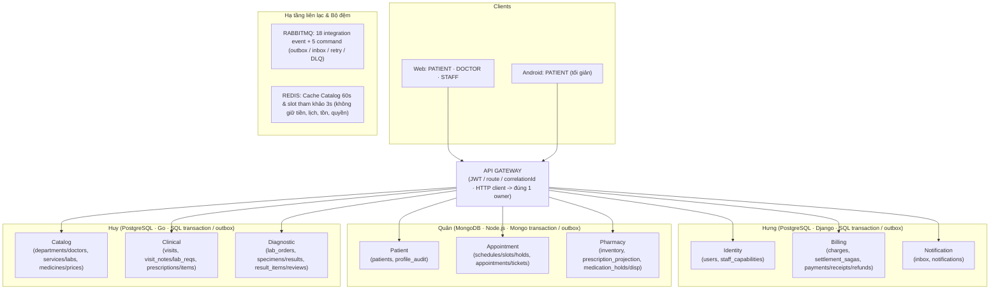
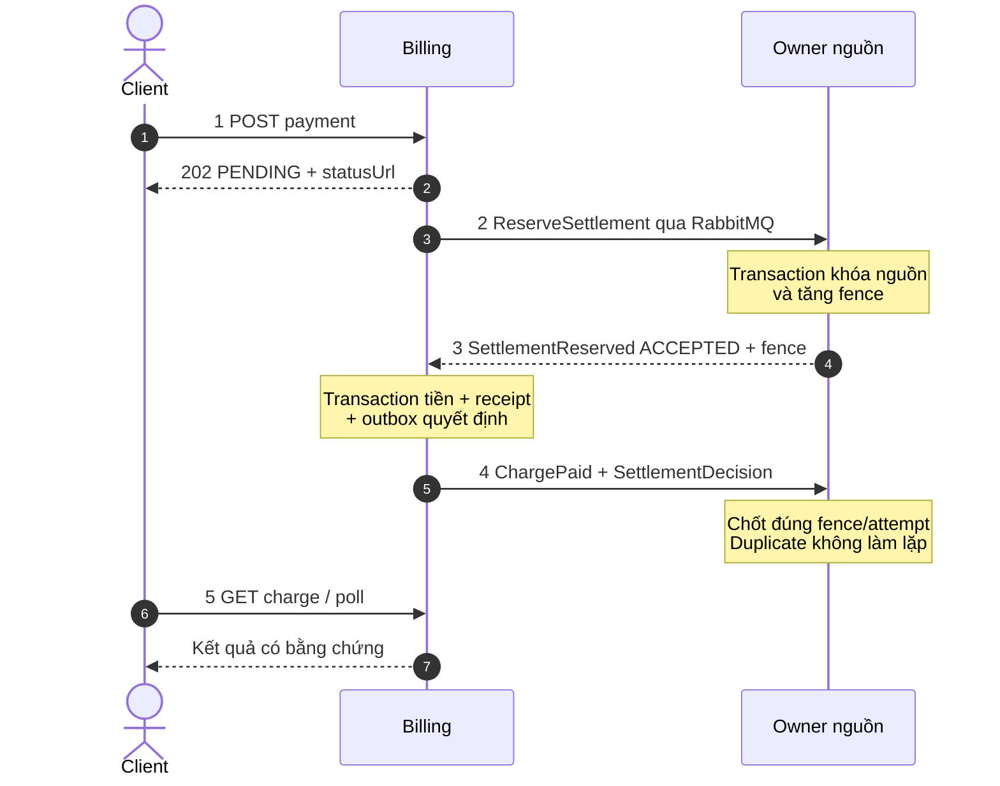

UMC Care SRS

Đặc tả yêu cầu phần mềm và hợp đồng triển khai · nhóm ba người

| **Thông tin** | **Giá trị** |
| --- | --- |
| **Phiên bản** | 5.0 · bản chốt nghiệp vụ nhóm ba người |
| **Ngày lập** | 17/10/2026 |
| **Nhóm thực hiện** | Huy · Quân · Hưng (3 người, 20–24 giờ/người/tuần) |
| **Hạn nộp** | 23/11/2026 |
| **Bối cảnh** | Đồ án mô phỏng hệ thống khám ngoại trú; không kết nối bệnh viện thật |

Tài liệu này hiện thực hóa BRD 5.0 ngày 17/10/2026. Đây là baseline để chia việc, viết API, giao diện và kiểm thử; các trạng thái/điều kiện dưới đây là contract của demo, không mô tả bệnh viện đang vận hành. API liệt kê ở phụ lục là mục tiêu thiết kế, không phải tuyên bố đã lập trình xong.

# 1 Mục đích, phạm vi và cấu hình

| **Thuộc tính** | **Quyết định** |
| --- | --- |
| **Phạm vi** | Web đủ ba actor (bệnh nhân, bác sĩ, nhân viên bệnh viện); Android bệnh nhân gọn nhưng hoàn chỉnh các thao tác chính. |
| **Kiến trúc** | Gateway → 9 service có DB riêng; client dùng HTTP; liên service dùng 18 event/5 command RabbitMQ, outbox/inbox và projection. Redis cache tùy chọn cho đọc; Compose cho demo. |
| **Công nghệ** | Node.js/TypeScript: Patient, Appointment, Pharmacy. Django: Identity, Billing, Notification. Go: Catalog, Clinical, Diagnostic. |
| **Dữ liệu** | Ba MongoDB logic và sáu PostgreSQL logic. Mỗi service chỉ ghi DB của mình; ID liên dịch vụ là opaque string. |
| **Đích API** | 86 operation HTTP: 83 endpoint client/tác vụ và 3 adapter phục hồi IA-014 DI-001 BI-001. Loại 10 IN-01..IN-10 của bản 3.0; health/metrics/job không tính. 18 event và 5 command tính riêng. |
| **Chủ phần** | Huy: Catalog Clinical Diagnostic; Quân: Patient Appointment Pharmacy; Hưng: Identity Billing Notification. Mỗi người 3 service; review và E2E chung. |

# 2 Kiến trúc và actor
 

Sơ đồ 9 service theo owner 3–3–3: Patient, Appointment và Pharmacy dùng MongoDB; sáu service còn lại dùng PostgreSQL. Web phục vụ ba actor, Android phục vụ PATIENT. RabbitMQ mang 18 event và 5 command; Redis chỉ cache Catalog và slot tham khảo của Appointment.

Gateway kiểm token, route và correlationId; owner quyết định quyền tài nguyên từ dữ liệu cục bộ. Request không gọi chuỗi service. Dữ liệu cần từ owner khác được nhân bản tối thiểu qua event; hành động xuyên service ghi outbox rồi trả 202 và client poll. Redis chỉ cache đọc, không thay quyền hay transaction. [S1] PDF 50–51, 65–66; [S2] slide 30–31, 40.

Có đúng ba actor: PATIENT (web/Android), DOCTOR (web), STAFF (web). STAFF là nhóm tài khoản; một tài khoản nhân viên demo chính có thể được cấp RECEPTION, LAB\_TECH, LAB\_REVIEW, PHARMACY, CASHIER và ADMIN theo phạm vi. Service owner vẫn kiểm quyền từng API. Quy tắc hai người vẫn bắt buộc: tài khoản đã nhập hoặc sửa một revision kết quả LAB không được duyệt chính revision đó; seed thêm tài khoản STAFF LAB thứ hai để duyệt. ADMIN chỉ cấp cho tài khoản quản trị chỉ định.

| **Capability của STAFF** | **Phạm vi chức năng** |
| --- | --- |
| **RECEPTION** | Hồ sơ tại quầy; đặt hộ; check-in; vé/gọi/vắng mặt. |
| **LAB\_TECH** | Nhận order đủ phí; lấy/từ chối/lấy lại mẫu; nhập kết quả nháp. |
| **LAB\_REVIEW** | Xem kết quả chờ duyệt; trả sửa, duyệt và công bố; không tự duyệt bản đã nhập. |
| **PHARMACY** | Tồn/nhập thuốc; giữ/nhả toàn toa; commit và phát thuốc. |
| **CASHIER** | Khoản phải thu; thu tại quầy; biên nhận; hoàn theo căn cứ. |
| **ADMIN** | Ca/phòng/capacity/giá; quyền tài khoản STAFF; báo cáo và audit. |

# 3 Yêu cầu chức năng

Mỗi FR là điều kiện bắt buộc kiểm thử được. Mã BR trỏ tới BRD cùng phiên bản. Service owner chịu trách nhiệm API/dữ liệu; client owner chịu trách nhiệm màn hình tương ứng.

## Identity · Hưng

| **FR** | **Hành vi cần triển khai** | **BR** |
| --- | --- | --- |
| **FR-01** | Đăng ký số điện thoại, tạo OTP REGISTER và gửi qua adapter SMS giả lập vào hộp thư demo chỉ mở localhost; xác minh rồi kích hoạt tài khoản. | BR-01 |
| **FR-02** | Gửi lại OTP có giới hạn; OTP sai/hết hạn/đã dùng trả mã lỗi ổn định và không tiết lộ tài khoản. | BR-01 |
| **FR-03** | Đăng nhập, refresh, logout; reset bằng OTP và đổi mật khẩu thu hồi phiên cũ. | BR-02 |
| **FR-05** | Cấp capability cho tài khoản STAFF theo tác vụ/khoa; chỉ STAFF[ADMIN] có quyền thay đổi. | BR-04,BR-30 |

## Patient · Quân

| **FR** | **Hành vi cần triển khai** | **BR** |
| --- | --- | --- |
| **FR-04** | Patient CRUD hồ sơ, kiểm owner cục bộ; lễ tân tạo hộ dựa account projection hoặc account proof ký từ Identity, không gọi HTTP Identity trong request và không tạo hồ sơ vô chủ. | BR-03,BR-04 |

## Catalog của Huy và Appointment của Quân

FR-06 và FR-07 phân công theo owner dưới đây; các FR lịch còn lại thuộc Appointment.

| **FR** | **Owner** | **Hành vi** | **BR** |
| --- | --- | --- | --- |
| FR-06 | Catalog và Appointment | Catalog trả khoa/bác sĩ/dịch vụ/giá/thuốc/xét nghiệm công khai có lọc trường; Appointment trả slot trống; không lẫn danh mục với tồn kho. | BR-05 |
| FR-07 | Catalog và Appointment | ADMIN quản lý ca/phòng/capacity ở Appointment, giá hiệu lực ở Catalog; snapshot giá lịch sử không bị sửa. | BR-06 |
| FR-08 | Appointment | Tạo slot hold 10 phút bằng cập nhật nguyên tử với capacity và chống trùng hồ sơ/giờ. | BR-07,BR-08 |
| FR-09 | Appointment | Tạo appointment và outbox RequestCharge cục bộ, trả 202; ChargePrepared cập nhật phiếu; ChargePaid đúng fence mới CONFIRMED. | BR-07,BR-25 |
| FR-10 | Appointment | Hết hạn hold/phiếu chờ thu phải giải phóng chỗ idempotent; lịch bệnh nhân có trạng thái phí. | BR-08,BR-09 |
| FR-11 | Appointment | Đổi lịch giữ slot mới trước, kiểm điều kiện cùng bác sĩ/giá, commit rồi nhả slot cũ. | BR-10 |
| FR-12 | Appointment | Hủy lịch hợp lệ, ghi lý do, phát căn cứ hoàn và trả slot; không tự đánh dấu REFUNDED. | BR-11 |
| FR-13 | Appointment | Lễ tân tìm/tạo hồ sơ gắn tài khoản đã xác minh và đặt lịch hộ qua cùng hold/appointment API; không tạo hồ sơ vô chủ. | BR-12 |
| FR-14 | Appointment | Check-in duy nhất cấp FIRST; call-next FIRST/RETURN; Clinical claim vé nguyên tử. VisitReturnReady tạo RETURN duy nhất, VisitSigned chuyển lịch COMPLETED; vắng RETURN không đổi lịch thành NO\_SHOW. | BR-13 |

## Clinical · Huy

| **FR** | **Hành vi cần triển khai** | **BR** |
| --- | --- | --- |
| **FR-15** | CL-002 ghi start\_requests PENDING + ClaimQueueTicket, trả 202; QueueTicketClaimed tạo visit duy nhất từ FIRST hoặc tiếp tục RETURN, lưu nháp bằng version. | BR-14 |
| **FR-16** | Clinical lưu lab\_requests PENDING + CreateLabOrder trong transaction; LabOrderResolved gắn orderId hoặc từ chối có căn cứ; pending cấm ký, timeout không gọi HTTP chuỗi. | BR-15 |
| **FR-17** | Khi mọi LAB PUBLISHED/CANCELLED hợp lệ, visit thành RETURN\_READY; call-next RETURN dẫn về chính visit đó. | BR-20 |
| **FR-18** | Chỉ ký visit khi mọi LAB PUBLISHED hoặc CANCELLED; bản ký có version/thời gian/người ký. | BR-21 |
| **FR-19** | Tạo/sửa/xóa prescription DRAFT; sau khi visit SIGNED mới ký toa FINAL có revision, chặn sửa trực tiếp bản FINAL. | BR-22 |

## Diagnostic · Huy

| **FR** | **Hành vi cần triển khai** | **BR** |
| --- | --- | --- |
| **FR-20** | POST specimens kiểm order PAID và payment projection đúng settlement/fence cục bộ rồi tạo mẫu COLLECTED; chưa nhận bằng chứng thì PENDING\_SYNC, không gọi Billing trong HTTP. | BR-16 |
| **FR-21** | Specimen REJECTED có lý do; POST recollect tạo sequence mới trong cùng order, không thu thêm LAB. | BR-17 |
| **FR-22** | KTV nhập/sửa DRAFT, gửi review; reviewer khác người nhập trả sửa hoặc duyệt và PUBLISHED trong một lệnh. | BR-18 |
| **FR-23** | Chỉ hủy order trước bất kỳ specimen/thực hiện; trả căn cứ void/refund cho Billing. | BR-19 |

## Pharmacy · Quân

| **FR** | **Hành vi cần triển khai** | **BR** |
| --- | --- | --- |
| **FR-24** | Nhận PrescriptionFinalized theo sourceId/revision; hàng chờ và chi tiết toa FINAL theo quyền; nhập bổ sung tồn có audit. | BR-23 |
| **FR-25** | Giữ đủ toàn toa bằng thao tác nguyên tử; thiếu một dòng trả danh sách thiếu và không trừ tồn. | BR-23 |
| **FR-26** | Hold 15 phút; chỉ HELD được nhả/expire; SETTLEMENT\_LOCKED chờ kết quả Billing, không tự mở khóa. Giữ lại tăng attemptNo và tạo charge revision mới. | BR-24 |
| **FR-27** | Consumer ChargePaid/SettlementDecision chốt COMMITTED đúng attempt/fence. PH-007 chỉ chạy reconcile cục bộ; phát chỉ sau bằng chứng PAID đã đồng bộ. | BR-24 |

## Billing và Notification · Hưng

| **FR** | **Owner** | **Hành vi** | **BR** |
| --- | --- | --- | --- |
| FR-28 | Billing | RequestCharge tạo duy nhất charge theo sourceType/sourceId/sourceRevision, snapshot và inbox/outbox ChargePrepared nguyên tử; không cần HTTP BI-001 trong luồng chuẩn. | BR-25 |
| FR-29 | Billing | Payment API trả 202 với PENDING, ghi settlement saga + ReserveSettlement. Chỉ sau SettlementReserved ACCEPTED đúng fence mới ghi SUCCEEDED, PAID, receipt và events trong một transaction. | BR-26 |
| FR-30 | Billing | Consumer AppointmentChanged(CANCELLED/EXPIRED/EXPIRED\_LATE\_PAID)/LabCancelled void charge OPEN hoặc tạo refund REQUESTED khi đã thu; thu ngân thực hiện hoàn và theo dõi REQUESTED/SUCCEEDED/FAILED. | BR-27 |
| FR-31 | Notification | Notification tiêu thụ AppointmentChanged, LabResultPublished, MedicationDispensed và BillingStatusChanged; ghi inbox + notifications nguyên tử, không lưu chi tiết y tế. | BR-28 |
| FR-32 | Billing | Billing trả hàng chờ thu/hoàn và summary tiền; Appointment trả summary lịch; PH-004 cung cấp trạng thái cấp thuốc tối thiểu cho PATIENT owner. | BR-29,BR-34 |

## Ứng dụng và vận hành · Cả nhóm

| **FR** | **Hành vi cần triển khai** | **BR** |
| --- | --- | --- |
| **FR-33** | Web bệnh nhân xem các bản visit, LAB PUBLISHED, toa FINAL, tiền và thông báo đúng hồ sơ. | BR-29 |
| **FR-34** | Web có đúng ba actor; menu STAFF lọc theo capability; mọi ghi dữ liệu đi qua Gateway. | BR-31 |
| **FR-35** | Android bệnh nhân thực hiện tài khoản, tra cứu/đặt/đổi/hủy, tiền và xem bản công bố. | BR-32 |
| **FR-36** | Hai client phản ánh cùng trạng thái server; pending/retry/error không tự suy đoán thành công. | BR-33 |
| **FR-37** | STAFF[ADMIN] xem audit quyền/đăng nhập tại Identity và hai summary Appointment/Billing theo ngày; không lộ dữ liệu nhạy cảm. | BR-30,BR-34 |

# 4 Use case và luồng ngoại lệ

Các use case dùng cùng một nguồn trạng thái server. Điều kiện tiên quyết thất bại phải trả 4xx có error code; lỗi dependency tạo pending/retry, không giả thành công. Client gửi Idempotency-Key cho lệnh tiền, giữ chỗ, phát thuốc và chuyển trạng thái nhạy cảm.

## UC-01 · Tài khoản và hồ sơ

| **Trường** | **Đặc tả** |
| --- | --- |
| **Tác nhân** | Bệnh nhân |
| **Tiền điều kiện** | Chưa có tài khoản hoặc có phiên hợp lệ |
| **Luồng chính** | REGISTER → OTP → login → tạo hồ sơ; reset/đổi mật khẩu theo quyền |
| **Ngoại lệ / hậu điều kiện** | OTP sai/hết hạn/replay; tài khoản trùng; hồ sơ không thuộc owner → 403 |
| **Truy vết** | FR-01..05; BAC-01,BAC-02 |

## UC-02 · Tra cứu và đặt lịch

| **Trường** | **Đặc tả** |
| --- | --- |
| **Tác nhân** | Bệnh nhân/Nhân viên bệnh viện |
| **Tiền điều kiện** | Slot khả dụng, hồ sơ hợp lệ; STAFF cần RECEPTION |
| **Luồng chính** | Tra cứu → hold → appointment chờ tiền → charge → thanh toán → CONFIRMED |
| **Ngoại lệ / hậu điều kiện** | Hết slot/hold hết hạn; payment retry; người khác chiếm slot cuối |
| **Truy vết** | FR-06..10,FR-13; BAC-03 |

## UC-03 · Đổi lịch

| **Trường** | **Đặc tả** |
| --- | --- |
| **Tác nhân** | Bệnh nhân |
| **Tiền điều kiện** | Lịch CONFIRMED, chưa check-in, trước giờ ≥2h |
| **Luồng chính** | Chọn slot cùng bác sĩ/giá → giữ mới → cập nhật appointment → nhả cũ |
| **Ngoại lệ / hậu điều kiện** | Không đủ chỗ/timeout → lịch cũ còn hiệu lực; khác giá → hủy và đặt mới |
| **Truy vết** | FR-11; BAC-04 |

## UC-04 · Hủy lịch và hoàn

| **Trường** | **Đặc tả** |
| --- | --- |
| **Tác nhân** | Bệnh nhân/Nhân viên bệnh viện |
| **Tiền điều kiện** | Lịch đủ điều kiện hủy; STAFF cần CASHIER để xử lý hoàn |
| **Luồng chính** | Ghi lý do → CANCELLED → trả slot → refund REQUESTED → SUCCEEDED/FAILED |
| **Ngoại lệ / hậu điều kiện** | Chưa thu → void charge; đã check-in/quá hạn → 409; refund lỗi → theo dõi lại |
| **Truy vết** | FR-12,FR-30; BAC-04 |

## UC-05 · Tiếp nhận và hàng chờ

| **Trường** | **Đặc tả** |
| --- | --- |
| **Tác nhân** | Nhân viên bệnh viện/Bác sĩ |
| **Tiền điều kiện** | CONFIRMED và đủ phí, đúng ngày; STAFF cần RECEPTION |
| **Luồng chính** | Xác minh → CHECKED\_IN → vé FIRST → gọi → visit IN\_PROGRESS |
| **Ngoại lệ / hậu điều kiện** | Check-in trùng → trả vé cũ; vắng mặt có lý do; lịch hủy → từ chối |
| **Truy vết** | FR-14,FR-15; BAC-05 |

## UC-06 · Khám không LAB

| **Trường** | **Đặc tả** |
| --- | --- |
| **Tác nhân** | Bác sĩ |
| **Tiền điều kiện** | Visit IN\_PROGRESS |
| **Luồng chính** | Ghi khám → toa DRAFT sửa/xóa → ký visit → ký toa FINAL → xem hồ sơ |
| **Ngoại lệ / hậu điều kiện** | Ký hai lần → trả bản cuối; toa FINAL không sửa; phiên bác sĩ khác khoa → 403 |
| **Truy vết** | FR-15,FR-18,FR-19,FR-33; BAC-06 |

## UC-07 · Khám có LAB

| **Trường** | **Đặc tả** |
| --- | --- |
| **Tác nhân** | Bác sĩ/Nhân viên bệnh viện |
| **Tiền điều kiện** | Visit IN\_PROGRESS; STAFF có LAB\_TECH hoặc LAB\_REVIEW theo bước |
| **Luồng chính** | Order → phí LAB PAID → specimen → DRAFT → review → PUBLISHED → RETURN → ký |
| **Ngoại lệ / hậu điều kiện** | Người nhập không tự duyệt; mẫu REJECTED → recollect; nháp không hiện bệnh nhân |
| **Truy vết** | FR-16,FR-17,FR-20..22; BAC-07 |

## UC-08 · Hủy LAB

| **Trường** | **Đặc tả** |
| --- | --- |
| **Tác nhân** | Bác sĩ/Nhân viên bệnh viện |
| **Tiền điều kiện** | Order chưa có bất kỳ mẫu/thực hiện; STAFF[CASHIER] xử lý hoàn |
| **Luồng chính** | CANCELLED → void khoản chưa thu hoặc yêu cầu refund khoản đã thu chưa dùng |
| **Ngoại lệ / hậu điều kiện** | Đã có mẫu dù REJECTED → 409; refund thất bại không đổi trạng thái order |
| **Truy vết** | FR-23,FR-30; BAC-08 |

## UC-09 · Cấp thuốc

| **Trường** | **Đặc tả** |
| --- | --- |
| **Tác nhân** | Nhân viên bệnh viện/Bệnh nhân |
| **Tiền điều kiện** | Toa FINAL hợp lệ; STAFF có PHARMACY hoặc CASHIER theo bước |
| **Luồng chính** | Kiểm tồn → giữ toàn toa → charge → PAID → commit → dispense |
| **Ngoại lệ / hậu điều kiện** | Thiếu thuốc → nhập bổ sung; hold hết hạn/nhả; payment retry không phát lặp |
| **Truy vết** | FR-24..29; BAC-09 |

## UC-10 · Theo dõi và quản trị

| **Trường** | **Đặc tả** |
| --- | --- |
| **Tác nhân** | Bệnh nhân/Nhân viên bệnh viện |
| **Tiền điều kiện** | Đăng nhập; thao tác quản trị cần STAFF[ADMIN] |
| **Luồng chính** | Bệnh nhân xem hồ sơ cuối/tiền; STAFF[ADMIN] quản lý ca/giá/quyền/báo cáo |
| **Ngoại lệ / hậu điều kiện** | Truy cập chéo hồ sơ/khoa → 403; dữ liệu pending ghi trạng thái rõ |
| **Truy vết** | FR-32..37; BAC-02,BAC-10 |

# 5 Quy tắc và máy trạng thái

Mọi chuyển trạng thái được server kiểm tra bằng expectedVersion/điều kiện transaction; sai trạng thái trả 409 và currentState. Client không được tự ghi trạng thái terminal. RL-01..RL-16 trong BRD là quy tắc chuẩn, bảng dưới quy định cách triển khai.

| **Thực thể** | **Đường chính** | **Nhánh** | **Guard / bất biến** |
| --- | --- | --- | --- |
| **Appointment** | PENDING\_PAYMENT → SETTLEMENT\_LOCKED → CONFIRMED → CHECKED\_IN → IN\_SERVICE → COMPLETED | PENDING\_PAYMENT → EXPIRED; CONFIRMED → CANCELLED; CHECKED\_IN → NO\_SHOW trước visit; đổi giữ CONFIRMED | HELD thuộc hold; hoàn tất qua VisitSigned; khóa thanh toán không tự hết hạn. |
| **Visit** | IN\_PROGRESS → LAB\_REQUEST\_PENDING → WAITING\_LAB → RETURN\_READY → IN\_PROGRESS → SIGNED | Không LAB: IN\_PROGRESS → SIGNED; RETURN vắng: WAITING\_RETURN → IN\_PROGRESS cùng vé | start\_requests pending trước visit; lab\_requests pending cấm ký; tập order cục bộ từ event; chỉ1 vòng RETURN. |
| **LAB order** | CREATED → WAITING\_PAYMENT → SETTLEMENT\_LOCKED → PAID → SAMPLING → RESULT\_DRAFT → REVIEW → PUBLISHED | Trước mẫu: CREATED/WAITING\_PAYMENT/PAID → CANCELLED; REVIEW → REWORK; SAMPLING → RECOLLECT\_REQUIRED | Settlement FAILED trở về WAITING\_PAYMENT sau đối soát; có specimen thì cấm hủy; cùng order dùng một phí. |
| **Specimen** | COLLECTED | COLLECTED → REJECTED; recollect tạo mẫu COLLECTED mới | Barcode unique; chỉ mẫu hợp lệ được lập kết quả; giữ lịch sử mẫu lỗi. |
| **Prescription** | DRAFT → FINAL | DRAFT → DELETED | Chỉ FINAL sau visit SIGNED; FINAL bất biến; không có lệnh sửa bản FINAL. |
| **Medication hold** | HELD → SETTLEMENT\_LOCKED → COMMITTED → DISPENSED | HELD → RELEASED/EXPIRED; settlement FAILED → HELD hoặc EXPIRED sau đối soát | ChargePaid/SettlementDecision cục bộ đúng fence + attempt; không HTTP query Billing khi phát; không tự nhả khóa timeout. |
| **Charge/payment/refund** | Charge OPEN → PAID hoặc VOID; Payment PENDING → SUCCEEDED/FAILED; Refund REQUESTED → SUCCEEDED/FAILED | FAILED được retry bằng request mới gắn nguồn cũ | Số hoàn lũy kế ≤ số thu; trạng thái appointment/order không tự suy ra hoàn thành. |

# 6 Hợp đồng RabbitMQ và phối hợp bất đồng bộ

18 integration event là sự kiện đã xảy ra, 5 command là yêu cầu một owner thực hiện. Domain event bên trong service không tính vào bảng này. Response của command là event có requestId; không chờ response trong HTTP gốc.

| **Integration event** | **Producer** | **Consumer** | **Nội dung và tác dụng** |
| --- | --- | --- | --- |
| ChargePaid | Billing | Appointment Diagnostic Pharmacy | chargeId, sourceType, sourceId, sourceRevision, settlementId, fence, transactionId, amountVnd, paidAt. Chốt nguồn đúng fence; cùng transaction tiền và receipt |
| AppointmentChanged | Appointment | Billing Notification | appointmentId, patientId, recipientUserId, changeType, reasonCode, cancellationId, version. Thông báo; void/hoàn khi hủy hoặc hết hạn |
| LabCancelled | Diagnostic | Billing Clinical | orderId, visitId, cancellationId, noSpecimen, reasonCode, version. Hủy order; xét lại điều kiện ký và tiền |
| LabResultPublished | Diagnostic | Clinical Notification | orderId, visitId, revision, publishedAt, recipientUserId, version. Cập nhật kết quả đã công bố; không mang giá trị y tế vào Notification |
| PrescriptionFinalized | Clinical | Pharmacy | prescriptionId, revision, visitId, patientId, itemsSnapshot, finalizedAt. Projection toa FINAL bất biến |
| MedicationDispensed | Pharmacy | Notification | prescriptionId, revision, holdId, attemptNo, recipientUserId, dispensedAt. Thông báo đã phát; không lộ tên thuốc |
| BillingStatusChanged | Billing | Notification | chargeId, recipientUserId, paymentId hoặc refundId, state, version. Thông báo thu/hoàn |
| MedicationHoldChanged | Pharmacy | Billing | holdId, attemptNo, chargeId, changeType, cancellationId, version. Void/hoàn cho lần giữ cũ; không chốt attempt mới |
| VisitSigned | Clinical | Appointment | visitId, appointmentId, signedAt, version. Chuyển appointment COMPLETED |
| VisitReturnReady | Clinical | Appointment | visitId, appointmentId, returnRound, version. Tạo RETURN duy nhất |
| CatalogChanged | Catalog | Appointment Clinical Diagnostic Pharmacy Billing | entityType, entityId, entityVersion, fullSnapshot, effectiveAt, streamSequence, mode. UPSERT/TOMBSTONE/CHECKPOINT; cập nhật projection tối thiểu |
| PatientAccessChanged | Patient | Appointment Clinical Diagnostic Pharmacy Billing | patientId, ownerUserId, active, policyVersion. Projection quyền hồ sơ; không mang bệnh án, địa chỉ hoặc BHYT |
| IdentityAccessChanged | Identity | Patient Appointment Clinical Diagnostic Pharmacy Billing Notification Catalog | userId, status, actorType, capabilities, tokenVersion, phoneVerified, version. Projection quyền và trạng thái tài khoản; không mang mật khẩu/OTP/phone đầy đủ |
| ChargePrepared | Billing | Appointment Diagnostic Pharmacy | requestId, sourceType, sourceId, sourceRevision, chargeId, state, reasonCode. Phản hồi nghiệp vụ cho RequestCharge; state=CREATED/REJECTED |
| LabOrderResolved | Diagnostic | Clinical | requestId, visitId, state, orderId?, reasonCode, version. CREATED/REJECTED; kết thúc pending registry an toàn |
| QueueTicketClaimed | Appointment | Clinical | requestId, ticketId, appointmentId, patientId, visitId?, claimId?, state, reasonCode. ACCEPTED/REJECTED; FIRST và RETURN cùng contract |
| SettlementReserved | Appointment Diagnostic Pharmacy | Billing | settlementId, sourceId, sourceRevision, state, fence?, lockedAt?, reasonCode. ACCEPTED/REJECTED; owner khóa nguồn trong transaction |
| SettlementDecision | Billing | Appointment Diagnostic Pharmacy | settlementId, sourceId, sourceRevision, decisionVersion, state, fence?, paymentId?. SUCCEEDED/FAILED/UNKNOWN; UNKNOWN không mở khóa |

## Command liên service

| **Command** | **Producer** | **Owner nhận** | **Request và phản hồi** |
| --- | --- | --- | --- |
| RequestCharge | Appointment Diagnostic Pharmacy | Billing | requestId, sourceType, sourceId, sourceRevision, patientId, recipientUserId, linesSnapshot, amountVnd, snapshotHash → ChargePrepared |
| CreateLabOrder | Clinical | Diagnostic | requestId, visitId, patientId, doctorId, testSnapshot, requestHash, authorizedAt → LabOrderResolved |
| ClaimQueueTicket | Clinical | Appointment | requestId, ticketId, expectedTicketVersion, doctorId, patientId → QueueTicketClaimed |
| ReserveSettlement | Billing | Appointment Diagnostic Pharmacy theo sourceType | settlementId, chargeId, sourceType, sourceId, sourceRevision, amountHash, attemptVersion → SettlementReserved |
| QuerySettlement | Appointment Diagnostic Pharmacy | Billing | requestId, settlementId, sourceType, sourceId, sourceRevision → SettlementDecision |

# 7 Dữ liệu và read model theo owner

| **Owner** | **DB gốc** | **Bổ sung kỹ thuật bắt buộc** |
| --- | --- | --- |
| Identity | PostgreSQL | outbox, inbox; authorization lease key rotation, tokenVersion |
| Patient | MongoDB | outbox, inbox; account\_user\_projection |
| Catalog | PostgreSQL | outbox, inbox; generation, price\_versions, source checkpoint |
| Appointment | MongoDB | outbox, inbox; patient\_time\_locks, claimId, settlement\_decisions, catalog/access projections |
| Clinical | PostgreSQL | outbox, inbox; lab\_requests, start\_requests, catalog/access projections |
| Diagnostic | PostgreSQL | outbox, inbox; clinical\_request\_id unique, payment/access/catalog projections |
| Pharmacy | MongoDB | outbox, inbox; attemptHistory, settlement\_decisions, catalog/access projections |
| Billing | PostgreSQL | outbox, inbox; settlement\_sagas, source/cancellation evidence, access/catalog projections |
| Notification | PostgreSQL | inbox; notifications tối thiểu |

DB riêng theo owner; 3 MongoDB logic, 6 PostgreSQL logic; Redis cache không là read model bền vững. HTTP query đọc owner DB/projection của chính service. ERD 5.0 quy định khóa và bảng kỹ thuật; không JOIN/ghi DB service khác.

# 8 Giao diện và hành vi hai nền tảng

| **Actor web** | **Nhóm màn hình bắt buộc** |
| --- | --- |
| **Bệnh nhân** | Trang chủ/danh mục; login/OTP/hồ sơ; lịch và đổi/hủy; thanh toán; kết quả/toa/biên nhận/thông báo. |
| **Bác sĩ** | Hàng chờ; visit/ghi khám; order LAB; kết quả; RETURN; toa DRAFT và ký. |
| **Nhân viên bệnh viện** | Một shell web với module tiếp nhận, LAB, dược, thu ngân, quản trị. Menu và API lọc theo capability được gán cho tài khoản. |

Android có 5 cụm màn hình: (1) đăng ký/OTP/login/quên/đổi mật khẩu; (2) hồ sơ bản thân/người thân; (3) tra cứu và đặt lịch; (4) lịch của tôi với đổi/hủy, tiền/hoàn và thông báo; (5) hồ sơ đã công bố gồm kết quả, toa, biên nhận. Android không có màn hình nghiệp vụ nhân viên. Mọi màn hình ghi dữ liệu có loading, xác nhận, lỗi theo mã, trạng thái pending và refresh; không cache kết quả y tế nhạy cảm lâu dài.

# 9 Danh mục API nghiệp vụ

Kiểm kê 86 operation HTTP giữ ID từ bản 3.0: 83 endpoint client/tác vụ và 3 adapter phục hồi nội bộ IA-014 DI-001 BI-001. HTTP liên service phục hồi không thuộc đường request người dùng; profile chuẩn dùng 18 event và 5 command. Không đếm handler, worker, cache hoặc job là API.

## Identity gồm 14 API

| **ID** | **Method** | **Route** | **Mục đích và quyền** |
| --- | --- | --- | --- |
| IA-001 | POST | /api/v1/auth/register | Tạo tài khoản và OTP đăng ký · PATIENT (chưa đăng nhập) |
| IA-002 | POST | /api/v1/auth/otp/verify | Xác minh OTP theo purpose · PATIENT (chưa đăng nhập) |
| IA-003 | POST | /api/v1/auth/otp/resend | Gửi lại OTP có rate limit · PATIENT (chưa đăng nhập) |
| IA-004 | POST | /api/v1/auth/login | Đăng nhập cho cả ba actor · chưa đăng nhập; không giới hạn PATIENT |
| IA-005 | POST | /api/v1/auth/refresh | Đổi access token · PATIENT/DOCTOR/STAFF |
| IA-006 | POST | /api/v1/auth/logout | Thu hồi phiên · PATIENT/DOCTOR/STAFF |
| IA-007 | POST | /api/v1/auth/password/forgot | Xin OTP đặt lại mật khẩu · PATIENT (chưa đăng nhập) |
| IA-008 | POST | /api/v1/auth/password/reset | Đặt lại bằng OTP · PATIENT (chưa đăng nhập) |
| IA-009 | PUT | /api/v1/auth/password | Đổi mật khẩu · PATIENT/DOCTOR/STAFF |
| IA-010 | GET | /api/v1/auth/session | Phiên/quyền và authorization lease ký tối đa 30 giây cho thao tác nhạy cảm; client dùng trực tiếp · PATIENT/DOCTOR/STAFF |
| IA-011 | GET | /api/v1/admin/staff | Danh sách nhân viên và scope · STAFF[ADMIN] |
| IA-012 | PUT | /api/v1/admin/staff/{staffId}/roles | Gán vai trò và khoa · STAFF[ADMIN] |
| IA-013 | GET | /api/v1/admin/audit | Tra cứu thao tác nhạy cảm · STAFF[ADMIN] |
| IA-014 | GET | /api/v1/internal/users/resolve | ADAPTER PHỤC HỒI tắt mặc định · SERVICE[Patient]; luồng quầy chuẩn dùng account projection/proof, không gọi chuỗi HTTP |

## Patient gồm 5 API

| **ID** | **Method** | **Route** | **Mục đích và quyền** |
| --- | --- | --- | --- |
| PT-001 | GET | /api/v1/patients | Hồ sơ thuộc tài khoản · PATIENT |
| PT-002 | GET | /api/v1/patients/search | Tìm hồ sơ theo định danh demo · STAFF[RECEPTION] |
| PT-003 | POST | /api/v1/patients | Tạo hồ sơ bản thân/người thân · PATIENT/STAFF[RECEPTION] |
| PT-004 | GET | /api/v1/patients/{patientId} | Chi tiết theo owner hoặc scope tiếp nhận/điều trị được xác minh · PATIENT/STAFF[RECEPTION]/DOCTOR; không cho mọi STAFF |
| PT-005 | PATCH | /api/v1/patients/{patientId} | Sửa hồ sơ theo quyền · PATIENT/STAFF[RECEPTION] |

## Catalog gồm 6 API

| **ID** | **Method** | **Route** | **Mục đích và quyền** |
| --- | --- | --- | --- |
| CA-001 | GET | /api/v1/departments | Danh mục khoa · PATIENT (công khai) |
| CA-002 | GET | /api/v1/doctors | Bác sĩ theo khoa · PATIENT (công khai) |
| CA-003 | GET | /api/v1/medical-services | Dịch vụ khám và giá · PATIENT (công khai) |
| CA-004 | POST | /api/v1/prices | Tạo phiên bản giá tương lai cho khám/LAB/thuốc; chặn khoảng chồng · STAFF[ADMIN] |
| CA-005 | GET | /api/v1/catalog/medicines | Danh mục thuốc để kê toa; không trả tồn · DOCTOR/STAFF[PHARMACY]/STAFF[ADMIN] |
| CA-006 | GET | /api/v1/catalog/lab-tests | Danh mục test, đơn vị, khoảng tham chiếu, giá version · DOCTOR/STAFF[LAB\_TECH]/STAFF[LAB\_REVIEW]/STAFF[ADMIN] |

## Appointment gồm 15 API

| **ID** | **Method** | **Route** | **Mục đích và quyền** |
| --- | --- | --- | --- |
| AP-004 | GET | /api/v1/slots/available | Slot còn chỗ · PATIENT (công khai) |
| AP-005 | POST | /api/v1/schedules | Tạo ca/phòng/capacity · STAFF[ADMIN] |
| AP-006 | PATCH | /api/v1/schedules/{scheduleId} | Sửa ca tương lai · STAFF[ADMIN] |
| AP-008 | POST | /api/v1/appointment-holds | Giữ slot nguyên tử; hold có thời hạn và chống trùng hồ sơ/giờ · PATIENT/STAFF[RECEPTION] |
| AP-009 | DELETE | /api/v1/appointment-holds/{holdId} | Nhả hold · PATIENT/STAFF[RECEPTION] |
| AP-010 | POST | /api/v1/appointments | Commit appointment + RequestCharge và trả 202; poll AP-011 · PATIENT/STAFF[RECEPTION] |
| AP-011 | GET | /api/v1/appointments/{appointmentId} | Chi tiết lịch và phí · PATIENT/STAFF |
| AP-012 | GET | /api/v1/patients/{patientId}/appointments | Lịch theo hồ sơ · PATIENT/STAFF[RECEPTION] |
| AP-013 | POST | /api/v1/appointments/{appointmentId}/reschedule | Đổi slot nguyên tử · PATIENT/STAFF[RECEPTION] |
| AP-014 | POST | /api/v1/appointments/{appointmentId}/cancel | Hủy và phát căn cứ hoàn · PATIENT/STAFF[RECEPTION] |
| AP-015 | POST | /api/v1/appointments/{appointmentId}/check-in | Tiếp nhận và cấp vé · STAFF[RECEPTION] |
| AP-016 | GET | /api/v1/queues/today | Hàng chờ hôm nay · STAFF[RECEPTION]/DOCTOR |
| AP-017 | POST | /api/v1/queues/call-next | Gọi vé FIRST hoặc RETURN theo ticketType; RETURN giữ visit cũ · STAFF[RECEPTION]/DOCTOR |
| AP-018 | POST | /api/v1/queues/{ticketId}/no-show | Vắng mặt FIRST trước visit → NO\_SHOW; RETURN chỉ đánh dấu vé vắng, giữ visit chờ · STAFF[RECEPTION] |
| AP-019 | GET | /api/v1/admin/appointments/summary | Summary đặt/hủy/COMPLETED kèm asOf và syncStatus theo ngày Việt Nam · STAFF[ADMIN] |

## Clinical gồm 11 API

| **ID** | **Method** | **Route** | **Mục đích và quyền** |
| --- | --- | --- | --- |
| CL-001 | GET | /api/v1/clinical/worklist | Danh sách lượt bác sĩ · DOCTOR |
| CL-002 | POST | /api/v1/visits/start | Commit start\_requests + ClaimQueueTicket; trả 202/operationId; poll CL-001 theo operationId · DOCTOR |
| CL-003 | GET | /api/v1/visits/{visitId} | Chi tiết visit; bệnh nhân chỉ thấy bản SIGNED kèm toa FINAL · DOCTOR/PATIENT |
| CL-004 | PUT | /api/v1/visits/{visitId}/draft | Lưu nháp triệu chứng, khám, nhận định và chẩn đoán · DOCTOR |
| CL-005 | POST | /api/v1/visits/{visitId}/lab-orders | Commit lab\_requests + CreateLabOrder; trả 202/requestId; poll CL-003 · DOCTOR |
| CL-006 | POST | /api/v1/visits/{visitId}/prescriptions | Tạo toa DRAFT · DOCTOR |
| CL-007 | PUT | /api/v1/prescriptions/{prescriptionId} | Sửa toa DRAFT · DOCTOR |
| CL-008 | DELETE | /api/v1/prescriptions/{prescriptionId} | Xóa toa DRAFT · DOCTOR |
| CL-009 | POST | /api/v1/prescriptions/{prescriptionId}/finalize | Ký toa FINAL · DOCTOR |
| CL-010 | POST | /api/v1/visits/{visitId}/complete | Ký kết luận và kết thúc · DOCTOR |
| CL-011 | GET | /api/v1/patients/{patientId}/medical-records | Bản khám đã ký · PATIENT/DOCTOR |

## Diagnostic gồm 13 API

| **ID** | **Method** | **Route** | **Mục đích và quyền** |
| --- | --- | --- | --- |
| DI-001 | POST | /api/v1/diagnostic-orders | ADAPTER PHỤC HỒI tắt mặc định · SERVICE[Clinical]; handler CreateLabOrder cùng requestId/hash; DOCTOR dùng CL-005 |
| DI-002 | GET | /api/v1/diagnostic-orders | Hàng chờ LAB · STAFF[LAB\_TECH]/STAFF[LAB\_REVIEW] |
| DI-003 | GET | /api/v1/diagnostic-orders/{orderId} | Order theo quyền · STAFF[LAB\_TECH]/STAFF[LAB\_REVIEW]/DOCTOR |
| DI-004 | POST | /api/v1/diagnostic-orders/{orderId}/specimens | Lấy mẫu khi order PAID và fence cục bộ hợp lệ; pending nếu thiếu đồng bộ · STAFF[LAB\_TECH] |
| DI-005 | POST | /api/v1/specimens/{specimenId}/reject | Từ chối mẫu có lý do · STAFF[LAB\_TECH] |
| DI-006 | POST | /api/v1/diagnostic-orders/{orderId}/recollect | Tạo mẫu lấy lại · STAFF[LAB\_TECH] |
| DI-007 | POST | /api/v1/diagnostic-orders/{orderId}/results | Tạo kết quả DRAFT · STAFF[LAB\_TECH] |
| DI-008 | PUT | /api/v1/results/{resultId} | Sửa DRAFT/REWORK · STAFF[LAB\_TECH] |
| DI-009 | POST | /api/v1/results/{resultId}/submit-review | Gửi duyệt · STAFF[LAB\_TECH] |
| DI-010 | POST | /api/v1/results/{resultId}/return-rework | Trả sửa có lý do · STAFF[LAB\_REVIEW] |
| DI-011 | POST | /api/v1/results/{resultId}/publish | Reviewer khác người nhập duyệt và công bố trong một lệnh · STAFF[LAB\_REVIEW] |
| DI-012 | POST | /api/v1/diagnostic-orders/{orderId}/cancel | Hủy trước mẫu · DOCTOR |
| DI-013 | GET | /api/v1/patients/{patientId}/published-results | Kết quả đã công bố · PATIENT/DOCTOR |

## Pharmacy gồm 8 API

| **ID** | **Method** | **Route** | **Mục đích và quyền** |
| --- | --- | --- | --- |
| PH-001 | GET | /api/v1/pharmacy/stock | Tồn khả dụng · STAFF[PHARMACY] |
| PH-002 | POST | /api/v1/pharmacy/stock/receipts | Nhập bổ sung · STAFF[PHARMACY] |
| PH-003 | GET | /api/v1/pharmacy/prescriptions/queue | Toa FINAL chờ cấp · STAFF[PHARMACY] |
| PH-004 | GET | /api/v1/pharmacy/prescriptions/{prescriptionId} | PHARMACY xem toa/tồn; PATIENT owner chỉ xem projection trạng thái giữ/phát, không trả tồn; thiếu projection trả 503 SERVICE\_UNAVAILABLE |
| PH-005 | POST | /api/v1/pharmacy/prescriptions/{prescriptionId}/holds | Giữ toàn toa cục bộ + RequestCharge; trả 202/holdId; poll PH-004 · STAFF[PHARMACY] |
| PH-006 | DELETE | /api/v1/pharmacy/holds/{holdId} | Nhả hold chưa thu · STAFF[PHARMACY] |
| PH-007 | POST | /api/v1/pharmacy/holds/{holdId}/commit | Reconcile/chốt theo settlement decision cục bộ, không gọi Billing trong request; trả 202 nếu chờ · STAFF[PHARMACY] |
| PH-008 | POST | /api/v1/pharmacy/holds/{holdId}/dispense | Phát một lần · STAFF[PHARMACY] |

## Billing gồm 12 API

| **ID** | **Method** | **Route** | **Mục đích và quyền** |
| --- | --- | --- | --- |
| BI-001 | POST | /api/v1/charges | ADAPTER PHỤC HỒI tắt mặc định · SERVICE owner nguồn; luồng chuẩn dùng RequestCharge và ChargePrepared |
| BI-002 | GET | /api/v1/charges/{chargeId} | Khoản thu cùng latestPayment/saga/refundState theo quyền; dữ liệu gốc ở Billing · PATIENT/STAFF[CASHIER] |
| BI-003 | GET | /api/v1/patients/{patientId}/charges | Các khoản thu của hồ sơ · PATIENT/STAFF[CASHIER] |
| BI-004 | POST | /api/v1/payments/simulate | Tạo payment PENDING + saga ReserveSettlement; trả 202; poll BI-002 · PATIENT |
| BI-005 | POST | /api/v1/payments/counter | Thu quầy cùng saga; 202 không đồng nghĩa đã thu · STAFF[CASHIER] |
| BI-006 | GET | /api/v1/receipts/{receiptId} | Biên nhận · PATIENT/STAFF[CASHIER] |
| BI-007 | POST | /api/v1/refunds | Yêu cầu hoàn theo căn cứ · SERVICE/STAFF[CASHIER] |
| BI-008 | POST | /api/v1/refunds/{refundId}/execute | Thực hiện hoàn mô phỏng · STAFF[CASHIER] |
| BI-009 | GET | /api/v1/refunds/{refundId} | Trạng thái hoàn · PATIENT/STAFF[CASHIER] |
| BI-010 | GET | /api/v1/admin/reports/summary | Báo cáo thu/hoàn; web ghép với summary lịch từ Appointment · STAFF[ADMIN] |
| BI-013 | GET | /api/v1/charges | Hàng chờ thu theo trạng thái/ngày; STAFF[CASHIER] · STAFF[CASHIER] |
| BI-014 | GET | /api/v1/refunds | Hàng chờ hoàn theo trạng thái/ngày; STAFF[CASHIER] · STAFF[CASHIER] |

## Notification gồm 2 API

| **ID** | **Method** | **Route** | **Mục đích và quyền** |
| --- | --- | --- | --- |
| NO-001 | GET | /api/v1/notifications | Danh sách thông báo · PATIENT/DOCTOR/STAFF |
| NO-002 | PATCH | /api/v1/notifications/{notificationId}/read | Đánh dấu đã đọc · PATIENT/DOCTOR/STAFF |

## 9a Ánh xạ ID chuyển owner

| **ID cũ** | **ID mới** | **Owner và route** |
| --- | --- | --- |
| AP-001 | CA-001 | Catalog · GET /api/v1/departments |
| AP-002 | CA-002 | Catalog · GET /api/v1/doctors |
| AP-003 | CA-003 | Catalog · GET /api/v1/medical-services |
| AP-007 | CA-004 | Catalog · POST /api/v1/prices |
| BI-011 | NO-001 | Notification · GET /api/v1/notifications |
| BI-012 | NO-002 | Notification · PATCH /api/v1/notifications/{notificationId}/read |

## 9b Thay HTTP nội bộ bằng projection và command

10 route IN-01..IN-10 bản 3.0 bị loại khỏi baseline. Không triển khai như endpoint nghiệp vụ; không cộng vào tổng 86. 3 adapter IA-014 DI-001 BI-001 được giữ ID phục hồi tương thích nhưng tắt mặc định và Gateway không mở; khi bật phải có service identity, audit và gọi cùng handler idempotent.

| **Chức năng cũ** | **Hợp đồng thay thế** | **Hành vi** |
| --- | --- | --- |
| IN-01 Patient authorize | patient\_access\_projection + lease | Owner check quyền cục bộ; chưa có projection chặn đọc/ghi. |
| IN-02 Catalog snapshots | catalog\_projection từ CatalogChanged | Bootstrap ngoài request người dùng; quote snapshot được owner lưu. |
| IN-03 claim-ticket | ClaimQueueTicket → QueueTicketClaimed | CL-002 trả 202, ghi start\_requests. |
| IN-04 lab-request validate | CreateLabOrder có request/hash do Clinical phát | Không có đường tạo order ngoài registry. |
| IN-05/07/09 reserve-settlement | ReserveSettlement → SettlementReserved | Khóa nguồn và trả fence qua RabbitMQ. |
| IN-06/08/10 resolve-settlement | ChargePaid + SettlementDecision; QuerySettlement | UNKNOWN không nhả khóa; replay theo settlementId. |

## 9.1 Quy ước payload và lỗi

ID UUID; UTC ISO-8601; tiền int64 VND. Ghi có Idempotency-Key/requestHash và expectedVersion khi cần. Cross-service command trả 202 {data:{requestId,resourceId,state,statusUrl},meta:{correlationId}} sau commit local/outbox. GET existing resource trả tiến độ; lỗi 400/401/403/404/409/429/503, không lộ OTP/hash. Gateway chặn adapter phục hồi và route nội bộ. Lease hết hạn trả 401 AUTHZ\_LEASE\_EXPIRED; projection chưa đủ trả 409 PROJECTION\_NOT\_READY hoặc 503 PRICE\_PROJECTION\_STALE; không trả dữ liệu nhạy cảm khi pending.

| **Lệnh trọng yếu** | **Request tối thiểu** | **Response tối thiểu** | **Lỗi nghiệp vụ** |
| --- | --- | --- | --- |
| **POST appointments** | holdId, patientId, Idempotency-Key | 202 requestId, appointmentId, PENDING\_PAYMENT, statusUrl; poll AP-011.chargeSync | 409 HOLD\_EXPIRED / HOLD\_ALREADY\_CONSUMED; tiền đến sau EXPIRED phải hoàn, không xác nhận lịch |
| **POST reschedule** | newSlotId, expectedVersion, Idempotency-Key | appointmentId, CONFIRMED, slotHistory, version | 409 SLOT\_FULL / RESCHEDULE\_WINDOW\_CLOSED / APPOINTMENT\_STATE\_CONFLICT |
| **POST cancel** | reasonCode, expectedVersion, Idempotency-Key | CANCELLED, refundStatus=NONE|REQUESTED | 409 CANCELLATION\_WINDOW\_CLOSED / APPOINTMENT\_STATE\_CONFLICT |
| **POST lab-orders** | visitId (path), tests[{testId, revision}], Idempotency-Key | 202 requestId, state=PENDING, statusUrl; poll CL-003.labRequests | 409 VISIT\_NOT\_ACTIVE / LAB\_REQUEST\_DUPLICATE |
| **POST specimens / reject / recollect** | orderId hoặc specimenId; reason khi reject | specimenId, sequence, state, collectedAt | 409 ORDER\_NOT\_PAID / SPECIMEN\_ALREADY\_COLLECTED / SPECIMEN\_ALREADY\_PROCESSED / STATE\_CONFLICT (theo từng API) |
| **POST results submit / rework / publish** | resultId, expectedVersion; reason khi trả sửa | resultId, revision, PUBLISHED, reviewedBy | 409 RESULT\_INCOMPLETE / RESULT\_NOT\_IN\_REVIEW / SELF\_REVIEW\_FORBIDDEN (theo từng API) |
| **POST medication holds** | prescriptionId (path), prescriptionRevision, Idempotency-Key | 202 requestId, holdId, state, statusUrl; poll PH-004.holds | 409 INSUFFICIENT\_STOCK / PRESCRIPTION\_REVISION\_CONFLICT |
| **POST payments/refunds** | chargeId/refundId, transactionId hoặc Idempotency-Key | Payment:202 paymentId,PENDING,statusUrl=BI-002; refund execute: state có bằng chứng adapter | 409 CHARGE\_NOT\_PAYABLE / DUPLICATE\_TRANSACTION / REFUND\_NOT\_ELIGIBLE / REFUND\_EXCEEDS\_PAID / REFUND\_ALREADY\_EXECUTED (theo API) |

# 10 Yêu cầu phi chức năng và an toàn

| **Mã** | **Nhóm** | **Tiêu chí đo được** |
| --- | --- | --- |
| **NFR-01** | Bảo mật | JWT access 15 phút, refresh rotation; hash mật khẩu Argon2id hoặc bcrypt cost phù hợp; TLS ở gateway khi demo công khai; CORS allowlist. |
| **NFR-02** | Riêng tư | Chỉ dùng dữ liệu giả; OTP đi qua hộp thư SMS giả lập chỉ mở localhost trong demo, không trả trong API nghiệp vụ hoặc log; log chỉ ID rút gọn/correlationId, không dữ liệu y tế/định danh đầy đủ. |
| **NFR-03** | Hiệu năng | Với seed ≥100 lịch và 30 request đọc đồng thời trên máy demo, p95 tra cứu/lịch <2 giây; ghi thường <3 giây khi dependency khỏe. |
| **NFR-04** | Đúng đắn | Test tranh slot cuối, idempotency cho callback/thu/hoàn/phát, unique index và transaction Mongo replica set; không oversell. |
| **NFR-05** | Khả dụng | RabbitMQ dừng: commit local/outbox vẫn bền vững, luồng xuyên service pending. Redis dừng: cache đọc fallback có bulkhead; không mất lịch/tiền/tồn. Không tuyên bố mọi write vẫn sẵn sàng khi điều kiện an toàn chưa biết. |
| **NFR-06** | Quan sát | Request/event có correlationId, structured log và healthcheck; audit thay đổi quyền/đăng nhập ở Identity, log nghiệp vụ tại owner. |
| **NFR-07** | Giao diện | Web responsive ở 360/768/1440px, bàn phím thao tác được, lỗi gắn trường; Android chạy emulator hoặc thiết bị thật. |
| **NFR-08** | Triển khai | Compose dựng Gateway/web/9 service, Mongo replica set +3 DB, PostgreSQL +6 DB, RabbitMQ, Redis cache, volumes và seed. Service có /health/live và /health/ready; Android emulator/thiết bị riêng. |
| **NFR-09** | API | OpenAPI 3.1.1, UTC ISO-8601, tiền VND integer, pagination, error code ổn định, version /api/v1. |
| **NFR-10** | Khôi phục | Có script seed/reset dữ liệu demo và backup/restore thử cho PG/Mongo; ghi rõ thời gian khôi phục trên máy nhóm. |
| NFR-11 | Cache | Mục tiêu demo với 100 GET lặp cùng bộ lọc sau warm-up: cache hit>=80%; p95 đọc vẫn<2 giây khi 30 request đồng thời. Đo lại khi Redis tắt; không được sai capacity/giá snapshot, cho phép fallback có giới hạn và 503 khi quá tải. |
| NFR-12 | Bất đồng bộ | Với seed 100 message và dependency khỏe: mục tiêu p95 từ commit outbox đến applied projection<5 giây; sau restart backlog xử lý trong60 giây. Đo trên máy nhóm, ghi cấu hình và actual; chưa đo thì không báo đã đạt. |

# 11 Kiểm thử chấp nhận và bằng chứng

| **BAC** | **Kịch bản bắt buộc** | **Bằng chứng tối thiểu** |
| --- | --- | --- |
| **BAC-01** | Đăng ký → OTP → login, quên/đổi mật khẩu chạy trên web và Android; OTP sai/hết hạn/replay không tạo quyền. | Test tự động hoặc kịch bản chạy; ảnh UI; request/response; DB/event/log có correlationId. |
| **BAC-02** | Cùng tài khoản tạo hồ sơ bản thân/người thân; truy cập hồ sơ khác bị 403; nhân viên chỉ thấy phạm vi được gán. | Test tự động hoặc kịch bản chạy; ảnh UI; request/response; DB/event/log có correlationId. |
| **BAC-03** | Hai người tranh chỗ cuối: chỉ một hold/booking thành công; hold hết hạn trả chỗ; tiền đến muộn không xác nhận lịch đã EXPIRED và có đường hoàn; retry không thu lặp. | Test tự động hoặc kịch bản chạy; ảnh UI; request/response; DB/event/log có correlationId. |
| **BAC-04** | Đổi lịch hợp lệ giữ slot mới rồi trả slot cũ; lỗi hoặc timeout vẫn giữ lịch cũ. Hủy có căn cứ và trạng thái hoàn riêng. | Test tự động hoặc kịch bản chạy; ảnh UI; request/response; DB/event/log có correlationId. |
| **BAC-05** | Lễ tân đặt cho hồ sơ thuộc tài khoản hợp lệ, check-in/gọi/start một lần; lịch hủy/hết hạn hoặc chưa đủ phí không check-in; vé vắng mặt có lý do. | Test tự động hoặc kịch bản chạy; ảnh UI; request/response; DB/event/log có correlationId. |
| **BAC-06** | Khám không LAB: bác sĩ sửa/xóa toa nháp, ký kết luận; người bệnh chỉ xem bản cuối. | Test tự động hoặc kịch bản chạy; ảnh UI; request/response; DB/event/log có correlationId. |
| **BAC-07** | Khám có LAB: thu phí → lấy mẫu → từ chối/lấy lại → nháp/trả sửa/duyệt/công bố → RETURN cùng visit → ký. | Test tự động hoặc kịch bản chạy; ảnh UI; request/response; DB/event/log có correlationId. |
| **BAC-08** | Hủy LAB trước mẫu: phiếu chưa thu vô hiệu hoặc phí đã thu chưa dùng tạo hoàn; sau mẫu không hủy được. | Test tự động hoặc kịch bản chạy; ảnh UI; request/response; DB/event/log có correlationId. |
| **BAC-09** | Thiếu thuốc không giữ một phần; nhập bổ sung, giữ lại toàn toa, thu và phát một lần; nhả hold chưa thu đúng trạng thái. | Test tự động hoặc kịch bản chạy; ảnh UI; request/response; DB/event/log có correlationId. |
| **BAC-10** | Web đủ ba actor và các module nhân viên theo quyền; Android đủ luồng bệnh nhân; trạng thái server giống nhau trên hai nền tảng. | Test tự động hoặc kịch bản chạy; ảnh UI; request/response; DB/event/log có correlationId. |
| **BAC-11** | Một Mongo replica set chứa ba DB logic và một PostgreSQL chứa sáu DB logic; service không ghi DB của nhau; event lặp/restart không lặp lịch, tiền, mẫu hoặc phát thuốc. | Test tự động hoặc kịch bản chạy; ảnh UI; request/response; DB/event/log có correlationId. |
| **BAC-12** | Một lệnh Compose dựng 9 service và hạ tầng gồm RabbitMQ/Redis; có bằng chứng 18 event, 5 command, retry/DLQ, dedupe và cache fallback. | Test tự động hoặc kịch bản chạy; ảnh UI; request/response; DB/event/log có correlationId. |

Bộ seed demo: ít nhất 2 bệnh nhân, 1 lễ tân, 2 bác sĩ, 1 KTV, 1 reviewer, 1 dược sĩ, 1 thu ngân, 1 admin; một slot còn 1 chỗ; một mẫu lỗi; một thuốc thiếu; một refund FAILED rồi retry. Test E2E chạy lại được từ dữ liệu reset, không sửa DB thủ công giữa các bước.

# 12 Truy vết BRD → SRS

| **BR** | **FR thực hiện** | **Nhóm trách nhiệm** |
| --- | --- | --- |
| **BR-01** | FR-01, FR-02 | Identity |
| **BR-02** | FR-03 | Identity |
| **BR-03** | FR-04 | Patient |
| **BR-04** | FR-05, FR-04 | Identity và Patient |
| **BR-05** | FR-06 | Catalog và Appointment |
| **BR-06** | FR-07 | Catalog và Appointment |
| **BR-07** | FR-08, FR-09 | Appointment |
| **BR-08** | FR-08, FR-10 | Appointment |
| **BR-09** | FR-10 | Appointment |
| **BR-10** | FR-11 | Appointment |
| **BR-11** | FR-12 | Appointment |
| **BR-12** | FR-13 | Patient và Appointment |
| **BR-13** | FR-14 | Appointment |
| **BR-14** | FR-15 | Clinical |
| **BR-15** | FR-16 | Clinical |
| **BR-16** | FR-20 | Diagnostic |
| **BR-17** | FR-21 | Diagnostic |
| **BR-18** | FR-22 | Diagnostic |
| **BR-19** | FR-23 | Diagnostic |
| **BR-20** | FR-17 | Clinical |
| **BR-21** | FR-18 | Clinical |
| **BR-22** | FR-19 | Clinical |
| **BR-23** | FR-24, FR-25 | Pharmacy |
| **BR-24** | FR-26, FR-27 | Pharmacy |
| **BR-25** | FR-09, FR-28 | Billing và owner nguồn |
| **BR-26** | FR-29 | Billing |
| **BR-27** | FR-30 | Billing |
| **BR-28** | FR-31 | Notification |
| **BR-29** | FR-32, FR-33 | Clinical Diagnostic Pharmacy Billing Notification |
| **BR-30** | FR-05, FR-37 | Identity |
| **BR-31** | FR-34 | Ứng dụng và vận hành |
| **BR-32** | FR-35 | Ứng dụng và vận hành |
| **BR-33** | FR-36 | Ứng dụng và vận hành |
| **BR-34** | FR-32, FR-37 | Billing |

# 13 Giả định, triển khai và quyết định mở

* Thanh toán/hoàn là mô phỏng nhưng có transactionId, trạng thái và biên nhận; không kết nối tiền thật.
* BHYT chỉ là trường hồ sơ tự khai, không xác minh hay tính đồng chi trả.
* Mỗi service có migration/seed, Dockerfile, OpenAPI và test tối thiểu cho bất biến của owner. PR cần một reviewer khác owner.
* OpenAPI cho 86 operation HTTP, JSON Schema cho 18 integration event và 5 command được chốt cùng PR. 3 adapter HTTP phục hồi tắt trong profile chuẩn; 10 API IN cũ đã loại bỏ. Mọi thay đổi contract phải cập nhật bốn tài liệu và test tương thích.
* Docker Compose là bằng chứng chạy hệ thống: một lệnh dựng stack, healthcheck, restart service, seed/reset và log. Không tuyên bố HA hay vận hành bệnh viện thật.

# 14 Thuật ngữ

| **Thuật ngữ** | **Nghĩa trong đồ án** |
| --- | --- |
| **Hold** | Giữ tạm chỗ lịch hoặc toàn toa thuốc có hạn. |
| **Visit** | Một lượt khám duy nhất từ check-in tới ký; RETURN là pha tiếp tục cùng visit. |
| **LAB order** | Chỉ định xét nghiệm, có thể có nhiều specimen nhưng một nguồn phí. |
| **FINAL/PUBLISHED** | Bản đã ký/duyệt đủ điều kiện hiển thị hoặc cấp thuốc. |
| **Outbox/Inbox** | Bản ghi gửi/nhận sự kiện để chịu được retry và event lặp. |
| **Owner** | Dịch vụ có quyền ghi và xác định trạng thái gốc của một thực thể. |

# 15 Thiết kế áp dụng sách và phân công

| **Người** | **Ba service sở hữu** | **Đầu ra và tích hợp** |
| --- | --- | --- |
| Huy | Catalog · Clinical · Diagnostic | Danh mục y tế và giá; web bác sĩ/LAB; registry chỉ định và ký; producer CatalogChanged. |
| Quân | Patient · Appointment · Pharmacy | Hồ sơ, lịch/tiếp nhận và dược; tranh slot/tồn; phối hợp màn hình bệnh nhân và Android. |
| Hưng | Identity · Billing · Notification | Auth/Android nền; saga thu/hoàn và hộp thư; Gateway, RabbitMQ và Redis cấu hình dùng chung. |

Đúng 3 service/người là cách phân công, không phải tiêu chí chứng minh microservice. Theo [S1] PDF 44–46, 51 và [S2] slide 23–24, ranh giới đi theo năng lực nghiệp vụ, tính gắn kết và dữ liệu riêng. Một context có thể có nhiều tiến trình; trong demo, mỗi context có một API cùng consumer/publisher trong cùng service. Monorepo được phép nhưng build/deploy/migration riêng và không import domain/entity/repository của service khác.

## Đối chiếu ranh giới với sách

| **Service và owner** | **Context và dữ liệu gốc** | **Cách tổ chức bên trong** |
| --- | --- | --- |
| Identity · Hưng | Xác thực, phiên, capability và authorization lease; PostgreSQL | CRUD có chính sách bảo mật |
| Patient · Quân | Hồ sơ hành chính và quyền quản lý hồ sơ; MongoDB | CRUD và audit |
| Catalog · Huy | Danh mục tham chiếu, định nghĩa test/thuốc và giá version; PostgreSQL | CRUD có version và cache |
| Appointment · Quân | Ca, slot, giữ chỗ, hẹn và hàng chờ; MongoDB | DDD và CQRS đơn giản |
| Clinical · Huy | Lượt khám, registry chỉ định, bệnh án và toa ký; PostgreSQL | DDD và CQRS đơn giản |
| Diagnostic · Huy | Order LAB, mẫu, bản kết quả và duyệt; PostgreSQL | DDD và CQRS đơn giản |
| Pharmacy · Quân | Tồn tổng, giữ toàn toa và cấp phát; MongoDB | DDD và CQRS đơn giản |
| Billing · Hưng | Phiếu phí, thu/hoàn và saga thanh toán; PostgreSQL | DDD và process manager |
| Notification · Hưng | Thông báo trong ứng dụng và trạng thái đã đọc; PostgreSQL | Consumer và read model |

Catalog là context tham chiếu được chấp nhận trong phạm vi đồ án: khoa, hồ sơ nghề nghiệp bác sĩ, định nghĩa dịch vụ/test/thuốc và giá. Catalog không được trở thành nơi chứa lịch, tồn, bệnh án hay thanh toán. User của Identity, Patient của hồ sơ và Doctor của Catalog là ba mô hình khác nhau, chỉ liên kết định danh. Clinical quyết định chỉ định/kết luận; Diagnostic quyết định thực hiện LAB; Pharmacy quyết định giữ/phát; Billing quyết định thu/hoàn. Nếu hai service bắt buộc chia sẻ một transaction hoặc sửa schema cùng nhau thường xuyên, phải xem lại ranh giới.

## Ánh xạ eCommerce sang khám ngoại trú

| **Ý tưởng từ eShop** | **Áp dụng vào UMC Care** | **Điều chỉnh theo miền y tế** |
| --- | --- | --- |
| Catalog | Catalog và projection danh mục/giá | Giá chụp theo thời điểm; định nghĩa test khác kết quả xét nghiệm. |
| Basket dùng Redis | Cache danh mục và slot tham khảo | Giữ chỗ khám/thuốc không được mất khi Redis bị xóa; lưu MongoDB. |
| Ordering và workflow | Appointment và saga thu tại Billing | Lượt khám không phải đơn mua hàng; visit và LAB có trạng thái riêng. |
| Identity và Buyer projection | Identity và access projection tối thiểu | Owner patientId do Patient phát; không coi userId là patientId. |
| Integration event bus | RabbitMQ, outbox/inbox và read model | Nháp y tế không phát cho bệnh nhân; không đưa bệnh án vào Notification. |
| DDD CQRS ở Ordering | Appointment Clinical Diagnostic Pharmacy Billing | Tách command/query logic trong cùng DB; service CRUD dùng kiến trúc đơn giản. |

[S1] PDF 111–115, 147–149, 198–211; [S2] slide 4, 22, 56–62. Đây là ánh xạ thiết kế cho đồ án, không phải eShop có sẵn mô hình bệnh viện. Sách và sample không bảo đảm một thiết kế là hoàn hảo hoặc sẵn sàng vận hành thật.

## Công nghệ và giới hạn áp dụng

| **Thành phần** | **Lựa chọn cho đồ án** | **Lý do và giới hạn** |
| --- | --- | --- |
| Backend | Node.js/TypeScript cho Patient, Appointment, Pharmacy; Django cho Identity, Billing, Notification; Go cho Catalog, Clinical, Diagnostic | Sách cho phép polyglot; giữ công nghệ mỗi owner theo năng lực nhóm. |
| API Gateway | Envoy Gateway, JWT filter với public key cục bộ, TLS, allowlist route và request ID | Một cổng dùng chung web/Android; chưa tạo BFF riêng để hạn chế khối lượng. |
| HTTP | Client → Gateway → một service; 83 endpoint client/tác vụ và 3 adapter phục hồi nội bộ | Ghi liên service trả 202 sau commit cục bộ; client poll resource hiện có. |
| RabbitMQ | AMQP 0-9-1, 18 integration event và 5 command, JSON schema có version | Producer outbox, consumer inbox, publisher confirm, manual ack và DLQ. |
| Redis | Một instance cache có thể dựng lại; cache-aside và namespace theo owner | Không coi Redis cache là nguồn bằng chứng giữ chỗ, tiền, tồn hoặc quyền. |
| MongoDB | Một replica set demo, 3 DB và credential tách biệt | Transaction cục bộ giữ slot/tồn và outbox; mỗi owner chỉ ghi DB của mình. |
| PostgreSQL | Một instance demo, identity\_db, catalog\_db, clinical\_db, diagnostic\_db, billing\_db và notification\_db, role/migration riêng | FK, row lock và migration riêng trong 6 DB; Billing dùng transaction SQL cho tiền/receipt/outbox. |
| Vận hành | Docker Compose, volumes, health, JSON log và correlation/causation ID | Một node demo; không tuyên bố HA. Worker thuộc owner, không tăng số 9 service. |
| Công cụ phát triển | OpenAPI + JSON Schema, migration/seed, contract test, CI từng service | Giữ ngôn ngữ và UI hiện có; pin image/dependency cụ thể khi triển khai. |

Gateway chọn Envoy theo nhóm công cụ được giới thiệu ở [S2] slide 37; JWT filter dùng bộ public key/issuer/audience đã cấu hình, không gọi Identity trong mỗi request. Service vẫn kiểm token/lease và quyền resource. Đây là lựa chọn của đồ án, không phải sách bắt buộc dùng Envoy. Adapter phục hồi chỉ cho phép service account, không được tạo clinical order bỏ qua registry hoặc tạo charge thiếu source evidence; tắt trong profile nghiệm thu luồng chính.

## Redis theo từng mục đích

| **Owner** | **Key hoặc giới hạn** | **TTL và vận hành** | **Tính đúng đắn** |
| --- | --- | --- | --- |
| Catalog | umc:catalog:v1:{generation}:{filterHash} | 60 giây ± jitter 10%; maxmemory 128 MiB, allkeys-lru | Cache danh mục công khai; miss đọc PostgreSQL của Catalog; key đổi generation sau cập nhật. |
| Appointment | umc:appointment:available:v1:{date}:{filterHash} | 3 giây; xóa sau giữ/nhả/đổi tại owner | Chỉ gợi ý còn chỗ; POST hold luôn kiểm slot và patient\_time\_locks trong Mongo transaction. |
| Giới hạn Redis | Không lưu tiền, OTP, session gốc, inbox, saga, giữ chỗ hoặc tồn gốc | ACL từng owner theo prefix; cổng 6379 chỉ mạng nội bộ | Redis lỗi: circuit mở 15 giây, cache timeout 100 ms; bỏ cache và giới hạn tải DB. |

## Aggregate và ranh giới nhất quán cục bộ

| **Context** | **Mô hình ghi** | **Invariant** |
| --- | --- | --- |
| Appointment | Appointment, Slot và patient\_time\_locks | capacity + interval lock trong local transaction; change slot cũ/mới nguyên tử |
| Clinical | Visit cùng registry lab\_requests và toa | pending request cấm ký; one visit/appointment; FINAL/PUBLISHED không sửa đè |
| Diagnostic | LabOrder, specimens và result revision | cancel tranh sample cùng khóa order; reviewer không thuộc contributors |
| Pharmacy | Prescription fulfillment và inventory | toàn toa trong local transaction; đúng attempt/fence, không âm tồn |
| Billing | Charge, payment/refund và SettlementSaga | một saga active/charge; SUCCEEDED terminal; tổng hoàn ≤ đã thu |

# 16 Hợp đồng thực thi và phục hồi

## Giao tiếp và phản hồi cho client

HTTP đầu vào chỉ kiểm token/lease, quyền trên dữ liệu cục bộ, invariant trong DB owner rồi commit. Nếu cần service khác, ghi workflow request và outbox rồi trả 202 Accepted với requestId/operationId, resourceId và statusUrl tới GET đã có. Không giữ kết nối HTTP chờ RabbitMQ reply và không biến AMQP thành RPC đồng bộ. Hủy/đổi hoặc phát là lệnh cục bộ có thể trả 200/201 sau commit; UI không suy PAID hay CONFIRMED chỉ từ 202. 3 adapter IA-014/DI-001/BI-001 chỉ bật trong profile phục hồi, không thuộc hành trình chuẩn; 10 route IN-01..IN-10 ở bản 3.0 được loại bỏ và ánh xạ sang projection/command.

## Quyền cục bộ và cửa sổ thu hồi

Patient kiểm owner từ DB gốc; service khác lưu patient\_access\_projection(patientId,ownerUserId,active,policyVersion) từ PatientAccessChanged. IdentityAccessChanged cung cấp user\_access\_projection tối thiểu. Tạo hồ sơ tại quầy dùng account projection đã xác minh hoặc account proof ký từ Identity mà bệnh nhân trình qua IA-010; không gọi chuỗi Patient → Identity trong request. JWT access 15 phút; lệnh nhạy cảm cần authorization lease do Identity ký, hạn tối đa 30 giây, audience/action và tokenVersion; client lấy qua IA-010 khi cần. Owner kiểm chữ ký, hạn, scope, owner projection và version. Có cửa sổ thu hồi tối đa 30 giây theo lease còn hạn, không tuyên bố thu hồi tức thì toàn hệ thống khi có partition. Mất lease/không có projection thì fail closed; không trả bệnh án dựa trên quyền chưa biết. Redis không giữ quyền gốc.

Authorization lease chỉ là khả năng truy cập ngắn hạn, không thay patient ownership. IA-010 kiểm phiên hiện tại, không nhận audience/action ngoài scope; ký bằng private key Identity, kid/public key phân phối qua cấu hình. Account proof tại quầy gắn userId, phoneVerified, intendedAction=CREATE\_PATIENT, hạn 3 phút và nonce; Patient kiểm proof cùng quyền RECEPTION. Không gửi access/refresh token hay OTP vào message. Command bất đồng bộ mang actorId, policyVersion và authorizedAt do server chốt khi nhận lệnh; handler không tin trường quyền do client tự khai. Giới hạn thu hồi 30 giây tính theo đồng hồ server đồng bộ và không cộng leeway vào lease.

## Dữ liệu đọc và giá có hiệu lực

CatalogChanged mang full snapshot từng entity và entityVersion, tombstone khi khóa; consumer chỉ lưu phần cần dùng và không ghi ngược Catalog. Appointment/Clinical/Diagnostic/Pharmacy đọc catalog\_projection trong DB của mình; Billing chỉ giữ định danh/giá version cần đối chiếu và snapshot tài chính từ owner nguồn. Catalog phát CHECKPOINT mỗi 10 giây cùng stream sequence; consumer theo dõi gap và lastCheckpointAt. Giá mới khai báo trước ít nhất 5 phút, stream chưa đủ hoặc checkpoint cũ quá 30 giây thì chặn tạo báo giá bằng PRICE\_PROJECTION\_STALE. Giá ràng buộc là quote/snapshot được owner phát cho người dùng xác nhận, có priceVersion, pricingAt, expiresAt và snapshotHash; charge không tự cập nhật theo giá mới. Projection cập nhật là eventual consistency, không hứa nhìn thấy giá mới tức thời ở mọi service.

Đọc hồ sơ y tế hoặc biên nhận chi tiết cũng là thao tác nhạy cảm: cần lease còn hạn và owner projection, không chỉ JWT còn hạn. Read công khai Catalog không cần lease. Với job đã nhận lệnh hợp lệ, authorizedAt được lưu và quyền xử lý nội bộ theo service identity; không tái sử dụng bearer của người dùng qua broker. Clinical duy trì lab\_status\_projection(orderId,requestId,state,publishedRevision,sourceVersion) từ LabOrderResolved/LabCancelled/LabResultPublished để ký theo tập registry đóng, không dựa danh sách do client gửi.

## Giữ chỗ và tạo phí

POST hold là Mongo transaction cục bộ giữ capacity và patient\_time\_locks, hạn 10 phút tính từ hold.createdAt. POST appointment tiêu thụ hold, tạo appointment PENDING\_PAYMENT/chargeSync=PENDING và outbox RequestCharge trong cùng transaction. Billing nhận RequestCharge, xác thực producer/sourceType, snapshot và unique source revision rồi ghi charge + inbox + ChargePrepared vào outbox. Appointment nhận ChargePrepared cập nhật chargeId hoặc lỗi; GET AP-011 phản ánh pending/ready. TTL chỉ dọn dữ liệu sau nghiệp vụ, không trả capacity. Source đã hủy/hết hạn nhận ChargePrepared muộn phải phát căn cứ void, không hồi sinh lịch.

Luồng thành công của saga thanh toán. Mũi tên giữa Billing và owner là message RabbitMQ; HTTP gốc đã trả 202 trước khi phối hợp hoàn tất.

## Saga thanh toán và fence

Billing sở hữu settlement\_sagas và transaction tiền. POST payment ghi payment PENDING + saga REQUESTED + outbox ReserveSettlement rồi trả 202; tuyệt đối chưa cấp receipt thành công. Owner xử lý command, khóa đúng sourceRevision/attemptNo bằng transaction, tạo fence tăng đơn điệu rồi phát SettlementReserved. Khi ACCEPTED, Billing kiểm saga chưa terminal, commit payment SUCCEEDED, charge PAID, receipt, ChargePaid, BillingStatusChanged và SettlementDecision(SUCCEEDED) nguyên tử. FAILED được đóng bằng CAS và phát SettlementDecision(FAILED). Owner chốt hoặc nhả từ quyết định đã xác minh producer/fence; ChargePaid và SettlementDecision có thể đến lặp/đảo thứ tự nhưng chỉ một hiệu ứng.

## Mất phản hồi và bản tin đến muộn

Timeout không chứng minh thất bại. Saga quá 60 giây chuyển IN\_DOUBT và cảnh báo. Nguồn đang khóa phát QuerySettlement mỗi 30 giây; Billing manager đối soát saga trong DB của mình; không tự nhả SETTLEMENT\_LOCKED. Billing trả SettlementDecision từ DB bền vững, UNKNOWN giữ nguyên khóa. Quyết định FAILED là terminal cho settlementId; owner lưu settlement\_decisions tombstone ngay cả khi ReserveSettlement chưa tới, để command tới muộn không khóa lại. Một charge chỉ một saga không terminal; payment không được SUCCEEDED sau saga FAILED. Reserve sau nguồn hết hạn bị từ chối; adapter báo đã thu muộn thì tạo hoàn có căn cứ, không chốt attempt mới. Billing restart sau commit phải phát lại outbox; Redis mất không ảnh hưởng khóa.

## Chỉ định xét nghiệm bất đồng bộ

Clinical lưu lab\_requests PENDING và outbox CreateLabOrder cùng transaction khóa visit version. Diagnostic chỉ nhận command từ Clinical với requestId/requestHash và snapshot test; lưu order + response LabOrderResolved nguyên tử với inbox. Clinical nhận CREATED gắn orderId và chuyển WAITING\_LAB; REJECTED có bằng chứng thì kết thúc request; timeout vẫn pending và cấm ký. DI-001 HTTP không nằm trong luồng chính. Khi ký, Clinical chỉ kiểm tập lab\_requests và trạng thái order đã nhận từ LabResultPublished/LabCancelled; không có đường client tạo order ngoài registry. Lệnh tạo LAB và ký tranh nhau được tuần tự hóa trong DB Clinical. Sample và cancel tranh nhau bằng khóa cùng order Diagnostic.

## Vé khám và bản kết thúc

POST CL-002 ghi start\_requests PENDING rồi phát ClaimQueueTicket; Appointment claim FIRST/RETURN cục bộ và trả QueueTicketClaimed. Clinical nhận ACCEPTED tạo visit UNIQUE appointmentId hoặc tiếp tục visit cũ; thất bại hiển thị mã lỗi và không tạo visit. Appointment giữ claimId để duplicate command trả cùng kết quả; crash giữa claim và tạo visit được consumer/outbox phục hồi. Clinical phát VisitReturnReady và VisitSigned theo event đã chốt; Appointment xử lý idempotent. FIRST vắng trước khám có thể NO\_SHOW; RETURN vắng giữ cùng visit, không thu phí mới. Một vòng RETURN trong demo.

## Lấy mẫu và phát thuốc bằng bằng chứng đã đồng bộ

Diagnostic chỉ lấy mẫu khi order PAID đã áp dụng ChargePaid/SettlementDecision đúng source, settlement và fence trong DB của mình; không GET Billing trong HTTP lấy mẫu. Pharmacy chỉ COMMITTED/phát khi cùng bằng chứng tồn tại cục bộ và toa FINAL đúng revision. Chưa nhận event thì PENDING\_SYNC và không thực hiện bước y tế/cấp phát; không dùng Redis, UI hoặc thông báo để chứng minh đã thu. Đã PAID/COMMITTED không cho hoàn tùy ý khi đang lấy mẫu/phát; yêu cầu hoàn phải có cancellationId do owner phát sau guard. Bản PUBLISHED và FINAL bất biến trong demo.

## DDD và CQRS vừa đủ

Các context giàu nghiệp vụ có API adapter → application command handler → domain → repository; query handler đọc DTO trong cùng DB. Domain chứa state machine, MoneyVnd, TimeInterval, PrescriptionRevision và invariant; không import RabbitMQ, Redis hoặc ORM. Domain event trong tiến trình khác integration event qua outbox. Aggregate root là cổng sửa trạng thái, không repository mỗi bảng. Mongo giữ/phát toàn toa và giữ slot cần local transaction qua nhiều document; đây là ranh giới nhất quán cục bộ được thiết kế rõ, không áp đặt quy tắc một aggregate lên mọi invariant. Identity Patient Catalog Notification dùng cấu trúc đơn giản tương ứng độ phức tạp. Không thêm event sourcing, database đọc riêng hay MediatR/.NET khi code đang Node.js/Django/Go.

## Redis và cache mất dữ liệu

Cache-aside chỉ tăng tốc đọc có thể dựng lại. Định nghĩa TTL, generation key, cache invalidation và jitter theo bảng Redis; consumer không coi cache là read model bền vững. Cache hit có asOf; slot trả availableIsAdvisory=true. Redis tắt hoặc FLUSH dữ liệu cache không hủy lịch, không đổi tiền hoặc tồn và không bỏ chặn ký. Cache timeout 100 ms, lỗi liên tiếp 5 lần mở mạch 15 giây; giới hạn đồng thời DB fallback và trả 503 nếu vượt tải. allkeys-lru áp dụng instance cache, nên không đặt OTP/rate-limit bảo mật/session/saga vào cùng instance. OTP và giới hạn nghiệp vụ bảo mật giữ trong Identity PostgreSQL; Gateway rate limit cục bộ chỉ là lớp giảm tải.

## Phục hồi projection và dữ liệu tối thiểu

Các projection có sourceOwner, sourceEntityId, sourceVersion, lastEventId, appliedAt và schemaVersion. UPDATE snapshot đầy đủ theo version; bỏ event cũ, phát hiện gap stream và chặn write khi dữ liệu điều kiện chưa sẵn sàng. Identity/Patient/Catalog bootstrap từ export chỉ đọc do owner tạo ngoài request người dùng, có snapshotVersion/checksum và replay outbox sau watermark; không JOIN DB owner. Seed cho demo phải tạo cùng baseline projection và xác nhận ready trước nhận write. Outbox không phải event store vĩnh viễn; giữ tối thiểu 7 ngày trong demo, inbox/command result giữ qua kỳ replay, dữ liệu tài chính và unique domain không bị TTL xóa để mở lặp.

## Nhất quán và CAP được diễn giải đúng

Eventual consistency áp dụng projection và quy trình xuyên service; transaction cục bộ vẫn bắt buộc cho tiền, slot và tồn. Khi không xác minh được điều kiện an toàn, hệ thống chặn thao tác hoặc pending, không ưu tiên khả dụng bằng cách chấp nhận sai dữ liệu. Phát biểu khái quát trên slide 29 không phải lý do bỏ kiểm soát nhất quán của thanh toán. Redis Basket trong eShop lưu dữ liệu tạm; phép tương tự đó không cho phép giữ slot khám hay tồn thuốc chỉ trong cache.

## Giới hạn sample và nội dung sách

[S1] là edition v7.0; các tên .NET 7, SDK 7 và package trong sách mô tả phiên bản tài liệu. Đồ án giữ Node.js, Django và Go, không mặc định chọn .NET 7 hoặc sao chép nguyên thư viện EventBusRabbitMQ mẫu. Cảnh báo sample event bus ở [S1] PDF 153 và [S2] slide 52 nói về lớp bus mẫu thiếu tính năng, không có nghĩa RabbitMQ chỉ dùng được cho demo. Slide 54 nói về redelivered ở tầng broker; publisher có thể publish lại cùng business message thành delivery mới, nên inbox và unique nghiệp vụ áp dụng cho mọi message, kể cả redelivered=false.

# 17 Cấu hình RabbitMQ và vận hành

## Topology và bảo mật

Vhost /umc-care; exchange topic umc.events.{producer}.v1 và umc.commands.{producer}.v1. Mỗi producer chỉ có quyền ghi exchange của mình; consumer kiểm delivery.exchange khớp producer và allowlist type/source. Routing key dạng billing.charge-paid.v1 hoặc diagnostic.create-lab-order.v1; queue cmd.{target}.v1 cho command, evt.{consumer}.v1 cho event. Mỗi consumer service có queue riêng; nhiều replica cùng service dùng competing consumers cùng queue. Command gửi một owner; event fan-out nhiều owner. Không share một queue giữa hai service khác nhau rồi mong cả hai nhận event.

## Outbox publisher

Ghi domain + workflow + outbox trong local transaction. Publisher claim batch bằng lease trong DB, dùng delivery\_mode=2, durable exchange/queue, publisher confirms và mandatory=true. basic.return hoặc nack/timeout không đánh dấu PUBLISHED; confirm không chứng minh consumer đã xử lý. Chỉ mark PUBLISHED khi được confirm và không bị return; crash sau publish trước mark gây duplicate hợp lệ. Outbox có messageId, messageKind, destination, type, version, payloadHash, nextAttemptAt và claimLease.

## Consumer và lỗi

autoAck=false; validate schema/producer → transaction inbox + state + response outbox → commit → basic.ack trên cùng channel. Dedupe cả messageId/consumerName lẫn commandId/requestId nghiệp vụ. Crash sau commit trước ack chỉ đọc kết quả cũ, không tạo hiệu ứng mới. Prefetch khởi điểm 10 cho nghiệp vụ, 20 Notification; điều chỉnh bằng test. Không dùng redelivered hoặc bộ đếm delivery mặc định làm hàng rào duy nhất.

## Retry và DLQ

Lỗi tạm thời được ghi retry\_jobs bền vững trong DB owner với payload hash/messageId và lịch 5, 15, 60 giây cộng jitter; cùng transaction tạo inbox RETRY\_SCHEDULED. Ack bản giao ban đầu chỉ sau khi retry job đã commit. Worker chạy lại handler theo CAS; retry count tối đa 3 do ứng dụng quản lý, không phụ thuộc cách RabbitMQ phiên bản đang đếm nack. Lỗi schema/producer không hợp lệ chuyển dead\_letters nội bộ và outbox dead-letter, có metric; retry hết hạn vào quarantine/DLQ với nguyên messageId. DLQ publish có confirm. Không requeue=true lặp nóng; không giả định TTL+DLX mặc định là lossless.

Inbox PROCESSED là trạng thái cho phép bỏ duplicate; RETRY\_SCHEDULED chưa có business effect hoàn tất. Delivery lặp khi đã schedule chỉ ack theo job hiện có; worker duy nhất CAS retry job để chạy attempt tiếp theo và chuyển inbox PROCESSED khi transaction nghiệp vụ thành công. Không bỏ qua retry job vì thấy inbox tồn tại. Thất bại cuối cùng phải có terminal dead-letter record và metric, không đánh dấu nghiệp vụ SUCCEEDED.

## Queue và môi trường demo

Hàng đợi chính dùng quorum durable; Compose mặc định một broker node cho demo, không có HA. Profile ba node là mở rộng, chưa là tiêu chí bắt buộc. Quorum DLX at-least-once nếu dùng phải cấu hình rõ policy và điều kiện theo [R2]; baseline dùng retry\_jobs/outbox để không phụ thuộc DLX mặc định. Broker volume, giới hạn backlog và báo động khi oldest outbox >60 giây; không purge queue để cứu demo.

## Version và replay

Envelope: messageId, messageKind, messageType, schemaVersion, producer, aggregateId, aggregateVersion, correlationId, causationId, requestId, occurredAt, payload. Command thêm deadlineAt nếu có, sourceRevision và authorization context do server xác lập. Message cũ không ghi lùi terminal state; gap event không được bỏ qua nếu payload là delta. Baseline dùng snapshot đầy đủ cho projection. Replay giữ messageId; command result đã có trả/phát lại response đã lưu, không tạo charge/payment/order mới. Replay schema không tương thích phải qua adapter/migration được kiểm thử.

## Health metric và ngân sách lỗi

/health/live chỉ kiểm tiến trình/event loop; không restart chỉ vì RabbitMQ hay Redis mất. /health/ready kiểm DB/schema/seed bắt buộc; khi broker/cache lỗi có thể DEGRADED nhưng route còn an toàn vẫn phục vụ. Write phụ thuộc projection chưa đủ hoặc outbox vượt ngưỡng phải 503 rõ. Ngưỡng backlog demo: oldest outbox hoặc pending saga >60 giây báo động, >10000 outbox chưa gửi thì ngừng nhận workflow mới; là mục tiêu cấu hình cần đo, không phải số hiệu năng đã đạt.

Metric: http latency/error, cache hit/miss/fallback, DB conflict, oldest outbox age, publisher nack/return, inbox duplicate, retry/DLQ count, saga IN\_DOUBT, projection lag/gap. Log không chứa bệnh án/OTP; correlationId nối cả HTTP và message, causationId giữ cha message. Timeout broker publish 3 giây rồi giữ pending; retry broker connect 1/2/4/8/15 giây + jitter, không có HTTP retry lồng nhiều service. Circuit breaker chỉ bảo vệ adapter/cache, không chứng minh nghiệp vụ thành công.

Mỗi artifact triển khai có version riêng, OpenAPI/JSON Schema và migration tương thích N/N−1; thay schema theo expand–migrate–contract. CI mỗi service chạy unit/integration với Mongo replica set hoặc PostgreSQL thật trong container, không dùng DB giả để chứng minh unique/transaction. Gateway chỉ route và cross-cutting concern; backend không import chung entity/domain. Mỗi owner có Dockerfile multi-stage, chạy non-root, health endpoints, secret mounts/biến môi trường ngoài source và graceful shutdown để nack/finish message an toàn.

# 18 Kiểm thử chấp nhận kiến trúc

| **BAC** | **Kết quả cần chứng minh** |
| --- | --- |
| BAC-13 | Catalog version và projection đúng owner; đổi giá không sửa charge lịch sử. |
| BAC-14 | Thu tiền tranh expiry/hủy lịch hoặc thuốc: chỉ một kết quả hợp lệ, không thu tiền khi nguồn không thể khóa. |
| BAC-15 | VisitReturnReady tạo một RETURN; VisitSigned chuyển COMPLETED; replay/đảo thứ tự không làm lùi trạng thái. |
| BAC-16 | Notification dừng không chặn Billing; restart tạo đúng một thông báo cho recipient/message/kind. |
| BAC-17 | JWT cũ không vượt quyền hoặc lease đã hết 30 giây; role/owner giả bị từ chối. |
| BAC-18 | Tạo LAB tranh ký, hủy tranh lấy mẫu, hoàn song song và phát lặp giữ nguyên invariant. |
| BAC-19 | Mỗi người đúng 3 service; từng service build/migrate/test/deploy riêng; sửa một service không cần build lại 8 service còn lại. |
| BAC-20 | Dừng Diagnostic/Billing khi tạo LAB/phí: owner trả 202 và giữ request; khởi động lại hoàn tất đúng một lần, không chặn HTTP nối tiếp. |
| BAC-21 | Hai bản publish mới cùng messageId với redelivered=false vẫn chỉ tạo một hiệu ứng nghiệp vụ. |
| BAC-22 | Tắt/flush Redis: mất cache chỉ tăng latency đọc; booking đã giữ, tiền, mẫu và tồn vẫn đúng; không oversell với slot cache cũ. |
| BAC-23 | Crash trước publish, sau confirm trước mark, sau DB consumer commit trước ack; outbox/inbox phục hồi không tạo charge/receipt/dispense đôi. |
| BAC-24 | Settlement FAILED đến trước ReserveSettlement bị ghi tombstone; reserve đến muộn không khóa lại. UNKNOWN hoặc broker dừng không tự nhả nguồn đang khóa. |
| BAC-25 | Bootstrap/replay projection có checksum/version; thiếu quyền hoặc checkpoint giá cũ chặn write; không đọc DB owner khác. |
| BAC-26 | Thu hồi quyền được áp dụng trong cửa sổ lease tối đa 30 giây; sau hết hạn lease cũ không dùng cho lệnh nhạy cảm, kể cả event quyền đến trễ. |
| BAC-27 | Retry tối đa 3 lần qua retry\_jobs; schema sai vào quarantine/DLQ; không requeue nóng, ack trước commit hay xóa queue để sửa demo. |

## Ma trận truy vết bổ sung

| **Yêu cầu kỹ thuật** | **FR liên quan** | **BAC** |
| --- | --- | --- |
| Async charge và payment saga | FR-09 FR-28 FR-29 FR-30 | BAC-20 BAC-23 BAC-24 |
| Async LAB và claim vé | FR-14 FR-15 FR-16 FR-17 | BAC-20 BAC-23 |
| Redis cache tham khảo | FR-06 FR-08 FR-11 | BAC-22 |
| Access projection và lease | FR-03 FR-04 FR-05 FR-33 | BAC-25 BAC-26 |
| Inbox retry DLQ và deployment riêng | FR-31 FR-36 FR-37 | BAC-19 BAC-21 BAC-27 |

# 19 Dẫn chiếu và các lựa chọn không sao chép máy móc

| **Chủ đề** | **Trang nguồn** | **Cách áp dụng** |
| --- | --- | --- |
| Ranh giới nghiệp vụ và dữ liệu riêng | [S1] PDF 42–46; [S2] slide 18–24 | 9 context logic và 9 DB; phân công 3 người độc lập với ranh giới. |
| Tự trị và tránh chuỗi HTTP | [S1] PDF 50–51 và 65–66; [S2] slide 30–31, 40 | REST từ client qua Gateway; AMQP cho liên service, read model cục bộ. |
| eShopOnContainers | [S1] PDF 111–115; [S2] slide 4 | Gateway, event bus, database per service; không sao chép miền giỏ hàng sang bệnh án. |
| Redis và dữ liệu tạm | [S1] PDF 147–148; [S2] slide 22 | Cache danh mục và slot tham khảo; giữ chỗ/tiền/tồn vẫn là dữ liệu bền vững. |
| Event bus và outbox | [S1] PDF 148–160; [S2] slide 50–53 | 18 event và 5 command; state + outbox cùng transaction. |
| Idempotency và bản tin cũ | [S1] PDF 164–166; [S2] slide 54 | Inbox mọi message, domain unique, version và fence; không chỉ dựa redelivered. |
| DDD và CQRS đơn giản | [S1] PDF 198–211; [S2] slide 56–62 | Command/domain/query tách logic, cùng DB owner; domain không import broker/ORM. |
| Khả năng phục hồi và health | [S1] PDF 311–330; [S2] slide 64–66 | Timeout, backoff có giới hạn, bulkhead, liveness/readiness và kiểm thử lỗi. |
| Bảo mật và secret | [S2] slide 67–68 | JWT/lease, quyền tại owner, ACL broker/Redis, secret ngoài source. |

# Nguồn và cách dẫn chiếu

[S1] Microsoft. .NET Microservices Architecture for Containerized .NET Applications, edition v7.0, bản PDF người dùng cung cấp gồm 351 trang. Trong tài liệu này số PDF là số trang vật lý tính từ 1; từ PDF 16 trở đi số in trong sách thường bằng PDF trừ 15. Ví dụ PDF 111 tương ứng trang in 96.

[S2] Kiến trúc Microservice với .NET và Docker, bộ bài giảng 69 slide do người dùng cung cấp, dựa trên [S1]. Số slide bằng số trang PDF vật lý.

[R1] RabbitMQ Consumer Acknowledgements and Publisher Confirms: https://www.rabbitmq.com/docs/confirms — đối chiếu ngày 15/10/2026.

[R2] RabbitMQ Quorum Queues: https://www.rabbitmq.com/docs/quorum-queues — đối chiếu ngày 15/10/2026.

[R3] Redis Key eviction: https://redis.io/docs/latest/reference/eviction/ và Redis persistence: https://redis.io/docs/latest/management/persistence/ — đối chiếu ngày 15/10/2026.