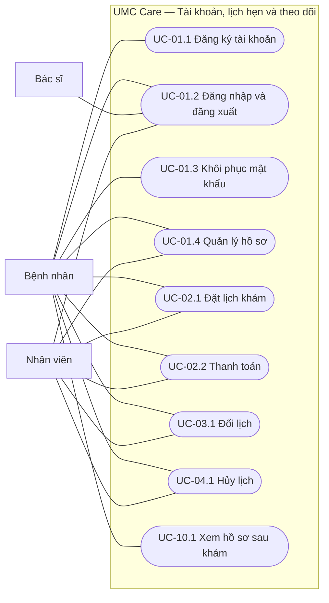
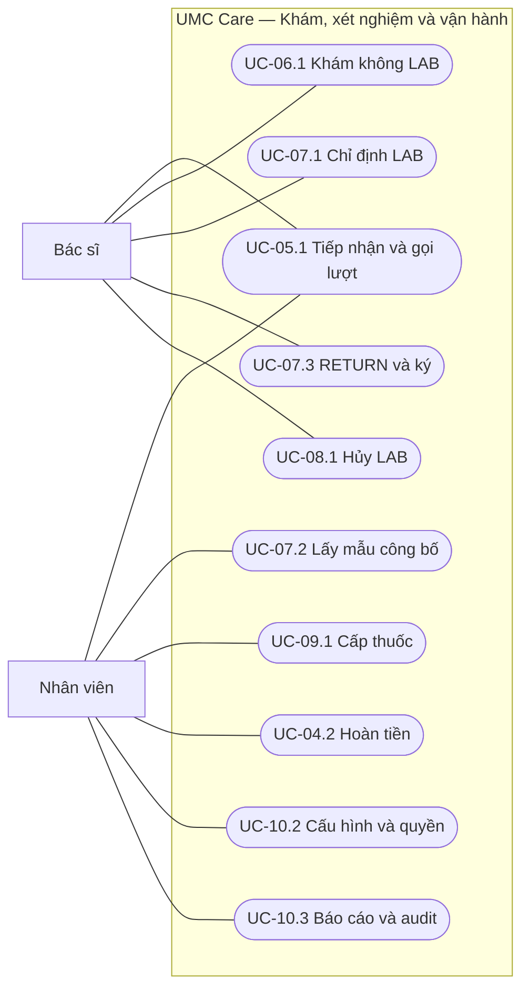

Đặc tả ca sử dụng UMC Care

Hệ thống khám ngoại trú với 9 service

Tài liệu này phân rã 10 nhóm use case trong SRS thành 19 mục tiêu cụ thể của người dùng để nhóm lập màn hình, kiểm thử và code theo cùng một luồng. Nó giữ nguyên phạm vi BRD/SRS; service, RabbitMQ và database là thành phần bên trong hệ thống, không phải actor mới. Mỗi ca mô tả kết quả nhìn thấy từ phía người dùng, điều kiện trước/sau, luồng chính, nhánh ngoại lệ và mã truy vết.

| **Thông tin** | **Giá trị** |
| --- | --- |
| Phiên bản | 5.0 đồng bộ BRD SRS và ERD 5.0 |
| Ngày lập | 17/10/2026 |
| Phạm vi | 9 service; mỗi người 3 service; 86 HTTP operation gồm 3 adapter phục hồi; 18 integration event và 5 command; web 3 actor, Android bệnh nhân. |
| Nhóm | Huy, Quân, Hưng; hạn nộp 23/11/2026 |

### Cách đọc tài liệu

Tra cứu mã ca ở mục lục rồi đọc sơ đồ actor và bảng đặc tả. Mỗi bảng gồm mã ca, tên, tác nhân, mô tả chức năng, điều kiện, kịch bản chính, ngoại lệ, kiểm chứng và truy vết. Phụ lục trình bày riêng ràng buộc kiến trúc và công nghệ.

Đường nối trong sơ đồ biểu thị actor tham gia; capability và các nhánh xử lý được mô tả trong bảng của từng ca.

# Mục lục tra cứu

Trong Word, giữ Ctrl và bấm vào tên ca hoặc mục để chuyển đến nội dung tương ứng. Các tiêu đề cũng xuất hiện trong Navigation Pane.

[<u>1 Phạm vi và tác nhân</u>](#scope)

[<u>2 Sơ đồ ca sử dụng</u>](#diagrams)

[<u>3 Đặc tả chi tiết</u>](#details)

| **Mã ca** | **Mục tiêu người dùng** |
| --- | --- |
| UC-01.1 | [<u>Đăng ký và xác minh tài khoản</u>](#UC_01_1) |
| UC-01.2 | [<u>Đăng nhập và kết thúc phiên</u>](#UC_01_2) |
| UC-01.3 | [<u>Khôi phục hoặc đổi mật khẩu</u>](#UC_01_3) |
| UC-01.4 | [<u>Quản lý hồ sơ bệnh nhân</u>](#UC_01_4) |
| UC-02.1 | [<u>Tra cứu và đặt lịch khám</u>](#UC_02_1) |
| UC-02.2 | [<u>Thanh toán khoản phí</u>](#UC_02_2) |
| UC-03.1 | [<u>Đổi lịch khám</u>](#UC_03_1) |
| UC-04.1 | [<u>Hủy lịch khám</u>](#UC_04_1) |
| UC-04.2 | [<u>Thực hiện hoàn tiền mô phỏng</u>](#UC_04_2) |
| UC-05.1 | [<u>Tiếp nhận và gọi lượt khám</u>](#UC_05_1) |
| UC-06.1 | [<u>Khám và ký kết luận không xét nghiệm</u>](#UC_06_1) |
| UC-07.1 | [<u>Chỉ định xét nghiệm trong lượt khám</u>](#UC_07_1) |
| UC-07.2 | [<u>Lấy mẫu và công bố kết quả xét nghiệm</u>](#UC_07_2) |
| UC-07.3 | [<u>Gọi lượt quay lại và ký kết luận</u>](#UC_07_3) |
| UC-08.1 | [<u>Hủy chỉ định xét nghiệm</u>](#UC_08_1) |
| UC-09.1 | [<u>Giữ thuốc và phát theo toa cuối</u>](#UC_09_1) |
| UC-10.1 | [<u>Xem hồ sơ và trạng thái sau khám</u>](#UC_10_1) |
| UC-10.2 | [<u>Quản lý ca giá và quyền nhân viên</u>](#UC_10_2) |
| UC-10.3 | [<u>Xem báo cáo và nhật ký quản trị</u>](#UC_10_3) |

[<u>4 Ma trận truy vết</u>](#trace)

[<u>5 Điểm kiểm tra xuyên ca</u>](#checks)

[<u>Phụ lục A Phân công và ranh giới service</u>](#appendix_a)

[<u>Phụ lục B Luồng bất đồng bộ và giao diện</u>](#appendix_b)

[<u>Phụ lục C Kiểm chứng kiến trúc</u>](#appendix_c)

[<u>Phụ lục D Công nghệ và Redis</u>](#appendix_d)

[<u>Nguồn tham chiếu</u>](#sources)

# 1 Phạm vi và tác nhân

Có đúng ba actor người dùng. Nhân viên bệnh viện là một actor có các capability RECEPTION, LAB\_TECH, LAB\_REVIEW, PHARMACY, CASHIER và ADMIN. Một tài khoản có thể có nhiều capability, nhưng người nhập một kết quả LAB không tự công bố kết quả ấy. Web phục vụ cả ba actor; Android chỉ phục vụ bệnh nhân và dùng cùng trạng thái server.

| **Actor** | **Kênh** | **Mục tiêu trong tài liệu** |
| --- | --- | --- |
| Bệnh nhân | Web, Android | Tài khoản, hồ sơ, lịch, thanh toán, xem kết quả và trạng thái sau khám. |
| Bác sĩ | Web | Nhận lượt, khám, chỉ định/hủy LAB, tiếp tục RETURN, ký kết luận và toa. |
| Nhân viên bệnh viện | Web | Tiếp nhận, LAB, dược, thu/hoàn và quản trị theo capability. |

Ký pháp sơ đồ dùng actor, ca sử dụng hình elip, ranh giới hệ thống và đường liên kết của OMG UML 2.5.1. Mẫu diễn giải luồng chính, luồng thay thế, tiền điều kiện và hậu điều kiện tham khảo hướng dẫn IBM. Mã BR/FR/RL/BAC giúp truy vết hai chiều theo nguyên tắc kỹ nghệ yêu cầu của ISO/IEC/IEEE 29148:2018; đây là cách áp dụng, không phải tuyên bố chứng nhận chuẩn. Sơ đồ không dùng include/extend khi quan hệ chỉ là thứ tự hoặc phụ thuộc điều kiện; nhánh đó được viết ở luồng ngoại lệ để tránh diễn giải UML sai.

**Quy ước trạng thái** PENDING là chưa có bằng chứng hoàn tất; SUCCEEDED/PAID chỉ từ service sở hữu. Thời gian theo đồng hồ server UTC; tiền là số nguyên VND; retry dùng Idempotency-Key ở lệnh nhạy cảm.

### Các trường trong một ca sử dụng

| **Trường** | **Cách sử dụng** |
| --- | --- |
| Mục tiêu | Kết quả người dùng muốn đạt được khi ca hoàn tất. |
| Actor và kích hoạt | Ai thực hiện, qua kênh nào và bắt đầu từ tình huống nào. |
| Tiền điều kiện | Trạng thái phải có trước khi bắt đầu ca. |
| Bảo đảm tối thiểu | Điều hệ thống vẫn phải bảo vệ khi ca thất bại. |
| Luồng chính | Các bước diễn ra khi điều kiện hợp lệ. |
| Ngoại lệ | Nhánh gắn với số bước, ví dụ 2a là ngoại lệ tại bước 2. |
| Kiểm chứng và truy vết | Kịch bản cần xác nhận và mã liên kết về yêu cầu, quy tắc, API. |

# 2 Sơ đồ ca sử dụng

Hai sơ đồ chia theo nhóm mục tiêu để giữ ký pháp UML dễ đọc. Mã UC-xx.y là ca chi tiết thuộc nhóm UC-xx trong SRS đã chốt; ví dụ UC-01.2 thuộc UC-01.

Hình 1. Tài khoản, lịch hẹn và theo dõi của bệnh nhân; nhân viên phối hợp ở quầy và thu ngân.

## Sơ đồ khám và vận hành

Hình 2. Khám, xét nghiệm, nhà thuốc, hoàn tiền và quản trị trên web.

Trong sơ đồ, đường liên kết biểu thị actor tham gia vào ca; capability của STAFF được ghi trong đặc tả từng ca. Billing, Appointment, Diagnostic và các service khác nằm trong ranh giới UMC Care nên không vẽ thành actor.

# 3 Đặc tả chi tiết

Các ca được xếp theo hành trình từ tài khoản, đặt lịch, tiếp nhận, khám và xét nghiệm đến nhà thuốc, theo dõi và quản trị.

**Tài khoản và hồ sơ**

## **UC-01.1 Đăng ký và xác minh tài khoản**

> *Sơ đồ UC-01.1 với actor Bệnh nhân*

Bảng 3.1 Đặc tả Use Case UC-01.1

| **Use Case ID** | **UC-01.1** |
| --- | --- |
| **Tên Use Case** | Đăng ký và xác minh tài khoản |
| **Tác nhân** | Bệnh nhân |
| **Mô tả chức năng** | Tài khoản ACTIVE gắn số điện thoại đã xác minh; người bệnh có thể đăng nhập. |
| **Kênh và kích hoạt** | Web và Android. Người bệnh chọn đăng ký bằng số điện thoại. |
| **Điều kiện tiên quyết** | Số điện thoại chưa thuộc tài khoản đã kích hoạt. |
| **Yêu cầu bảo đảm** | Không cấp phiên hoặc quyền cho tài khoản chưa xác minh; OTP hết hạn hoặc sai không được dùng lại. |
| **Kịch bản chính** | 1. Bệnh nhân nhập số điện thoại và mật khẩu hợp lệ.  2. Hệ thống kiểm tra số điện thoại duy nhất, tạo tài khoản chờ xác minh và OTP REGISTER có hạn; adapter SMS giả lập chuyển mã vào hộp thư demo chỉ mở localhost.  3. Bệnh nhân nhập mã nhận được và gửi xác minh.  4. Hệ thống kiểm tra purpose, thời hạn, số lần thử và trạng thái đã dùng; đánh dấu OTP đã dùng rồi kích hoạt tài khoản.  5. Hệ thống thông báo hoàn tất; bệnh nhân đăng nhập bằng UC-01.2. |
| **Kịch bản thay thế và ngoại lệ** | • 2a Số đã kích hoạt: không tạo tài khoản thứ hai; thông báo dùng đăng nhập hoặc quên mật khẩu.  • 3a Mã sai hoặc hết hạn: không kích hoạt; cho thử lại trong giới hạn hoặc gửi lại mã.  • 4a Mã đã dùng hay quá số lần sai: từ chối bằng mã lỗi ổn định và yêu cầu khởi tạo OTP mới. |
| **Kiểm chứng** | OTP sai, hết hạn hoặc replay không tạo tài khoản ACTIVE. |
| **Truy vết** | SRS UC-01; BR-01; FR-01, FR-02; RL-01, RL-15; BAC-01; API IA-001..003. |

**Tài khoản và hồ sơ**

## **UC-01.2 Đăng nhập và kết thúc phiên**

> *Sơ đồ UC-01.2 với actor Bệnh nhân, Bác sĩ, Nhân viên bệnh viện*

Bảng 3.2 Đặc tả Use Case UC-01.2

| **Use Case ID** | **UC-01.2** |
| --- | --- |
| **Tên Use Case** | Đăng nhập và kết thúc phiên |
| **Tác nhân** | Bệnh nhân bác sĩ hoặc nhân viên bệnh viện |
| **Mô tả chức năng** | Đăng nhập tạo access/refresh token đúng quyền; đăng xuất thu hồi refresh session. |
| **Kênh và kích hoạt** | Web cho cả ba actor; Android cho bệnh nhân. Người dùng chọn đăng nhập hoặc đăng xuất. |
| **Điều kiện tiên quyết** | Tài khoản ACTIVE; khi đăng xuất phải có phiên hợp lệ. |
| **Yêu cầu bảo đảm** | Thông tin đăng nhập sai không tạo phiên; phiên đã thu hồi không refresh được. |
| **Kịch bản chính** | 1. Người dùng nhập số điện thoại và mật khẩu.  2. Hệ thống xác minh tài khoản ACTIVE, mật khẩu và trạng thái khóa; trả phiên cùng actor/capability phù hợp.  3. Client chỉ hiển thị kênh và menu được phép; service sở hữu vẫn kiểm quyền trên từng request.  4. Khi đăng xuất, người dùng yêu cầu kết thúc phiên; hệ thống thu hồi refresh token và client xóa token lưu cục bộ. |
| **Kịch bản thay thế và ngoại lệ** | • 2a Sai mật khẩu hoặc tài khoản không hợp lệ: trả lỗi chung, không tiết lộ tài khoản có tồn tại.  • 2b Refresh token đã thu hồi hoặc hết hạn: yêu cầu đăng nhập lại.  • 3a Menu có thể ẩn, nhưng API trái quyền vẫn trả 403 tại service sở hữu. |
| **Kiểm chứng** | Đăng xuất hoặc đổi mật khẩu làm phiên cũ không refresh được. |
| **Truy vết** | SRS UC-01; BR-02, BR-04; FR-03, FR-05; RL-02, RL-03; BAC-01, BAC-02; API IA-004..006, IA-010. |

**Tài khoản và hồ sơ**

## **UC-01.3 Khôi phục hoặc đổi mật khẩu**

> *Sơ đồ UC-01.3 với actor Bệnh nhân*

Bảng 3.3 Đặc tả Use Case UC-01.3

| **Use Case ID** | **UC-01.3** |
| --- | --- |
| **Tên Use Case** | Khôi phục hoặc đổi mật khẩu |
| **Tác nhân** | Bệnh nhân |
| **Mô tả chức năng** | Mật khẩu mới có hiệu lực; refresh session cũ bị thu hồi và authorization lease cũ hết hiệu lực tối đa sau 30 giây. |
| **Kênh và kích hoạt** | Web và Android. Người bệnh chọn quên mật khẩu hoặc đổi mật khẩu. |
| **Điều kiện tiên quyết** | Quên mật khẩu cần số điện thoại đã đăng ký; đổi mật khẩu cần phiên hợp lệ. |
| **Yêu cầu bảo đảm** | Mật khẩu cũ còn nguyên nếu OTP hoặc mật khẩu hiện tại không hợp lệ. |
| **Kịch bản chính** | 1. Với quên mật khẩu, bệnh nhân gửi số điện thoại; hệ thống tạo OTP RESET và chuyển tới hộp thư SMS giả lập.  2. Bệnh nhân nhập OTP RESET cùng mật khẩu mới; hệ thống kiểm mã theo mục đích, hạn và giới hạn thử.  3. Với đổi mật khẩu, bệnh nhân nhập mật khẩu hiện tại và mật khẩu mới trong phiên hợp lệ.  4. Hệ thống lưu hash mật khẩu mới, đánh dấu OTP đã dùng nếu có và thu hồi các phiên cũ.  5. Bệnh nhân đăng nhập lại bằng mật khẩu mới. |
| **Kịch bản thay thế và ngoại lệ** | • 2a OTP REGISTER dùng cho RESET hoặc mã sai/hết hạn: từ chối, không đổi mật khẩu.  • 3a Mật khẩu hiện tại sai: giữ nguyên mật khẩu và phiên theo chính sách giới hạn thử.  • 4a Request lặp với cùng OTP đã dùng: không đổi lần hai. |
| **Kiểm chứng** | RESET thành công thu hồi phiên cũ; OTP dùng lại bị từ chối. |
| **Truy vết** | SRS UC-01; BR-02; FR-02, FR-03; RL-01, RL-02; BAC-01; API IA-007..009. |

**Tài khoản và hồ sơ**

## **UC-01.4 Quản lý hồ sơ bệnh nhân**

> *Sơ đồ UC-01.4 với actor Bệnh nhân, Nhân viên bệnh viện RECEPTION*

Bảng 3.4 Đặc tả Use Case UC-01.4

| **Use Case ID** | **UC-01.4** |
| --- | --- |
| **Tên Use Case** | Quản lý hồ sơ bệnh nhân |
| **Tác nhân** | Bệnh nhân; phối hợp: Nhân viên bệnh viện có quyền RECEPTION khi tạo tại quầy |
| **Mô tả chức năng** | Hồ sơ gắn ownerUserId hợp lệ và chỉ người có quyền xem/sửa được. |
| **Kênh và kích hoạt** | Web và Android cho bệnh nhân; web cho lễ tân. Người dùng tạo, xem hoặc sửa hồ sơ bản thân hay người thân. |
| **Điều kiện tiên quyết** | Bệnh nhân đã đăng nhập; tại quầy có tài khoản bệnh nhân đã xác minh. |
| **Yêu cầu bảo đảm** | Không tạo hồ sơ vô chủ; dữ liệu hồ sơ cũ không đổi khi kiểm quyền thất bại. |
| **Kịch bản chính** | 1. Bệnh nhân xem danh sách hồ sơ thuộc tài khoản rồi chọn tạo hoặc sửa.  2. Patient kiểm owner trong DB gốc; tại quầy đối chiếu account projection/proof từ Identity do bệnh nhân cung cấp, không tin ownerUserId client tự khai.  3. Bệnh nhân nhập thông tin tối thiểu, quan hệ bản thân/người thân và mã BHYT tự khai nếu có.  4. Patient lưu hồ sơ, trả profileId; bệnh nhân có thể dùng hồ sơ đó để đặt lịch.  5. Tại quầy, lễ tân dùng account projection đã xác minh hoặc proof ký hợp lệ để tạo hồ sơ tối thiểu; thiếu bằng chứng thì pending/chặn tạo, không gọi chuỗi Patient → Identity. |
| **Kịch bản thay thế và ngoại lệ** | • 2a Truy cập profileId của tài khoản khác: trả 403 hoặc 404, không lộ dữ liệu.  • 3a Thiếu trường bắt buộc hoặc trùng định danh demo: từ chối và chỉ rõ trường hợp lệ.  • 5a Không tìm được tài khoản đã xác minh: yêu cầu bệnh nhân đăng ký/xác minh trước, không tạo hồ sơ vô chủ. |
| **Kiểm chứng** | Lễ tân không tạo được hồ sơ gắn số chưa xác minh. |
| **Truy vết** | SRS UC-01; BR-03, BR-04, BR-12; FR-04, FR-13; RL-03, RL-15; BAC-02, BAC-05; API PT-001..005, IA-010; IdentityAccessChanged. |

**Đặt lịch và thanh toán**

## **UC-02.1 Tra cứu và đặt lịch khám**

> *Sơ đồ UC-02.1 với actor Bệnh nhân, Nhân viên bệnh viện RECEPTION*

Bảng 3.5 Đặc tả Use Case UC-02.1

| **Use Case ID** | **UC-02.1** |
| --- | --- |
| **Tên Use Case** | Tra cứu và đặt lịch khám |
| **Tác nhân** | Bệnh nhân; phối hợp: Nhân viên bệnh viện có quyền RECEPTION đặt hộ |
| **Mô tả chức năng** | Một appointment CONFIRMED gắn đúng hồ sơ, slot và khoản phí PAID; người dùng thấy mã hẹn. |
| **Kênh và kích hoạt** | Web và Android cho bệnh nhân; web cho lễ tân. Người dùng chọn khoa dịch vụ bác sĩ ngày và giờ khám. |
| **Điều kiện tiên quyết** | Danh mục/slot còn hiệu lực; trước khi giữ slot phải có hồ sơ hợp lệ. |
| **Yêu cầu bảo đảm** | Không oversell, không đặt trùng giờ cùng hồ sơ; hold/appointment chờ tiền hiển thị đúng trạng thái và hết hạn được giải phóng. |
| **Kịch bản chính** | 1. Người dùng tra cứu khoa, dịch vụ, bác sĩ, giá và slot còn chỗ.  2. Người dùng chọn hồ sơ và slot; hệ thống giữ chỗ nguyên tử 10 phút, kiểm capacity và lịch trùng.  3. Appointment commit lịch PENDING\_PAYMENT và RequestCharge vào outbox, trả 202 với appointmentId; Billing tạo charge và phát ChargePrepared, giao diện poll AP-011.  4. Bệnh nhân thanh toán mô phỏng hoặc thu ngân thu tại quầy theo UC-02.2.  5. Appointment nhận ChargePaid/SettlementDecision đúng fence, chốt CONFIRMED và phát AppointmentChanged. Poll AP-011/BI-002 cho tới kết quả có bằng chứng; 202 không đồng nghĩa đã xác nhận.  6. Người dùng xem lịch cùng trạng thái phí và bước tiếp theo. |
| **Kịch bản thay thế và ngoại lệ** | • 2a Slot hết chỗ hoặc trùng giờ: không tạo hold; trả 409 và gợi ý slot khác.  • 3a Hold hết hạn hoặc tạo charge tạm lỗi: giữ trạng thái PENDING/FAILED rõ ràng, retry cùng Idempotency-Key; không tạo phiếu đôi.  • 5a Tiền đến sau EXPIRED: không xác nhận lịch; tạo căn cứ hoàn theo UC-04.2.  • 5b Event đến trễ: hiển thị PENDING\_SYNC, cho refresh; không tự suy ra CONFIRMED. |
| **Kiểm chứng** | Hai người tranh slot cuối chỉ một người được giữ; tiền đến muộn không hồi sinh lịch. |
| **Truy vết** | SRS UC-02; BR-05..09, BR-12, BR-25, BR-26; FR-06..10, FR-13, FR-28, FR-29; RL-04, RL-14; BAC-03, BAC-05; API CA-001..003, AP-004, AP-008..012; RequestCharge/ChargePrepared; BI-004..005. |

**Đặt lịch và thanh toán**

## **UC-02.2 Thanh toán khoản phí**

> *Sơ đồ UC-02.2 với actor Bệnh nhân, Nhân viên bệnh viện CASHIER*

Bảng 3.6 Đặc tả Use Case UC-02.2

| **Use Case ID** | **UC-02.2** |
| --- | --- |
| **Tên Use Case** | Thanh toán khoản phí |
| **Tác nhân** | Bệnh nhân; phối hợp: Nhân viên bệnh viện có quyền CASHIER thu tại quầy |
| **Mô tả chức năng** | Payment SUCCEEDED và charge PAID đúng một lần; biên nhận có mã giao dịch. |
| **Kênh và kích hoạt** | Web và Android cho bệnh nhân; web cho thu ngân. Có charge OPEN cho lịch LAB hoặc thuốc. |
| **Điều kiện tiên quyết** | Charge có source hợp lệ và số tiền chụp tại thời điểm tạo; người trả có quyền xem charge. |
| **Yêu cầu bảo đảm** | Không thu lặp do retry; nếu chưa chắc kết quả, client hiển thị PENDING thay vì PAID. |
| **Kịch bản chính** | 1. Người dùng xem loại phí, số tiền VND và trạng thái charge.  2. Bệnh nhân chọn thanh toán mô phỏng hoặc thu ngân tìm charge OPEN trong hàng chờ và nhận thanh toán tại quầy.  3. Billing ghi payment PENDING, settlement saga REQUESTED và ReserveSettlement vào outbox rồi trả 202. Người dùng thấy đang xử lý; chưa có biên nhận thành công.  4. Owner khóa nguồn đúng attempt trong transaction và phát SettlementReserved với fence. Billing chỉ khi ACCEPTED mới commit payment SUCCEEDED, charge PAID, receipt và events ChargePaid, BillingStatusChanged, SettlementDecision.  5. Nguồn lịch, LAB hoặc thuốc nhận event idempotent và cập nhật trạng thái; client hiển thị kết quả cuối hoặc PENDING\_SYNC. |
| **Kịch bản thay thế và ngoại lệ** | • 2a Charge VOID/PAID: từ chối khoản thu mới hoặc trả kết quả cũ của cùng key.  • 3a Mô phỏng thanh toán FAILED: lưu lần thử, charge vẫn OPEN; cho retry bằng giao dịch mới.  • 4a Event bị gửi trùng: nguồn chỉ áp dụng một lần theo eventId/sourceId.  • 5a Lịch đã EXPIRED: nguồn không xác nhận, Billing tạo hoàn nếu tiền đã thu. |
| **Kiểm chứng** | Retry cùng transactionId không sinh payment hoặc receipt thứ hai. |
| **Truy vết** | SRS UC-02 và UC-09; BR-25, BR-26; FR-28, FR-29, FR-30; RL-04, RL-14; BAC-03, BAC-09; API BI-002..006; RequestCharge/ChargePrepared, BI-013. |

**Đổi hủy lịch và hoàn**

## **UC-03.1 Đổi lịch khám**

> *Sơ đồ UC-03.1 với actor Bệnh nhân, Nhân viên bệnh viện RECEPTION*

Bảng 3.7 Đặc tả Use Case UC-03.1

| **Use Case ID** | **UC-03.1** |
| --- | --- |
| **Tên Use Case** | Đổi lịch khám |
| **Tác nhân** | Bệnh nhân; phối hợp: Nhân viên bệnh viện có quyền RECEPTION |
| **Mô tả chức năng** | AppointmentId giữ nguyên, slotHistory ghi slot cũ/mới; slot cũ được trả sau khi slot mới được giữ. |
| **Kênh và kích hoạt** | Web và Android cho bệnh nhân; web cho lễ tân. Người dùng chọn đổi lịch đã CONFIRMED. |
| **Điều kiện tiên quyết** | Chưa check-in và còn ít nhất hai giờ trước giờ hẹn; slot mới cùng bác sĩ và mức giá. |
| **Yêu cầu bảo đảm** | Lỗi hoặc timeout không làm mất lịch cũ hay khoản đã thu. |
| **Kịch bản chính** | 1. Người dùng mở lịch CONFIRMED và tra cứu slot mới.  2. Hệ thống kiểm quyền, thời hạn, cùng bác sĩ và mức giá, giữ tạm slot mới.  3. Người dùng xác nhận; Appointment cập nhật appointment bằng expectedVersion và Idempotency-Key.  4. Appointment trả slot cũ sau commit và phát AppointmentChanged RESCHEDULED.  5. Người dùng thấy giờ mới, lịch sử đổi và thông báo. |
| **Kịch bản thay thế và ngoại lệ** | • 2a Còn dưới hai giờ, đã check-in, khác bác sĩ/giá: trả 409; hướng dẫn hủy và đặt lịch mới nếu còn đủ điều kiện.  • 2b Slot mới hết chỗ: không sửa lịch cũ.  • 3a Timeout trước commit: tra lại trạng thái cùng key; nếu chưa commit, nhả hold mới, giữ lịch cũ. |
| **Kiểm chứng** | Đổi slot thất bại vẫn giữ appointment và slot cũ. |
| **Truy vết** | SRS UC-03; BR-10; FR-11; RL-05, RL-06; BAC-04; API AP-004, AP-013. |

**Đổi hủy lịch và hoàn**

## **UC-04.1 Hủy lịch khám**

> *Sơ đồ UC-04.1 với actor Bệnh nhân, Nhân viên bệnh viện RECEPTION*

Bảng 3.8 Đặc tả Use Case UC-04.1

| **Use Case ID** | **UC-04.1** |
| --- | --- |
| **Tên Use Case** | Hủy lịch khám |
| **Tác nhân** | Bệnh nhân; phối hợp: Nhân viên bệnh viện có quyền RECEPTION |
| **Mô tả chức năng** | Lịch CANCELLED, slot được trả và căn cứ void/hoàn được tạo theo trạng thái tiền; hoàn không bị báo thành công sớm. |
| **Kênh và kích hoạt** | Web và Android cho bệnh nhân; web cho lễ tân. Người dùng chọn hủy lịch CONFIRMED. |
| **Điều kiện tiên quyết** | Lịch chưa check-in và còn ít nhất hai giờ; người hủy có quyền với hồ sơ. |
| **Yêu cầu bảo đảm** | Lịch không đổi nếu guard thất bại; không tạo nhiều refund cùng lý do. |
| **Kịch bản chính** | 1. Người dùng xem chính sách và nhập lý do hủy.  2. Appointment kiểm quyền, thời hạn, trạng thái và expectedVersion.  3. Appointment chuyển lịch CANCELLED, giải phóng slot rồi phát AppointmentChanged.  4. Billing void charge OPEN hoặc tạo refund REQUESTED nếu charge đã PAID.  5. Người dùng thấy lịch đã hủy và trạng thái tiền/hoàn riêng; thu ngân xử lý theo UC-04.2 khi cần. |
| **Kịch bản thay thế và ngoại lệ** | • 2a Đã check-in hoặc quá hạn: trả 409, không hủy.  • 3a Request lặp: trả lịch CANCELLED cũ, không trả slot lần hai.  • 4a Billing chưa xử lý event: hiển thị refund PENDING\_SYNC/REQUESTED, không ghi SUCCEEDED. |
| **Kiểm chứng** | Hủy lịch đã thu tạo refund REQUESTED, không tự hiện đã hoàn. |
| **Truy vết** | SRS UC-04; BR-11, BR-27; FR-12, FR-30; RL-05, RL-07, RL-14; BAC-04; API AP-014; BI-007..009, BI-014. |

**Đổi hủy lịch và hoàn**

## **UC-04.2 Thực hiện hoàn tiền mô phỏng**

> *Sơ đồ UC-04.2 với actor Nhân viên bệnh viện CASHIER*

Bảng 3.9 Đặc tả Use Case UC-04.2

| **Use Case ID** | **UC-04.2** |
| --- | --- |
| **Tên Use Case** | Thực hiện hoàn tiền mô phỏng |
| **Tác nhân** | Nhân viên bệnh viện có quyền CASHIER |
| **Mô tả chức năng** | Refund SUCCEEDED với mã giao dịch mô phỏng; tổng hoàn không vượt số đã thu. |
| **Kênh và kích hoạt** | Web. Có refund REQUESTED từ lịch/LAB bị hủy hoặc tiền tới sau lịch EXPIRED. |
| **Điều kiện tiên quyết** | Có căn cứ nguồn hợp lệ, payment đã SUCCEEDED và số chưa hoàn đủ. |
| **Yêu cầu bảo đảm** | Refund FAILED vẫn có thể retry có kiểm soát; không tạo hai lần hoàn thành công cho cùng căn cứ. |
| **Kịch bản chính** | 1. Thu ngân mở hàng chờ refund REQUESTED, lọc theo ngày/trạng thái và xem nguồn hủy, số tiền đã thu/chưa hoàn.  2. Thu ngân xác nhận thực hiện hoàn mô phỏng.  3. Billing kiểm căn cứ, số dư hoàn, Idempotency-Key và trạng thái request.  4. Billing ghi lần thử hoàn, chuyển SUCCEEDED hoặc FAILED và phát BillingStatusChanged để Notification tạo thông báo trạng thái.  5. Bệnh nhân xem trạng thái hoàn riêng với trạng thái lịch/order và biên nhận cũ. |
| **Kịch bản thay thế và ngoại lệ** | • 1a Charge chưa PAID: void thay vì refund, không tạo khoản hoàn.  • 3a Không có căn cứ hủy hoặc tổng hoàn vượt số thu: trả 409 và không ghi SUCCEEDED.  • 4a Adapter hoàn FAILED: giữ refund FAILED với lý do; retry bằng transactionId mới nhưng cùng chargeId/cancellationId/reasonCode.  • 4b Lệnh/consumer lặp: trả kết quả hiện có, không hoàn lần hai. |
| **Kiểm chứng** | Refund FAILED rồi retry thành công vẫn chỉ hoàn đúng một khoản. |
| **Truy vết** | SRS UC-04 và UC-08; BR-27; FR-30, FR-32; RL-07, RL-14; BAC-04, BAC-08; API BI-007..009, BI-014. |

**Tiếp nhận khám và xét nghiệm**

## **UC-05.1 Tiếp nhận và gọi lượt khám**

> *Sơ đồ UC-05.1 với actor Nhân viên bệnh viện RECEPTION, Bác sĩ*

Bảng 3.10 Đặc tả Use Case UC-05.1

| **Use Case ID** | **UC-05.1** |
| --- | --- |
| **Tên Use Case** | Tiếp nhận và gọi lượt khám |
| **Tác nhân** | Nhân viên bệnh viện có quyền RECEPTION; phối hợp: Bác sĩ gọi người bệnh |
| **Mô tả chức năng** | Một vé FIRST gắn appointment; bác sĩ gọi lượt và bắt đầu đúng một visit. |
| **Kênh và kích hoạt** | Web. Bệnh nhân đến quầy vào ngày hẹn. |
| **Điều kiện tiên quyết** | Appointment CONFIRMED, đủ phí, đúng ngày, chưa hủy hoặc hết hạn. |
| **Yêu cầu bảo đảm** | Check-in lặp không tạo vé thứ hai; vắng mặt ghi lý do và không tạo visit mới. |
| **Kịch bản chính** | 1. Lễ tân tra mã hẹn và xác minh hồ sơ/phiếu phí.  2. Hệ thống kiểm trạng thái, ngày và tiền; lễ tân xác nhận check-in.  3. Appointment chuyển CHECKED\_IN và cấp một vé FIRST vào hàng chờ.  4. Bác sĩ hoặc lễ tân gọi vé phù hợp; hệ thống ghi người/thời gian gọi.  5. Bác sĩ bắt đầu lượt theo UC-06.1; Clinical chỉ tạo một visit cho appointment. |
| **Kịch bản thay thế và ngoại lệ** | • 2a Chưa đủ phí, sai ngày, đã hủy/hết hạn: từ chối check-in và chỉ bước cần xử lý.  • 3a Check-in lặp: trả vé cũ.  • 4a FIRST vắng trước visit: vé/appointment NO\_SHOW có lý do. RETURN vắng: chỉ đánh dấu vé vắng, visit WAITING\_RETURN và gọi lại cùng vé, không tạo lịch/charge mới. |
| **Kiểm chứng** | Check-in hai lần vẫn có một vé FIRST và một visit tối đa. |
| **Truy vết** | SRS UC-05; BR-13, BR-14; FR-14, FR-15; RL-08; BAC-05; API AP-015..018; CL-002. |

**Tiếp nhận khám và xét nghiệm**

## **UC-06.1 Khám và ký kết luận không xét nghiệm**

> *Sơ đồ UC-06.1 với actor Bác sĩ*

Bảng 3.11 Đặc tả Use Case UC-06.1

| **Use Case ID** | **UC-06.1** |
| --- | --- |
| **Tên Use Case** | Khám và ký kết luận không xét nghiệm |
| **Tác nhân** | Bác sĩ |
| **Mô tả chức năng** | Visit SIGNED duy nhất; hồ sơ khám cuối và toa FINAL nếu có được công bố đúng quyền. |
| **Kênh và kích hoạt** | Web. Bác sĩ nhận vé FIRST đã gọi. |
| **Điều kiện tiên quyết** | Lịch đã check-in, vé hợp lệ; bác sĩ có quyền khoa/phòng; visit chưa ký. |
| **Yêu cầu bảo đảm** | Nháp còn lưu nếu ký thất bại; bệnh nhân không thấy nháp hoặc toa chưa FINAL. |
| **Kịch bản chính** | 1. Bác sĩ bắt đầu từ worklist; CL-002 commit start\_requests và ClaimQueueTicket, trả 202. Appointment claim và phát QueueTicketClaimed; Clinical tạo một visit hoặc trả lỗi, UI poll CL-001.  2. Bác sĩ ghi triệu chứng, khám, nhận định và chẩn đoán nháp; hệ thống lưu kèm version/người sửa.  3. Nếu cần thuốc, bác sĩ tạo/sửa/xóa toa DRAFT.  4. Bác sĩ xem lại rồi ký kết luận; hệ thống kiểm không có LAB đang mở, ghi người và thời gian ký. Clinical phát VisitSigned để Appointment chuyển COMPLETED; mất event hiển thị pending và được replay.  5. Bác sĩ ký toa FINAL sau visit SIGNED nếu có; hệ thống phát PrescriptionFinalized cho Pharmacy.  6. Bệnh nhân chỉ xem bản khám đã ký và toa FINAL theo UC-10.1. |
| **Kịch bản thay thế và ngoại lệ** | • 1a Vé không thuộc bác sĩ/khoa hoặc visit đã SIGNED: trả 403/409.  • 4a Có LAB\_REQUEST\_PENDING hoặc order LAB chưa PUBLISHED/CANCELLED: chặn ký và chuyển sang UC-07.1/UC-07.3.  • 5a Toa DRAFT sai hoặc finalize lặp: không phát hai bản FINAL cùng revision. |
| **Kiểm chứng** | Visit có LAB pending không ký được; bệnh nhân không thấy bản DRAFT. |
| **Truy vết** | SRS UC-06; BR-14, BR-21, BR-22; FR-15, FR-18, FR-19; RL-08, RL-11, RL-12; BAC-06; API CL-001..004, CL-006..011. |

**Tiếp nhận khám và xét nghiệm**

## **UC-07.1 Chỉ định xét nghiệm trong lượt khám**

> *Sơ đồ UC-07.1 với actor Bác sĩ*

Bảng 3.12 Đặc tả Use Case UC-07.1

| **Use Case ID** | **UC-07.1** |
| --- | --- |
| **Tên Use Case** | Chỉ định xét nghiệm trong lượt khám |
| **Tác nhân** | Bác sĩ |
| **Mô tả chức năng** | Order LAB gắn visit, một charge LAB chờ thu và visit WAITING\_LAB. |
| **Kênh và kích hoạt** | Web. Trong visit đang mở, bác sĩ chọn các xét nghiệm cần làm. |
| **Điều kiện tiên quyết** | Visit IN\_PROGRESS chưa ký; bác sĩ có quyền; mã xét nghiệm hợp lệ. |
| **Yêu cầu bảo đảm** | Không có order đôi khi timeout/retry; visit pending không được ký cho tới khi đối soát xong. |
| **Kịch bản chính** | 1. Bác sĩ tra danh mục test CA-006 từ Catalog rồi gửi chỉ định trong visit; chọn thuốc dùng CA-005 khi lập toa.  2. Clinical ghi lab\_requests PENDING + outbox CreateLabOrder cùng transaction khóa visit, trả 202/requestId; không giữ HTTP chờ Diagnostic.  3. Diagnostic nhận CreateLabOrder từ producer Clinical, kiểm requestId/hash và snapshot test rồi tạo order, RequestCharge và LabOrderResolved trong transaction cùng inbox; không gọi lại Clinical/Billing bằng HTTP.  4. Clinical nhận LabOrderResolved CREATED, lưu orderId và WAITING\_LAB; ChargePrepared cập nhật phí, UI poll CL-003. REJECTED phải có lý do; pending chưa được ký.  5. Sau charge PAID hợp lệ, Diagnostic cho phép bước lấy mẫu UC-07.2. |
| **Kịch bản thay thế và ngoại lệ** | • 2a Diagnostic không sẵn sàng: giữ LAB\_REQUEST\_PENDING, retry cùng key; bác sĩ không ký visit.  • 3a Retry sau timeout nhưng order đã tạo: Diagnostic phát lại LabOrderResolved với kết quả cũ, không tạo order hoặc charge thứ hai.  • 3b Mã xét nghiệm trùng/không hợp lệ hoặc visit đã đóng: trả 409; chỉ quay về IN\_PROGRESS khi nhận LabOrderResolved REJECTED có căn cứ. |
| **Kiểm chứng** | Timeout và retry chỉ tạo một order LAB và một charge. |
| **Truy vết** | SRS UC-07; BR-15, BR-25; FR-16, FR-28; RL-11, RL-14; BAC-07; API CL-005; CreateLabOrder/LabOrderResolved; RequestCharge/ChargePrepared. |

**Tiếp nhận khám và xét nghiệm**

## **UC-07.2 Lấy mẫu và công bố kết quả xét nghiệm**

> *Sơ đồ UC-07.2 với actor Nhân viên bệnh viện LAB_TECH, Nhân viên bệnh viện LAB_REVIEW*

Bảng 3.13 Đặc tả Use Case UC-07.2

| **Use Case ID** | **UC-07.2** |
| --- | --- |
| **Tên Use Case** | Lấy mẫu và công bố kết quả xét nghiệm |
| **Tác nhân** | Nhân viên bệnh viện có quyền LAB\_TECH; phối hợp: Nhân viên bệnh viện có quyền LAB\_REVIEW ở tài khoản khác |
| **Mô tả chức năng** | Kết quả PUBLISHED có reviewer khác người nhập; bệnh nhân chỉ đọc bản đã công bố. |
| **Kênh và kích hoạt** | Web. Order LAB đã PAID xuất hiện trong hàng chờ. |
| **Điều kiện tiên quyết** | Order chưa hủy; bằng chứng charge LAB PAID từ Billing đã đồng bộ cục bộ; KTV và reviewer có quyền. |
| **Yêu cầu bảo đảm** | Mẫu/kết quả nháp giữ nguyên trạng thái khi bước duyệt lỗi; không tự công bố hoặc thu phí lần hai khi lấy lại mẫu. |
| **Kịch bản chính** | 1. KTV mở order; Diagnostic kiểm PAID đã đồng bộ và fence trong DB cục bộ. Thiếu bằng chứng thì PENDING\_SYNC và chưa cho lấy mẫu, không gọi HTTP Billing trong request.  2. KTV tiếp nhận/lấy mẫu, lưu mã mẫu, thời điểm và người thực hiện.  3. KTV nhập kết quả DRAFT cho order rồi gửi review.  4. Reviewer kiểm dữ liệu đủ test, khác tất cả người đã nhập/sửa revision, rồi công bố bằng expectedVersion; bản PUBLISHED bất biến.  5. Diagnostic đánh dấu PUBLISHED và phát LabResultPublished; Clinical xét mọi order để mở RETURN\_READY, thông báo chỉ nêu có kết quả. |
| **Kịch bản thay thế và ngoại lệ** | • 1a Charge chưa PAID hoặc order CANCELLED: từ chối lấy mẫu.  • 2a Mẫu không đạt: KTV ghi REJECTED cùng lý do, tạo specimen sequence mới trong cùng order rồi lấy lại, không thêm charge.  • 4a Reviewer trả sửa: result REWORK; KTV chỉnh và gửi lại, không lộ cho bệnh nhân.  • 4b Reviewer chính là người nhập: trả 409 SELF\_REVIEW\_FORBIDDEN; cần tài khoản reviewer khác.  • 5a Event chậm/lặp: Clinical áp dụng idempotent; trạng thái hiển thị PENDING\_SYNC cho tới khi đối soát. |
| **Kiểm chứng** | Mẫu REJECTED vẫn chặn hủy order; cùng người không tự công bố kết quả. |
| **Truy vết** | SRS UC-07; BR-16..18, BR-20; FR-20..22, FR-17; RL-09, RL-10, RL-11; BAC-07; API DI-002..011, DI-013; CL-003. |

**Tiếp nhận khám và xét nghiệm**

## **UC-07.3 Gọi lượt quay lại và ký kết luận**

> *Sơ đồ UC-07.3 với actor Bác sĩ, Nhân viên bệnh viện RECEPTION*

Bảng 3.14 Đặc tả Use Case UC-07.3

| **Use Case ID** | **UC-07.3** |
| --- | --- |
| **Tên Use Case** | Gọi lượt quay lại và ký kết luận |
| **Tác nhân** | Bác sĩ; phối hợp: Nhân viên bệnh viện có quyền RECEPTION gọi vé RETURN |
| **Mô tả chức năng** | Bệnh nhân được gọi RETURN vào cùng visitId; bác sĩ ký kết luận/toa, không tạo phí khám mới. |
| **Kênh và kích hoạt** | Web. Mọi order LAB trong visit đã PUBLISHED hoặc CANCELLED hợp lệ. |
| **Điều kiện tiên quyết** | Visit WAITING\_LAB, kết quả đã đủ và bệnh nhân quay lại; appointment chưa có visit khác. |
| **Yêu cầu bảo đảm** | Nếu thiếu một kết quả, visit còn chờ; không tạo visit hoặc charge khám thứ hai. |
| **Kịch bản chính** | 1. Clinical nhận LabResultPublished/LabCancelled, kiểm tập registry/order trạng thái cục bộ; đủ điều kiện thì RETURN\_READY và outbox VisitReturnReady. Event còn thiếu giữ WAITING\_LAB.  2. Appointment tạo vé RETURN duy nhất từ VisitReturnReady; lễ tân/bác sĩ gọi vé, Clinical claim và liên kết visitId cũ.  3. Bác sĩ tiếp tục visit ấy và xem các kết quả PUBLISHED.  4. Bác sĩ hoàn thiện kết luận, cập nhật toa DRAFT nếu cần rồi ký visit. Clinical phát VisitSigned; Appointment hoàn tất lịch idempotent.  5. Sau visit SIGNED, bác sĩ ký toa FINAL; bệnh nhân xem bản công bố. |
| **Kịch bản thay thế và ngoại lệ** | • 1a Còn order WAITING\_PAYMENT/SAMPLING/REWORK: giữ WAITING\_LAB, không tạo vé RETURN.  • 2a Gọi lại nhiều lần: vẫn cùng visitId, không thêm charge khám.  • 4a Version không khớp hoặc còn order chưa PUBLISHED/CANCELLED: chặn ký và tải lại. Bản PUBLISHED bất biến trong demo; không sửa đè kết quả đã công bố. |
| **Kiểm chứng** | RETURN cùng visitId và không có charge khám thứ hai. |
| **Truy vết** | SRS UC-07; BR-20..22; FR-17..19; RL-11, RL-12; BAC-07; API AP-017; CL-002..003, CL-009..010; DI-003, DI-013. |

**Tiếp nhận khám và xét nghiệm**

## **UC-08.1 Hủy chỉ định xét nghiệm**

> *Sơ đồ UC-08.1 với actor Bác sĩ*

Bảng 3.15 Đặc tả Use Case UC-08.1

| **Use Case ID** | **UC-08.1** |
| --- | --- |
| **Tên Use Case** | Hủy chỉ định xét nghiệm |
| **Tác nhân** | Bác sĩ |
| **Mô tả chức năng** | Order CANCELLED, visit được xét lại điều kiện ký; khoản chưa thu VOID hoặc khoản đã thu chưa dùng thành refund REQUESTED. |
| **Kênh và kích hoạt** | Web. Bác sĩ quyết định hủy LAB order chưa thực hiện. |
| **Điều kiện tiên quyết** | Order chưa có specimen hay bước thực hiện nào; bác sĩ có quyền trên visit. |
| **Yêu cầu bảo đảm** | Không hủy order đã lấy mẫu; không hoàn hai lần hoặc bỏ chặn ký sai. |
| **Kịch bản chính** | 1. Bác sĩ mở order trong visit và nhập lý do hủy.  2. Diagnostic kiểm quyền, trạng thái và xác nhận chưa từng có specimen/thực hiện.  3. Diagnostic chuyển order CANCELLED, ghi lý do rồi phát LabCancelled.  4. Clinical bỏ order này khỏi tập đang chặn ký; Billing void charge OPEN hoặc tạo refund REQUESTED nếu đã PAID.  5. Bác sĩ và bệnh nhân thấy trạng thái order/tiền riêng; thu ngân hoàn theo UC-04.2 nếu cần. |
| **Kịch bản thay thế và ngoại lệ** | • 2a Đã có specimen, kể cả specimen REJECTED: trả 409 và giữ order.  • 3a Lệnh hủy lặp: trả trạng thái cũ, không phát căn cứ hoàn thứ hai.  • 4a Billing chậm: order vẫn CANCELLED, UI tiền PENDING\_SYNC/REQUESTED; không hiển thị đã hoàn. |
| **Kiểm chứng** | Order có một mẫu REJECTED vẫn không thể hủy. |
| **Truy vết** | SRS UC-08; BR-19, BR-27; FR-23, FR-30; RL-07, RL-09, RL-14; BAC-08; API DI-012; BI-007..009, BI-014. |

**Nhà thuốc**

## **UC-09.1 Giữ thuốc và phát theo toa cuối**

> *Sơ đồ UC-09.1 với actor Nhân viên bệnh viện PHARMACY, Bệnh nhân, Nhân viên bệnh viện CASHIER*

Bảng 3.16 Đặc tả Use Case UC-09.1

| **Use Case ID** | **UC-09.1** |
| --- | --- |
| **Tên Use Case** | Giữ thuốc và phát theo toa cuối |
| **Tác nhân** | Nhân viên bệnh viện có quyền PHARMACY; phối hợp: Bệnh nhân thanh toán hoặc nhân viên có quyền CASHIER thu phí |
| **Mô tả chức năng** | Toàn toa được giữ, charge PAID, hold COMMITTED và phát đúng một lần có người/thời gian. |
| **Kênh và kích hoạt** | Web cho dược sĩ và thu ngân; web/Android cho bệnh nhân thanh toán. Toa FINAL đã đồng bộ tới hàng chờ nhà thuốc. |
| **Điều kiện tiên quyết** | Visit SIGNED; prescription FINAL đúng revision; tồn khả dụng và người thao tác có quyền. |
| **Yêu cầu bảo đảm** | Thiếu thuốc không giữ một phần; hold chưa thu có thể nhả; không phát khi chưa xác nhận PAID. |
| **Kịch bản chính** | 1. Dược sĩ mở hàng chờ toa FINAL và kiểm từng dòng thuốc/tồn khả dụng.  2. Pharmacy giữ toàn toa và ghi RequestCharge trong local transaction; trả 202/holdId, UI poll PH-004 cho tới ChargePrepared. Redis không giữ inventory hoặc hold gốc.  3. Bệnh nhân hoặc thu ngân thanh toán theo UC-02.2.  4. Pharmacy áp dụng ChargePaid/SettlementDecision đúng fence và attempt để COMMITTED; không hỏi HTTP Billing trong request phát thuốc, chưa đồng bộ thì chờ.  5. Dược sĩ đối chiếu và xác nhận phát; Pharmacy ghi dispense một lần, giảm tồn đã giữ và phát MedicationDispensed.  6. Bệnh nhân thấy trạng thái thuốc đã phát và biên nhận. |
| **Kịch bản thay thế và ngoại lệ** | • 1a Projection toa chưa tới: hàng chờ PENDING\_SYNC; không cấp từ toa DRAFT.  • 2a Thiếu một thuốc: không giữ dòng nào; dược sĩ nhập bổ sung rồi thử lại.  • 2b Hold hết hạn trước khi khóa settlement: nhả tồn, phát MedicationHoldChanged để Billing void charge; giữ lại tăng attemptNo. Đang SETTLEMENT\_LOCKED không nhả tồn do timeout.  • 4a Payment/event trễ: kiểm settlementId và attemptNo ở owner; attempt cũ không commit attempt mới. Late payment đã thu tạo refund; không phát thuốc khi chưa COMMITTED đúng attempt.  • 5a Lệnh phát lặp: trả dispense cũ, không trừ tồn hay phát lần hai. |
| **Kiểm chứng** | Thiếu một dòng không giữ phần còn lại; phát lặp không giảm tồn lần hai. |
| **Truy vết** | SRS UC-09; BR-22..26; FR-24..29; RL-12..14; BAC-09; API PH-001..008; RequestCharge/ChargePrepared; BI-004..006. |

**Theo dõi và quản trị**

## **UC-10.1 Xem hồ sơ và trạng thái sau khám**

> *Sơ đồ UC-10.1 với actor Bệnh nhân*

Bảng 3.17 Đặc tả Use Case UC-10.1

| **Use Case ID** | **UC-10.1** |
| --- | --- |
| **Tên Use Case** | Xem hồ sơ và trạng thái sau khám |
| **Tác nhân** | Bệnh nhân |
| **Mô tả chức năng** | Chỉ dữ liệu đúng hồ sơ và bản SIGNED/PUBLISHED/FINAL được hiển thị; trạng thái phí/hoàn rõ ràng. |
| **Kênh và kích hoạt** | Web và Android. Người bệnh mở lịch hồ sơ kết quả toa tiền hoặc thông báo. |
| **Điều kiện tiên quyết** | Đã đăng nhập và patientId thuộc tài khoản; bản y tế cần trạng thái công bố phù hợp. |
| **Yêu cầu bảo đảm** | Không lộ hồ sơ khác, kết quả DRAFT hay nội dung y tế trong thông báo. |
| **Kịch bản chính** | 1. Bệnh nhân chọn hồ sơ bản thân/người thân trong danh sách được phép.  2. Hệ thống trả lịch, trạng thái phí và thông báo tóm tắt đúng owner.  3. Bệnh nhân mở lượt khám SIGNED, kết quả LAB PUBLISHED và toa FINAL nếu có.  4. Bệnh nhân xem charge, receipt, refund và trạng thái thuốc qua PH-004 với projection tối thiểu theo owner; đọc thông báo tại Notification và đánh dấu đã đọc.  5. Client hiện PENDING\_SYNC với nguồn dữ liệu chưa cập nhật, cho tải lại thay vì suy đoán trạng thái. |
| **Kịch bản thay thế và ngoại lệ** | • 1a patientId ngoài tài khoản: trả 403/404, không tiết lộ sự tồn tại.  • 3a Visit chưa SIGNED hoặc result chưa PUBLISHED: ẩn bản nháp; trả trạng thái chờ phù hợp.  • 4a Refund REQUESTED/FAILED: hiển thị đúng trạng thái, không ghi đã hoàn.  • 5a Event đến trễ: hiển thị pending và refresh; không cache kết quả nhạy cảm lâu dài. |
| **Kiểm chứng** | Tài khoản khác không xem được hồ sơ; chỉ bản PUBLISHED/FINAL hiện cho bệnh nhân. |
| **Truy vết** | SRS UC-10; BR-09, BR-28, BR-29, BR-31..33; FR-31..36; RL-03, RL-10, RL-12, RL-15; BAC-02, BAC-10; API AP-011..012; CL-003, CL-011; DI-013; BI-002..003, BI-006, BI-009; NO-001..002; PH-004. |

**Theo dõi và quản trị**

## **UC-10.2 Quản lý ca giá và quyền nhân viên**

> *Sơ đồ UC-10.2 với actor Nhân viên bệnh viện ADMIN*

Bảng 3.18 Đặc tả Use Case UC-10.2

| **Use Case ID** | **UC-10.2** |
| --- | --- |
| **Tên Use Case** | Quản lý ca giá và quyền nhân viên |
| **Tác nhân** | Nhân viên bệnh viện có quyền ADMIN |
| **Mô tả chức năng** | Ca/giá tương lai hoặc capability nhân viên được cập nhật có audit; lịch sử phiếu cũ giữ giá snapshot. |
| **Kênh và kích hoạt** | Web. Quản trị cần mở ca tương lai cập nhật giá hoặc gán quyền. |
| **Điều kiện tiên quyết** | Tài khoản ADMIN hợp lệ; dữ liệu danh mục gốc đã seed. |
| **Yêu cầu bảo đảm** | Không đổi dữ liệu lịch sử hoặc cấp quyền khi thao tác không hợp lệ. |
| **Kịch bản chính** | 1. Quản trị mở màn hình cấu hình và chọn ca bác sĩ/phòng/capacity, giá hiệu lực hoặc tài khoản nhân viên.  2. Hệ thống kiểm quyền ADMIN, điều kiện thời gian và xung đột ca.  3. Quản trị nhập thay đổi và xác nhận.  4. Appointment lưu ca/phòng/capacity; Catalog lưu giá version tương lai; Identity lưu capability/scope kèm audit riêng. Mỗi thay đổi là lệnh độc lập, không giả định transaction xuyên ba service.  5. Quản trị xem cấu hình mới; client khác nhận quyền mới theo phiên/chính sách refresh. |
| **Kịch bản thay thế và ngoại lệ** | • 2a Ca trùng hoặc sửa lịch đã phát sinh: trả 409; lịch/giá cũ không đổi.  • 3a Người thao tác không ADMIN: trả 403 tại service sở hữu.  • 4a Gán quyền không hợp lệ hoặc mất kết nối: từng lệnh giữ tính nguyên tử trong DB owner; không giả định rollback toàn bộ các cấu hình khác; audit phản ánh đúng kết quả. |
| **Kiểm chứng** | Giá mới không làm đổi số tiền của charge/appointment đã tạo. |
| **Truy vết** | SRS UC-10; BR-04, BR-06, BR-30; FR-05, FR-07, FR-37; RL-03, RL-16; BAC-10; API IA-011..013; AP-005..006, CA-004. |

**Theo dõi và quản trị**

## **UC-10.3 Xem báo cáo và nhật ký quản trị**

> *Sơ đồ UC-10.3 với actor Nhân viên bệnh viện ADMIN*

Bảng 3.19 Đặc tả Use Case UC-10.3

| **Use Case ID** | **UC-10.3** |
| --- | --- |
| **Tên Use Case** | Xem báo cáo và nhật ký quản trị |
| **Tác nhân** | Nhân viên bệnh viện có quyền ADMIN |
| **Mô tả chức năng** | Báo cáo lượt đặt/hủy/khám và thu/hoàn theo ngày; audit quyền/đăng nhập có thể tra cứu. |
| **Kênh và kích hoạt** | Web. Quản trị chọn ngày và xem số lượt khám thu hoàn hoặc audit. |
| **Điều kiện tiên quyết** | Tài khoản ADMIN có quyền; dữ liệu seed và khoảng ngày hợp lệ. |
| **Yêu cầu bảo đảm** | Không lộ dữ liệu bệnh nhân nhạy cảm hoặc suy ra số liệu khi một nguồn chưa phản hồi. |
| **Kịch bản chính** | 1. Quản trị chọn ngày hoặc khoảng ngày cần xem.  2. Web gọi summary Appointment cho lượt đặt/hủy/khám và summary Billing cho thu/hoàn.  3. Hệ thống hiển thị từng nguồn cùng thời điểm cập nhật; không cộng số liệu khác nghĩa thành một chỉ số.  4. Quản trị lọc audit quyền/đăng nhập từ Identity và xem actor, thời điểm, hành động, correlationId.  5. Web cho biết nguồn nào lỗi hoặc đang đồng bộ, cho tải lại. |
| **Kịch bản thay thế và ngoại lệ** | • 2a Một nguồn timeout: hiển thị phần còn lại kèm trạng thái thiếu nguồn, không báo tổng hợp hoàn chỉnh.  • 4a Quyền không đủ: trả 403, không trả audit.  • 4b Khoảng ngày sai hoặc vượt giới hạn demo: trả 400 với hướng dẫn sửa. |
| **Kiểm chứng** | Khi Billing lỗi, báo cáo không hiển thị tổng thu/hoàn như số 0. |
| **Truy vết** | SRS UC-10; BR-30, BR-34; FR-32, FR-37; RL-03, RL-15; BAC-10; API IA-013; AP-019; BI-010. |

# 4 Ma trận truy vết

Mười chín ca mã UC-xx.y phân rã 10 nhóm UC-xx trong SRS 5.0; việc tăng số ca là tăng độ chi tiết mô tả, không thêm chức năng hay API. Mọi BR-01 đến BR-34 và FR-01 đến FR-37 đều có ít nhất một ca liên kết. BAC-11 và BAC-12 kiểm chứng hạ tầng/event, không phải mục tiêu trực tiếp của actor.

| **Ca chi tiết** | **Nhóm SRS** | **BRD** | **SRS FR** |
| --- | --- | --- | --- |
| UC-01.1 | UC-01 | BR-01 | FR-01, FR-02 |
| UC-01.2 | UC-01 | BR-02, BR-04 | FR-03, FR-05 |
| UC-01.3 | UC-01 | BR-02 | FR-02, FR-03 |
| UC-01.4 | UC-01 | BR-03, BR-04, BR-12 | FR-04, FR-13 |
| UC-02.1 | UC-02 | BR-05, BR-06, BR-07, BR-08, BR-09, BR-12, BR-25, BR-26 | FR-06, FR-07, FR-08, FR-09, FR-10, FR-13, FR-28, FR-29 |
| UC-02.2 | UC-02 và UC-09 | BR-25, BR-26 | FR-28, FR-29, FR-30 |
| UC-03.1 | UC-03 | BR-10 | FR-11 |
| UC-04.1 | UC-04 | BR-11, BR-27 | FR-12, FR-30 |
| UC-04.2 | UC-04 và UC-08 | BR-27 | FR-30, FR-32 |
| UC-05.1 | UC-05 | BR-13, BR-14 | FR-14, FR-15 |
| UC-06.1 | UC-06 | BR-14, BR-21, BR-22 | FR-15, FR-18, FR-19 |
| UC-07.1 | UC-07 | BR-15, BR-25 | FR-16, FR-28 |
| UC-07.2 | UC-07 | BR-16, BR-17, BR-18, BR-20 | FR-17, FR-20, FR-21, FR-22 |
| UC-07.3 | UC-07 | BR-20, BR-21, BR-22 | FR-17, FR-18, FR-19 |
| UC-08.1 | UC-08 | BR-19, BR-27 | FR-23, FR-30 |
| UC-09.1 | UC-09 | BR-22, BR-23, BR-24, BR-25, BR-26 | FR-24, FR-25, FR-26, FR-27, FR-28, FR-29 |
| UC-10.1 | UC-10 | BR-09, BR-28, BR-29, BR-31, BR-32, BR-33 | FR-31, FR-32, FR-33, FR-34, FR-35, FR-36 |
| UC-10.2 | UC-10 | BR-04, BR-06, BR-30 | FR-05, FR-07, FR-37 |
| UC-10.3 | UC-10 | BR-30, BR-34 | FR-32, FR-37 |

# 5 Điểm kiểm tra xuyên ca

• Một profile không có hai lịch hoạt động trùng giờ; hold hết hạn trả sức chứa và tiền đến muộn không xác nhận lại lịch EXPIRED.

• Đổi lịch giữ slot mới trước; hủy lịch và hoàn tiền là hai trạng thái riêng, không tự đánh dấu hoàn xong.

• Một appointment có tối đa một visit; vé RETURN dùng chính visitId và không tạo phí khám mới.

• Order LAB không hủy sau bất kỳ specimen nào, kể cả mẫu REJECTED; lấy lại mẫu giữ cùng order/charge.

• Người nhập kết quả không tự công bố; bệnh nhân chỉ thấy visit SIGNED, result PUBLISHED và toa FINAL.

• Thu, hoàn, giữ thuốc, phát thuốc và xử lý event có định danh chống lặp; mỗi service chỉ ghi DB của mình.

### Tra cứu phần kỹ thuật

Phụ lục A mô tả phân công và ranh giới dữ liệu; phụ lục B giải thích xử lý bất đồng bộ; phụ lục C tập hợp tiêu chí kiểm chứng kiến trúc; phụ lục D quy định Redis và phạm vi công nghệ. Các phần này bổ sung cho luồng người dùng, không tạo thêm actor hay Use Case.

# Phụ lục A Phân công và ranh giới service

| **Người** | **Ba service sở hữu** | **Đầu ra và tích hợp** |
| --- | --- | --- |
| Huy | Catalog · Clinical · Diagnostic | Danh mục y tế và giá; web bác sĩ/LAB; registry chỉ định và ký; producer CatalogChanged. |
| Quân | Patient · Appointment · Pharmacy | Hồ sơ, lịch/tiếp nhận và dược; tranh slot/tồn; phối hợp màn hình bệnh nhân và Android. |
| Hưng | Identity · Billing · Notification | Auth/Android nền; saga thu/hoàn và hộp thư; Gateway, RabbitMQ và Redis cấu hình dùng chung. |

Đúng 3 service/người là cách phân công, không phải tiêu chí chứng minh microservice. Theo [S1] PDF 44–46, 51 và [S2] slide 23–24, ranh giới đi theo năng lực nghiệp vụ, tính gắn kết và dữ liệu riêng. Một context có thể có nhiều tiến trình; trong demo, mỗi context có một API cùng consumer/publisher trong cùng service. Monorepo được phép nhưng build/deploy/migration riêng và không import domain/entity/repository của service khác.

### Đối chiếu ranh giới với sách

| **Service và owner** | **Context và dữ liệu gốc** | **Cách tổ chức bên trong** |
| --- | --- | --- |
| Identity · Hưng | Xác thực, phiên, capability và authorization lease; PostgreSQL | CRUD có chính sách bảo mật |
| Patient · Quân | Hồ sơ hành chính và quyền quản lý hồ sơ; MongoDB | CRUD và audit |
| Catalog · Huy | Danh mục tham chiếu, định nghĩa test/thuốc và giá version; PostgreSQL | CRUD có version và cache |
| Appointment · Quân | Ca, slot, giữ chỗ, hẹn và hàng chờ; MongoDB | DDD và CQRS đơn giản |
| Clinical · Huy | Lượt khám, registry chỉ định, bệnh án và toa ký; PostgreSQL | DDD và CQRS đơn giản |
| Diagnostic · Huy | Order LAB, mẫu, bản kết quả và duyệt; PostgreSQL | DDD và CQRS đơn giản |
| Pharmacy · Quân | Tồn tổng, giữ toàn toa và cấp phát; MongoDB | DDD và CQRS đơn giản |
| Billing · Hưng | Phiếu phí, thu/hoàn và saga thanh toán; PostgreSQL | DDD và process manager |
| Notification · Hưng | Thông báo trong ứng dụng và trạng thái đã đọc; PostgreSQL | Consumer và read model |

Catalog là context tham chiếu được chấp nhận trong phạm vi đồ án: khoa, hồ sơ nghề nghiệp bác sĩ, định nghĩa dịch vụ/test/thuốc và giá. Catalog không được trở thành nơi chứa lịch, tồn, bệnh án hay thanh toán. User của Identity, Patient của hồ sơ và Doctor của Catalog là ba mô hình khác nhau, chỉ liên kết định danh. Clinical quyết định chỉ định/kết luận; Diagnostic quyết định thực hiện LAB; Pharmacy quyết định giữ/phát; Billing quyết định thu/hoàn. Nếu hai service bắt buộc chia sẻ một transaction hoặc sửa schema cùng nhau thường xuyên, phải xem lại ranh giới.

### Ánh xạ eCommerce sang khám ngoại trú

| **Ý tưởng từ eShop** | **Áp dụng vào UMC Care** | **Điều chỉnh theo miền y tế** |
| --- | --- | --- |
| Catalog | Catalog và projection danh mục/giá | Giá chụp theo thời điểm; định nghĩa test khác kết quả xét nghiệm. |
| Basket dùng Redis | Cache danh mục và slot tham khảo | Giữ chỗ khám/thuốc không được mất khi Redis bị xóa; lưu MongoDB. |
| Ordering và workflow | Appointment và saga thu tại Billing | Lượt khám không phải đơn mua hàng; visit và LAB có trạng thái riêng. |
| Identity và Buyer projection | Identity và access projection tối thiểu | Owner patientId do Patient phát; không coi userId là patientId. |
| Integration event bus | RabbitMQ, outbox/inbox và read model | Nháp y tế không phát cho bệnh nhân; không đưa bệnh án vào Notification. |
| DDD CQRS ở Ordering | Appointment Clinical Diagnostic Pharmacy Billing | Tách command/query logic trong cùng DB; service CRUD dùng kiến trúc đơn giản. |

[S1] PDF 111–115, 147–149, 198–211; [S2] slide 4, 22, 56–62. Đây là ánh xạ thiết kế cho đồ án, không phải eShop có sẵn mô hình bệnh viện. Sách và sample không bảo đảm một thiết kế là hoàn hảo hoặc sẵn sàng vận hành thật.

# Phụ lục B Luồng bất đồng bộ và giao diện

| **Ca** | **Hợp đồng** | **Ngoại lệ và hậu điều kiện** |
| --- | --- | --- |
| UC-01.4 | IdentityAccessChanged / PatientAccessChanged | Thiếu account proof hoặc access projection: chặn/pending, không hồ sơ vô chủ. |
| UC-02.1 | RequestCharge → ChargePrepared | Billing dừng: lịch/hold vẫn bền vững, phí chờ; nhận reply muộn không hồi sinh lịch hết hạn. |
| UC-02.2 | ReserveSettlement → SettlementReserved → quyết định | Chưa có ACCEPTED: payment PENDING; không receipt; UNKNOWN không nhả khóa. |
| UC-05.1 / UC-06.1 | ClaimQueueTicket → QueueTicketClaimed | Claim đã commit nhưng Clinical crash: replay vẫn một visit, cùng claimId. |
| UC-07.1 | CreateLabOrder → LabOrderResolved | Diagnostic dừng: 202, registry pending cấm ký; retry không tạo order/charge đôi. |
| UC-07.2 / UC-09.1 | ChargePaid / SettlementDecision | Event PAID chưa tới: chưa lấy mẫu/phát; dùng bằng chứng đã lưu cục bộ đúng fence. |
| UC-10.1 | Local read models và Notification | Event chậm hiện pending/asOf; không đọc bệnh án nháp hoặc cache quyền gốc. |
| UC-10.2 | CatalogChanged | Đổi giá có hiệu lực tương lai; projection stale chặn quote; snapshot charge cũ không đổi. |

Sau 202, web/Android poll statusUrl bằng GET đã có với khoảng 1/2/5 giây và jitter; dừng khi terminal hoặc người dùng rời màn hình. Quá 60 giây hiển thị đang đối soát, không tự gửi payment mới bằng key khác. Sau mất mạng mở lại resource bằng ID; không suy trạng thái từ toast, Redis hay receipt cũ.

### Quyền cục bộ và cửa sổ thu hồi

Patient kiểm owner từ DB gốc; service khác lưu patient\_access\_projection(patientId,ownerUserId,active,policyVersion) từ PatientAccessChanged. IdentityAccessChanged cung cấp user\_access\_projection tối thiểu. Tạo hồ sơ tại quầy dùng account projection đã xác minh hoặc account proof ký từ Identity mà bệnh nhân trình qua IA-010; không gọi chuỗi Patient → Identity trong request. JWT access 15 phút; lệnh nhạy cảm cần authorization lease do Identity ký, hạn tối đa 30 giây, audience/action và tokenVersion; client lấy qua IA-010 khi cần. Owner kiểm chữ ký, hạn, scope, owner projection và version. Có cửa sổ thu hồi tối đa 30 giây theo lease còn hạn, không tuyên bố thu hồi tức thì toàn hệ thống khi có partition. Mất lease/không có projection thì fail closed; không trả bệnh án dựa trên quyền chưa biết. Redis không giữ quyền gốc.

### Saga thanh toán và fence

Billing sở hữu settlement\_sagas và transaction tiền. POST payment ghi payment PENDING + saga REQUESTED + outbox ReserveSettlement rồi trả 202; tuyệt đối chưa cấp receipt thành công. Owner xử lý command, khóa đúng sourceRevision/attemptNo bằng transaction, tạo fence tăng đơn điệu rồi phát SettlementReserved. Khi ACCEPTED, Billing kiểm saga chưa terminal, commit payment SUCCEEDED, charge PAID, receipt, ChargePaid, BillingStatusChanged và SettlementDecision(SUCCEEDED) nguyên tử. FAILED được đóng bằng CAS và phát SettlementDecision(FAILED). Owner chốt hoặc nhả từ quyết định đã xác minh producer/fence; ChargePaid và SettlementDecision có thể đến lặp/đảo thứ tự nhưng chỉ một hiệu ứng.

### Mất phản hồi và bản tin đến muộn

Timeout không chứng minh thất bại. Saga quá 60 giây chuyển IN\_DOUBT và cảnh báo. Nguồn đang khóa phát QuerySettlement mỗi 30 giây; Billing manager đối soát saga trong DB của mình; không tự nhả SETTLEMENT\_LOCKED. Billing trả SettlementDecision từ DB bền vững, UNKNOWN giữ nguyên khóa. Quyết định FAILED là terminal cho settlementId; owner lưu settlement\_decisions tombstone ngay cả khi ReserveSettlement chưa tới, để command tới muộn không khóa lại. Một charge chỉ một saga không terminal; payment không được SUCCEEDED sau saga FAILED. Reserve sau nguồn hết hạn bị từ chối; adapter báo đã thu muộn thì tạo hoàn có căn cứ, không chốt attempt mới. Billing restart sau commit phải phát lại outbox; Redis mất không ảnh hưởng khóa.

### Chỉ định xét nghiệm bất đồng bộ

Clinical lưu lab\_requests PENDING và outbox CreateLabOrder cùng transaction khóa visit version. Diagnostic chỉ nhận command từ Clinical với requestId/requestHash và snapshot test; lưu order + response LabOrderResolved nguyên tử với inbox. Clinical nhận CREATED gắn orderId và chuyển WAITING\_LAB; REJECTED có bằng chứng thì kết thúc request; timeout vẫn pending và cấm ký. DI-001 HTTP không nằm trong luồng chính. Khi ký, Clinical chỉ kiểm tập lab\_requests và trạng thái order đã nhận từ LabResultPublished/LabCancelled; không có đường client tạo order ngoài registry. Lệnh tạo LAB và ký tranh nhau được tuần tự hóa trong DB Clinical. Sample và cancel tranh nhau bằng khóa cùng order Diagnostic.

### Vé khám và bản kết thúc

POST CL-002 ghi start\_requests PENDING rồi phát ClaimQueueTicket; Appointment claim FIRST/RETURN cục bộ và trả QueueTicketClaimed. Clinical nhận ACCEPTED tạo visit UNIQUE appointmentId hoặc tiếp tục visit cũ; thất bại hiển thị mã lỗi và không tạo visit. Appointment giữ claimId để duplicate command trả cùng kết quả; crash giữa claim và tạo visit được consumer/outbox phục hồi. Clinical phát VisitReturnReady và VisitSigned theo event đã chốt; Appointment xử lý idempotent. FIRST vắng trước khám có thể NO\_SHOW; RETURN vắng giữ cùng visit, không thu phí mới. Một vòng RETURN trong demo.

### Lấy mẫu và phát thuốc bằng bằng chứng đã đồng bộ

Diagnostic chỉ lấy mẫu khi order PAID đã áp dụng ChargePaid/SettlementDecision đúng source, settlement và fence trong DB của mình; không GET Billing trong HTTP lấy mẫu. Pharmacy chỉ COMMITTED/phát khi cùng bằng chứng tồn tại cục bộ và toa FINAL đúng revision. Chưa nhận event thì PENDING\_SYNC và không thực hiện bước y tế/cấp phát; không dùng Redis, UI hoặc thông báo để chứng minh đã thu. Đã PAID/COMMITTED không cho hoàn tùy ý khi đang lấy mẫu/phát; yêu cầu hoàn phải có cancellationId do owner phát sau guard. Bản PUBLISHED và FINAL bất biến trong demo.

### Redis và cache mất dữ liệu

Cache-aside chỉ tăng tốc đọc có thể dựng lại. Định nghĩa TTL, generation key, cache invalidation và jitter theo bảng Redis; consumer không coi cache là read model bền vững. Cache hit có asOf; slot trả availableIsAdvisory=true. Redis tắt hoặc FLUSH dữ liệu cache không hủy lịch, không đổi tiền hoặc tồn và không bỏ chặn ký. Cache timeout 100 ms, lỗi liên tiếp 5 lần mở mạch 15 giây; giới hạn đồng thời DB fallback và trả 503 nếu vượt tải. allkeys-lru áp dụng instance cache, nên không đặt OTP/rate-limit bảo mật/session/saga vào cùng instance. OTP và giới hạn nghiệp vụ bảo mật giữ trong Identity PostgreSQL; Gateway rate limit cục bộ chỉ là lớp giảm tải.

# Phụ lục C Kiểm chứng kiến trúc

| **Mã kiểm thử** | **Tiêu chí** |
| --- | --- |
| BAC-13 | Catalog version và projection đúng owner; đổi giá không sửa charge lịch sử. |
| BAC-14 | Thu tiền tranh expiry/hủy lịch hoặc thuốc: chỉ một kết quả hợp lệ, không thu tiền khi nguồn không thể khóa. |
| BAC-15 | VisitReturnReady tạo một RETURN; VisitSigned chuyển COMPLETED; replay/đảo thứ tự không làm lùi trạng thái. |
| BAC-16 | Notification dừng không chặn Billing; restart tạo đúng một thông báo cho recipient/message/kind. |
| BAC-17 | JWT cũ không vượt quyền hoặc lease đã hết 30 giây; role/owner giả bị từ chối. |
| BAC-18 | Tạo LAB tranh ký, hủy tranh lấy mẫu, hoàn song song và phát lặp giữ nguyên invariant. |
| BAC-19 | Mỗi người đúng 3 service; từng service build/migrate/test/deploy riêng; sửa một service không cần build lại 8 service còn lại. |
| BAC-20 | Dừng Diagnostic/Billing khi tạo LAB/phí: owner trả 202 và giữ request; khởi động lại hoàn tất đúng một lần, không chặn HTTP nối tiếp. |
| BAC-21 | Hai bản publish mới cùng messageId với redelivered=false vẫn chỉ tạo một hiệu ứng nghiệp vụ. |
| BAC-22 | Tắt/flush Redis: mất cache chỉ tăng latency đọc; booking đã giữ, tiền, mẫu và tồn vẫn đúng; không oversell với slot cache cũ. |
| BAC-23 | Crash trước publish, sau confirm trước mark, sau DB consumer commit trước ack; outbox/inbox phục hồi không tạo charge/receipt/dispense đôi. |
| BAC-24 | Settlement FAILED đến trước ReserveSettlement bị ghi tombstone; reserve đến muộn không khóa lại. UNKNOWN hoặc broker dừng không tự nhả nguồn đang khóa. |
| BAC-25 | Bootstrap/replay projection có checksum/version; thiếu quyền hoặc checkpoint giá cũ chặn write; không đọc DB owner khác. |
| BAC-26 | Thu hồi quyền được áp dụng trong cửa sổ lease tối đa 30 giây; sau hết hạn lease cũ không dùng cho lệnh nhạy cảm, kể cả event quyền đến trễ. |
| BAC-27 | Retry tối đa 3 lần qua retry\_jobs; schema sai vào quarantine/DLQ; không requeue nóng, ack trước commit hay xóa queue để sửa demo. |

# Phụ lục D Công nghệ và Redis

| **Owner** | **Key hoặc giới hạn** | **TTL** | **Guard nghiệp vụ** |
| --- | --- | --- | --- |
| Catalog | umc:catalog:v1:{generation}:{filterHash} | 60 giây ± jitter 10%; maxmemory 128 MiB, allkeys-lru | Cache danh mục công khai; miss đọc PostgreSQL của Catalog; key đổi generation sau cập nhật. |
| Appointment | umc:appointment:available:v1:{date}:{filterHash} | 3 giây; xóa sau giữ/nhả/đổi tại owner | Chỉ gợi ý còn chỗ; POST hold luôn kiểm slot và patient\_time\_locks trong Mongo transaction. |
| Giới hạn Redis | Không lưu tiền, OTP, session gốc, inbox, saga, giữ chỗ hoặc tồn gốc | ACL từng owner theo prefix; cổng 6379 chỉ mạng nội bộ | Redis lỗi: circuit mở 15 giây, cache timeout 100 ms; bỏ cache và giới hạn tải DB. |

Các ca người dùng không tăng chỉ vì thêm RabbitMQ/Redis: vẫn 19 ca chi tiết, 10 nhóm và 3 actor. Event/command/worker/DB là thành phần nội bộ. HTTP có 86 operation gồm 3 adapter phục hồi tắt mặc định; luồng chính dùng 18 event và 5 command, không còn 10 IN endpoint cũ. Sách không quy định mỗi người phải sở hữu 3 service.

# Nguồn tham chiếu

BRD UMC Care 5.0 ngày 17/10/2026; SRS UMC Care 5.0 ngày 17/10/2026; baseline 5.0 gồm 9 service 86 operation HTTP gồm 3 adapter phục hồi của nhóm.

OMG Unified Modeling Language 2.5.1: https://www.omg.org/spec/UML/2.5.1/

ISO/IEC/IEEE 29148:2018 Requirements engineering: https://www.iso.org/standard/72089.html

IBM Use case specification outline: https://www.ibm.com/docs/en/engineering-lifecycle-management-suite/doors-next/7.2.0?topic=cases-use-case-specification-outline

[S1] Microsoft. .NET Microservices Architecture for Containerized .NET Applications, edition v7.0, bản PDF người dùng cung cấp gồm 351 trang. Trong tài liệu này số PDF là số trang vật lý tính từ 1; từ PDF 16 trở đi số in trong sách thường bằng PDF trừ 15. Ví dụ PDF 111 tương ứng trang in 96.

[S2] Kiến trúc Microservice với .NET và Docker, bộ bài giảng 69 slide do người dùng cung cấp, dựa trên [S1]. Số slide bằng số trang PDF vật lý.

[R1] RabbitMQ Consumer Acknowledgements and Publisher Confirms: https://www.rabbitmq.com/docs/confirms — đối chiếu ngày 15/10/2026.

[R2] RabbitMQ Quorum Queues: https://www.rabbitmq.com/docs/quorum-queues — đối chiếu ngày 15/10/2026.

[R3] Redis Key eviction: https://redis.io/docs/latest/reference/eviction/ và Redis persistence: https://redis.io/docs/latest/management/persistence/ — đối chiếu ngày 15/10/2026.